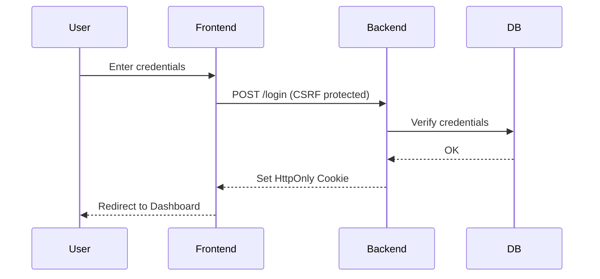

# Chapter 12 — Authentication Standards

Version: 1.0.0

Status: Approved

Category: Platform Modules

Document Owner: Finzo Team

Last Updated: July 2026

Document ID: FEPS-12

## Scope

This chapter applies to every authentication-related page.

Including:

Login

Register

Forgot Password

Reset Password

OTP Verification

Email Verification

Account Pending

Account Rejected

Account Suspended

Account Locked

Session Expired

Admin Login

Staff Login

Password Changed

Verification Successful

Verification Failed

Every future authentication page

---

---

## Chapter Purpose

Authentication is the gateway to the Finzo Banking Management System.

It is the user's first interaction with the secure banking environment.

These pages must immediately communicate:

• Trust

• Security

• Professionalism

• Reliability

• Simplicity

• Enterprise Quality

Authentication should never feel like a generic login page.

It should feel like entering a trusted financial institution.

Every authentication page within Finzo must follow these standards.

---

## Enterprise Authentication Philosophy

Authentication pages exist for one purpose:

Allow users to securely access their banking services.

Everything else is secondary.

The experience should remove uncertainty.

Users should immediately understand:

Where they are.

What they need to do.

Why information is required.

What happens next.

---

## Primary Goal

Transform every authentication page into a professional banking authentication experience.

Not a template.

Not a student project.

Not a SaaS login screen.

Not a Bootstrap form.

The pages should resemble authentication used by real enterprise financial institutions.

---

## Mandatory Pre-Implementation Rules

Before modifying any authentication page:

Read the existing implementation completely.

Understand:

HTML

CSS

JavaScript

Validation

Navigation

Backend Integration

Form Submission

Session Logic

Authentication Flow

Never redesign blindly.

Never delete working functionality.

Never break authentication.

Never change backend behavior unless absolutely necessary.

---

## Authentication Design Principles

Every authentication page must communicate:

Security

Trust

Professionalism

Clarity

Accessibility

Consistency

Calmness

Efficiency

---

## Layout Standards

Authentication pages should remain visually focused.

Every page should contain only:

Brand Identity

↓

Page Title

↓

Supporting Description

↓

Authentication Form

↓

Security Information

↓

Helpful Links

↓

Legal Information

Nothing unnecessary.

Avoid visual clutter.

---

## Brand Presentation

Every authentication page must reinforce the Finzo identity.

Include:

Professional Logo

Consistent Branding

Enterprise Typography

Professional Color Palette

Consistent Layout

Never over-brand the page.

Security should receive more emphasis than marketing.

---

## Login Page Standards

The login page should include:

Professional Heading

↓

Short Description

↓

Email / Username

↓

Password

↓

Remember Me

↓

Forgot Password

↓

Login Button

↓

Register Link

↓

Security Information

↓

Support Link

Avoid unnecessary promotional content.

---

## Registration Page Standards

Registration should appear secure.

Collect only necessary information.

Group related fields logically.

Provide:

Progressive validation

Clear instructions

Password requirements

Privacy notice

Terms acceptance

Professional confirmation messaging

Never overwhelm new users.

---

## Forgot Password Standards

Provide reassurance.

Explain:

What will happen.

How long it takes.

What the user should expect.

Never expose whether an email exists.

Maintain security best practices.

---

## Reset Password Standards

Clearly communicate:

Password requirements

Security expectations

Confirmation

Next steps

Use strong password guidance.

---

## OTP Verification

OTP pages should:

Clearly explain verification.

Display masked contact information.

Support resend.

Display countdown timer.

Provide recovery guidance.

Never create unnecessary anxiety.

---

## Account Pending

Pending pages should explain:

Current status.

Reason (when appropriate).

Expected timeline.

Next steps.

Support options.

Avoid generic messages.

---

## Account Rejected

Rejected pages should:

Explain the situation professionally.

Offer recovery or contact options.

Avoid blaming the user.

---

## Locked Account

Communicate:

Why the account is locked.

Temporary or permanent.

Recovery steps.

Support information.

Security reassurance.

---

## Session Expired

Explain:

Why the session expired.

How to continue.

Provide secure login access.

Avoid technical language.

---

## Admin Authentication

Admin pages should communicate:

Enterprise Security

Restricted Access

Administrative Environment

Audit Monitoring

Authorized Personnel Only

Avoid unnecessary graphics.

---

## Staff Authentication

Staff login should remain distinct from customer login.

Communicate:

Operational Access

Secure Staff Portal

Authorized Employees Only

Professional enterprise appearance.

---

## Authentication Content Standards

Remove:

Marketing slogans

Fake statistics

Promotional banners

Decorative feature lists

Meaningless marketing copy

Replace with:

Security guidance

Privacy assurance

Helpful explanations

Professional support information

---

## Security Messaging

Every authentication page should reassure users.

Examples:

Protected by enterprise-grade encryption.

Secure authentication process.

Your credentials remain encrypted.

Multi-factor authentication supported.

Sessions are securely managed.

Avoid fear-based language.

---

## Form Standards

Authentication forms must include:

Visible labels

Helper text

Accessible validation

Consistent spacing

Logical grouping

Professional buttons

Clear error messages

Never rely solely on placeholders.

---

## Validation Standards

Validation should be:

Immediate

Clear

Helpful

Professional

Explain:

What is wrong.

How to fix it.

Never expose internal errors.

---

## Error Messages

Authentication errors should:

Protect security.

Avoid revealing sensitive information.

Remain concise.

Remain professional.

Examples:

Invalid credentials.

Verification required.

Session expired.

Password does not meet requirements.

Avoid technical error codes.

---

## Success Messages

Successful authentication actions should reassure users.

Examples:

Password updated successfully.

Verification completed.

Account created successfully.

Please log in to continue.

---

## CTA Standards

Use professional actions.

Examples:

Sign In Securely

Create Account

Verify Identity

Reset Password

Return to Login

Contact Support

Avoid aggressive marketing CTAs.

---

## Accessibility

Authentication pages must support:

Keyboard navigation

Screen readers

Logical focus order

Visible focus indicators

Accessible labels

High contrast

Error announcements

---

## Responsive Design

Authentication pages must function perfectly on:

Mobile

Tablet

Laptop

Desktop

Ultra-wide

Forms should remain easy to complete on every device.

---

## Motion Standards

Use only subtle motion.

Allowed:

Fade

Small transitions

Button feedback

Focus transitions

Loading indicators

Forbidden:

Bounce

Glow

Pulse

Floating objects

Large transitions

---

## Performance

Authentication pages should load almost instantly.

Optimize:

Images

Fonts

CSS

JavaScript

Avoid unnecessary assets.

---

## Authentication Transformation Requirements (Mandatory)

Every existing authentication page must be professionally transformed.

This includes:

Read the current implementation first.

Understand every existing feature.

Preserve:

Authentication logic

Validation

Routing

Backend integration

Security

Accessibility

Responsiveness

JavaScript

Then improve:

UI

UX

Typography

Spacing

Forms

Visual hierarchy

Professional banking content

Trust indicators

Security messaging

Readability

Consistency

Responsiveness

Accessibility

Performance

Remove:

Cheap visual effects

Template layouts

Unnecessary graphics

Marketing clutter

Duplicate content

Fake statistics

Decorative animations

Anything that reduces enterprise quality.

The final authentication experience must resemble the secure login experience of a modern enterprise banking platform.

---

## Authentication Review Checklist

Every authentication page must answer "Yes".

✓ Does this page immediately communicate trust?

✓ Does it clearly explain the authentication task?

✓ Is unnecessary content removed?

✓ Is the layout clean?

✓ Is the form accessible?

✓ Is security properly communicated?

✓ Is typography professional?

✓ Is responsiveness flawless?

✓ Is functionality preserved?

✓ Would this page feel appropriate for a real online banking system?

If any answer is "No," the page requires further refinement.

---

## Chapter Completion Criteria

This chapter is complete only when:

✓ Every authentication page follows one enterprise standard.

✓ Login experience is standardized.

✓ Registration experience is standardized.

✓ Password recovery is standardized.

✓ Verification flows are standardized.

✓ Security messaging is standardized.

✓ Accessibility is maintained.

✓ Responsiveness is maintained.

✓ Existing functionality is preserved.

✓ No authentication bugs are introduced.

✓ Every authentication page delivers a secure, professional, enterprise banking experience.

## End of **Chapter 12 — Authentication Standards**
---

### Authentication Flow Diagram

---

### UI Reference Screenshots

---

## See Also

- **Chapter 00 — Foundation**

---

## Related Chapters

- **Chapter 00 — Foundation**

---

## References

- W3C HTML Standard
- W3C CSS Specifications
- WCAG 2.2

---

## Version History

| Version | Date | Author | Summary of Changes |
|---------|------|--------|--------------------|
| 1.0.0 | July 2026 | Finzo Team | Initial enterprise release |
