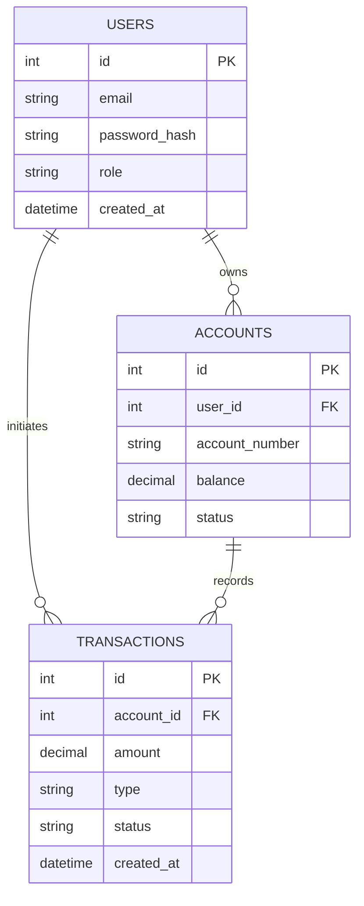

# Chapter 36 — Database Documentation

Version: 1.0.0

Status: Approved

Category: Engineering

Document Owner: Finzo Team

Last Updated: July 2026

Document ID: FEPS-36

## Purpose

Establish the standards and documentation for Database Documentation.

## Scope

Applies to the entire Finzo Banking Management System.

## Objectives

Maintain enterprise-grade transparency and quality.

### Database Overview

The Finzo database uses a normalized relational model designed for strict financial data integrity, ACID compliance, and high availability.

### Entity Relationship Diagram

### Database Best Practices
- **Normalization:** 3NF minimum.
- **Indexes:** Apply to all foreign keys and frequently queried columns.
- **Backup Strategy:** Nightly full backups, hourly incremental.

---

## See Also

- **Chapter 00 — Foundation**

---

## Related Chapters

- **Chapter 00 — Foundation**

---

## References

- Finzo Architecture Team

---

## Version History

| Version | Date | Author | Summary of Changes |
|---------|------|--------|--------------------|
| 1.0.0 | July 2026 | Finzo Team | Initial enterprise release |
