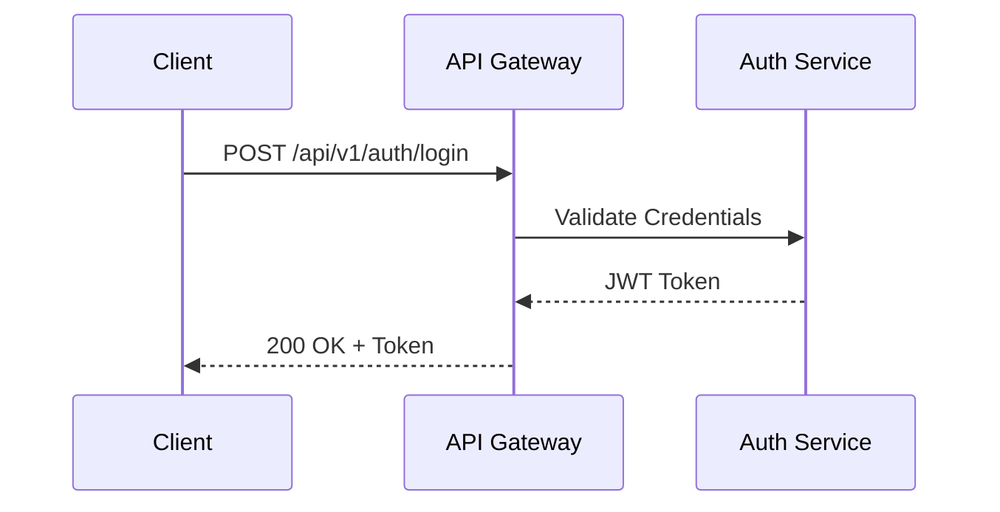

# Chapter 37 — API Documentation

Version: 1.0.0

Status: Approved

Category: Engineering

Document Owner: Finzo Team

Last Updated: July 2026

Document ID: FEPS-37

## Purpose

Establish the standards and documentation for API Documentation.

## Scope

Applies to the entire Finzo Banking Management System.

## Objectives

Maintain enterprise-grade transparency and quality.

### API Overview

RESTful API architecture for internal microservices and external integrations.

### Authentication Flow

### HTTP Status Codes
- `200 OK`: Success
- `201 Created`: Resource created
- `400 Bad Request`: Validation failed
- `401 Unauthorized`: Missing/invalid token
- `403 Forbidden`: Insufficient permissions
- `429 Too Many Requests`: Rate limit exceeded
- `500 Internal Server Error`: Backend failure

### Rate Limiting
- 100 requests per minute per IP.

---

## See Also

- **Chapter 00 — Foundation**

---

## Related Chapters

- **Chapter 00 — Foundation**

---

## References

- Finzo Architecture Team

---

## Version History

| Version | Date | Author | Summary of Changes |
|---------|------|--------|--------------------|
| 1.0.0 | July 2026 | Finzo Team | Initial enterprise release |
