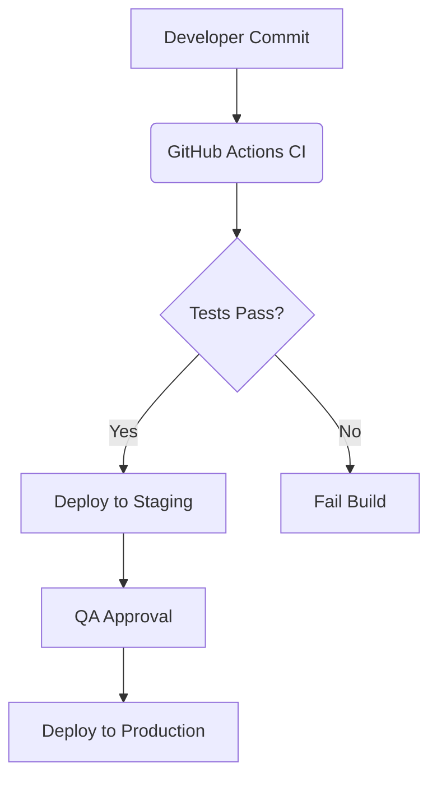

# Chapter 40 — Deployment Documentation

Version: 1.0.0

Status: Approved

Category: Engineering

Document Owner: Finzo Team

Last Updated: July 2026

Document ID: FEPS-40

## Purpose

Establish the standards and documentation for Deployment Documentation.

## Scope

Applies to the entire Finzo Banking Management System.

## Objectives

Maintain enterprise-grade transparency and quality.

### Deployment Architecture

### Environments
1. **Development:** Local XAMPP/Docker environments.
2. **Staging:** Replica of production for QA testing.
3. **Production:** Live environment with strict access controls.

### Rollback Strategy
Blue-Green deployment allows instant rollback to previous container image if production health checks fail.

---

## See Also

- **Chapter 00 — Foundation**

---

## Related Chapters

- **Chapter 00 — Foundation**

---

## References

- Finzo Architecture Team

---

## Version History

| Version | Date | Author | Summary of Changes |
|---------|------|--------|--------------------|
| 1.0.0 | July 2026 | Finzo Team | Initial enterprise release |
