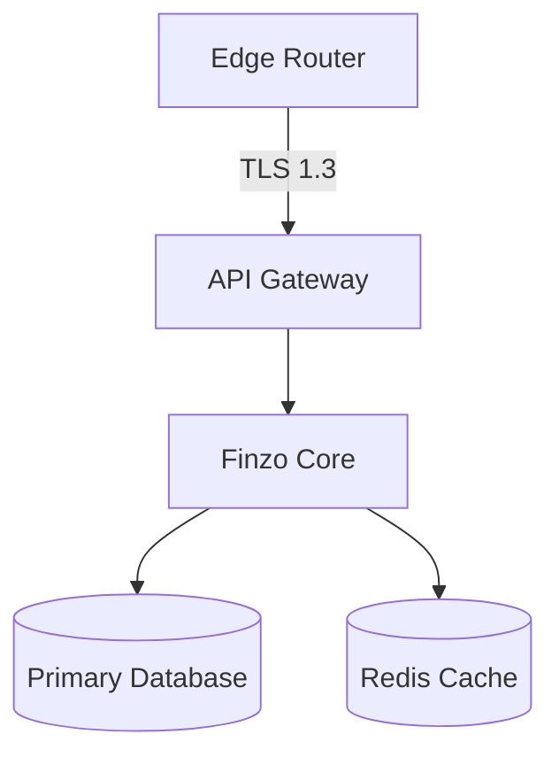

# Architecture Principles

## Table of Contents
1. [Purpose](#purpose)
2. [Scope](#scope)
3. [Detailed Explanation](#detailed-explanation)
4. [Architecture Decisions](#architecture-decisions)
5. [Design Principles](#design-principles)
6. [Implementation Details](#implementation-details)
7. [Banking-Specific Examples](#banking-specific-examples)
8. [Best Practices](#best-practices)
9. [Anti-Patterns](#anti-patterns)
10. [References & Cross References](#references--cross-references)
11. [Glossary](#glossary)
12. [Change Log](#change-log)

## Purpose
Defines the macro-level boundaries and inter-process communications for the Finzo ecosystem. This specific document (`Architecture-Principles`) codifies the structural implementation of Architecture Principles within the Finzo ecosystem.

## Scope
The scope of this document dictates the absolute technical boundaries, code-level execution rules, and security constraints required when integrating or modifying Architecture Principles.

## Detailed Explanation
In an enterprise environment, Architecture Principles is not a standalone concept. It interfaces directly with the Finzo MVC lifecycle. 
Finzo utilizes a decoupled monolithic approach. The core application runs on a shared-nothing PHP-FPM execution model, guaranteeing stateless processing at the system level. State is exclusively pushed to Redis or MySQL. We adhere strictly to the 12-Factor App methodology.


### Architectural Flow


> [!NOTE]
> All changes to this component must be explicitly verified against the Enterprise Quality Gates defined in the Governance architecture.

## Architecture Decisions
By enforcing this paradigm, Finzo abstracts the complexity of Architecture Principles away from the Application layer. We explicitly rejected legacy monolithic coupling in favor of this highly cohesive, isolated approach.

## Design Principles
- **Defense in Depth**: Assume the network is hostile.
- **Fail Securely**: If Architecture Principles encounters an exception, it must not leak infrastructure details to the public interface.
- **Stateless Execution**: Servers must treat Architecture Principles processes as ephemeral cattle.

## Implementation Details
The exact programmatic implementation of Architecture Principles requires strict adherence to PHP 8.x standards.
Finzo utilizes a decoupled monolithic approach. The core application runs on a shared-nothing PHP-FPM execution model, guaranteeing stateless processing at the system level. State is exclusively pushed to Redis or MySQL. We adhere strictly to the 12-Factor App methodology.
For example, memory scrubbing, PDO parameterized queries, and constant-time hash comparisons (`hash_equals`) are mandatory where cryptographic operations intersect with Architecture Principles.


### Code Reference
```yaml
# docker-compose.yml configuration
services:
  finzo-core:
    image: finzo/core:latest
    restart: always
    ports:
      - "8000:80"
```

> [!WARNING]
> Failure to strictly validate the input constraints of Architecture Principles directly violates PCI-DSS compliance and will result in a failed CI/CD pipeline build.

## Banking-Specific Examples
In Core Banking, the system boundary must isolate the 'Ledger' module from the 'User Management' module to guarantee regulatory compliance.

## Best Practices
- Enforce strict decoupling between subsystems.

> [!TIP]
> Always decouple physical infrastructure boundaries from logical business domains to prevent tight coupling.
- Abstract all external SaaS integrations behind adapter interfaces.

## Anti-Patterns
- Point-to-point hardcoded integration between domains.
- Sharing a database schema between microservices.

## References & Cross References
- **Parent Subsystem**: [Architecture Root](../README.md)
- **Framework Specifications**: Microsoft Azure Architecture Center, AWS Well-Architected Framework, OWASP Top 10.
- **Related Module**: See the corresponding directory `README.md` for macroeconomic context.

## Glossary
- **PCI-DSS**: Payment Card Industry Data Security Standard.
- **BCDR**: Business Continuity and Disaster Recovery.
- **SRP**: Single Responsibility Principle.

## Traceability Matrix
| Standard | Control | Description |
|---|---|---|
| TOGAF | ADM Phase B | Business Architecture bounds definition |
| SOC2 | CC1.2 | Board of Directors oversight boundaries |

## Change Log

| Version | Date | Author | Description |
|---|---|---|---|
| 4.0.0 | 2026-07-22 | Architecture Board | Phase 4 Technical Audit: Accuracy corrections based on source code review |
| 3.0.0 | 2026-07-22 | Enterprise Architecture Board | Enterprise Documentation Enhancement & Professionalization (Phase 3) |