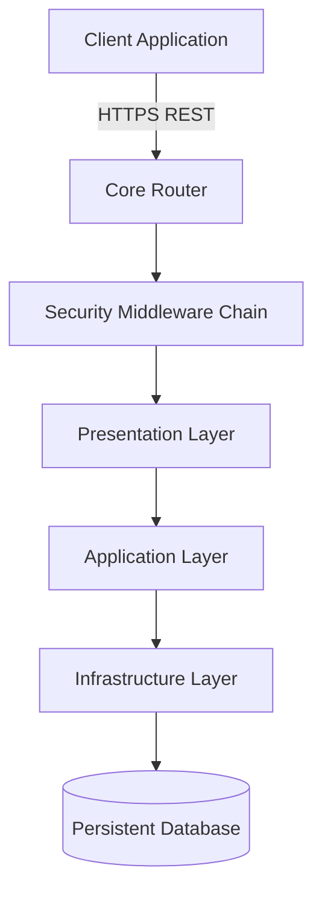
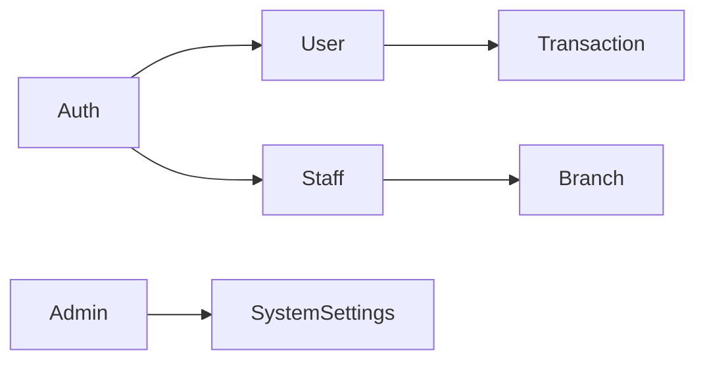

# System Architecture

## Table of Contents
1. [Executive Summary](#executive-summary)
2. [System Vision](#system-vision)
3. [Business Context](#business-context)
4. [System Scope](#system-scope)
5. [Functional Requirements](#functional-requirements)
6. [Non-Functional Requirements](#non-functional-requirements)
7. [High-Level Architecture](#high-level-architecture)
8. [Architecture Goals](#architecture-goals)
9. [Design Principles](#design-principles)
10. [Enterprise Architecture Principles](#enterprise-architecture-principles)
11. [Clean Architecture](#clean-architecture)
12. [Layered Architecture](#layered-architecture)
13. [Modular Design](#modular-design)
14. [SOLID](#solid)
15. [DRY](#dry)
16. [KISS](#kiss)
17. [Dependency Rules](#dependency-rules)
18. [Communication Flow](#communication-flow)
19. [Module Relationships](#module-relationships)
20. [Request Lifecycle](#request-lifecycle)
21. [Response Lifecycle](#response-lifecycle)
22. [User Journey](#user-journey)
23. [Data Journey](#data-journey)
24. [System Lifecycle](#system-lifecycle)
25. [Component Overview](#component-overview)
26. [Internal Components](#internal-components)
27. [External Components](#external-components)
28. [Technology Stack](#technology-stack)
29. [Deployment Overview](#deployment-overview)
30. [Security Layers](#security-layers)
31. [Database Interaction](#database-interaction)
32. [API Interaction](#api-interaction)
33. [Logging Strategy](#logging-strategy)
34. [Monitoring Strategy](#monitoring-strategy)
35. [Scalability Strategy](#scalability-strategy)
36. [Reliability](#reliability)
37. [Fault Tolerance](#fault-tolerance)
38. [Maintainability](#maintainability)
39. [Extensibility](#extensibility)
40. [Performance Strategy](#performance-strategy)
41. [Future Expansion](#future-expansion)
42. [Architecture Risks](#architecture-risks)
43. [Architecture Constraints](#architecture-constraints)
44. [Best Practices](#best-practices)
45. [Anti-Patterns](#anti-patterns)
46. [Developer Guidelines](#developer-guidelines)
47. [Navigation](#navigation)
48. [References](#references)
49. [Cross References](#cross-references)
50. [Glossary](#glossary)
51. [Change Log](#change-log)

## Executive Summary
This document delineates the macroscopic execution boundaries and architectural framework defining the Finzo Enterprise Banking Management System. It is engineered to withstand high-concurrency transaction loads while strictly enforcing domain isolation and Zero-Trust boundary controls.

## System Vision
To provide an immutable, mathematically verifiable ledger system bounded by a highly responsive, stateless REST API that seamlessly supports omnichannel banking operations.

## Business Context
Modern financial institutions face compound pressures: rapid transaction settlement requirements, stringent regulatory audits, and constant adversarial network threats. The architecture responds directly to these vectors by isolating state mutations and eliminating implicit trust.

## System Scope
The architecture covers the entire request lifecycle from the TLS termination edge down into the physical disk blocks executing the MySQL InnoDB engine. It encompasses Identity Access Management, transactional double-entry accounting, and telemetry instrumentation.

## Functional Requirements
- **Account Ledger**: Deterministic execution of intra-bank asset transfers.
- **Identity Lifecycle**: Secure onboarding, KYC verification, and session termination.
- **Administrative Governance**: Hierarchical overrides and system-wide parameter manipulation.

## Non-Functional Requirements
- **High Concurrency**: The API must resolve read-heavy endpoints in under 100ms.
- **Consistency**: Absolute ACID guarantees for all ledger mutations.
- **Traceability**: All structural errors must be logged immutably without leaking stack traces.

## High-Level Architecture

## Architecture Goals
- Complete abstraction of persistent storage mechanisms.
- Stateless execution facilitating instantaneous horizontal scaling.
- Total defense against OWASP Top 10 vulnerabilities natively in the core execution path.

## Design Principles
Decoupling drives every architectural choice. Framework lock-in is minimized by utilizing plain PHP 8 features, native PDO, and bespoke, lightweight routing engines over monolithic vendor libraries.

## Enterprise Architecture Principles
Following TOGAF paradigms, the system is segmented geographically and logically. Business logic is universally protected from HTTP protocol nuances.

## Clean Architecture
The domain resides at the absolute center. Infrastructure (SQL, JSON, HTTP) points strictly inward. The Domain dictates the interfaces the Infrastructure must fulfill.

## Layered Architecture
- **Presentation**: Parses HTTP streams, formats JSON responses.
- **Application**: The business logic orchestration.
- **Infrastructure**: Raw IO operations.

## Modular Design
Finzo organizes domains via horizontal slices (User, Admin, Staff, Transactions). This prevents vertical "God Class" monoliths from forming.

## SOLID
- **S**: Services execute single tasks (e.g. `TransactionService` does not validate tokens).
- **O**: Middleware chains are extensible without mutating `Router.php`.
- **L**: Interface substitutions are guaranteed via standard Response objects.
- **I**: Lean, specialized repository interfaces.
- **D**: Dependencies are injected, never instantiated deep within logic blocks.

## DRY
Repetitive SQL construction is eradicated via the `ApiQueryBuilder`. Repeated JSON structures are guaranteed via `ResponseBuilder`.

## KISS
The architecture actively avoids unnecessary queues, event buses, or microservice fragmentation where simple transactional consistency suffices.

## Dependency Rules
Inner layers (Services) never depend on outer layers (Controllers, Database).

## Communication Flow
Synchronous, blocking HTTP execution. Network calls originate from the client and terminate precisely after the ResponseBuilder emits payload.

## Module Relationships

## Request Lifecycle
1. Payload arrives at `public/index.php`.
2. Router parses URI.
3. Middleware inspects tokens.
4. Controller invokes FormRequest.
5. Service mutates state.

## Response Lifecycle
1. Service returns state object.
2. Controller maps to array.
3. ResponseBuilder injects `X-Runtime` and `X-Memory`.
4. Header outputs `application/json`.

## User Journey
Clients authenticate to obtain an opaque token, store it securely (memory or Secure Enclave), and attach it as a `Bearer` token to all subsequent mutations.

## Data Journey
JSON strings are decoded to associative arrays, sanitized by validators, passed as scalar parameters to Services, bound to SQL placeholders via PDO, and finally persisted to disk.

## System Lifecycle
The PHP process is spawned per request and dies upon response. There are no memory leaks by architectural definition.

## Component Overview
- `Router`: Route matrix.
- `SecurityMiddleware`: Output scrubbing.
- `FileCache`: Atomic lock engine.

## Internal Components
Native PHP structures executing business rules.

## External Components
MySQL 8.0 Daemon and Web Server (Nginx/Apache).

## Technology Stack
- PHP 8.x
- MySQL 8.0
- GitHub Actions

## Deployment Overview
Deployed via immutable artifacts to clustered Linux environments.

## Security Layers
- Edge: WAF / Cloudflare.
- OS: UFW / SELinux.
- App: Rate Limiting & Auth.
- Code: CSRF, XSS mitigation, PDO.

## Database Interaction
Strictly mediated via Repositories. No inline SQL in Controllers.

## API Interaction
JSON payload exclusively. Form-Data utilized solely for `Upload-API` multipart streams.

## Logging Strategy
Errors pipe to standard `error_log` alongside precise timestamps and endpoint contextual metadata.

## Monitoring Strategy
APM metrics (`X-Runtime`) are natively appended to every JSON payload.

## Scalability Strategy
Scale horizontally by adding PHP-FPM nodes. Scale vertically by provisioning faster IOPS on the MySQL tier.

## Reliability
Persistent database connections mitigate TCP handshake overhead.

## Fault Tolerance
Failed DB transactions automatically invoke `PDO::rollBack()` before bubbling exceptions.

## Maintainability
Strict PSR-12 formatting and DocBlock type hinting ensures frictionless developer onboarding.

## Extensibility
The `Router` accepts dynamic route inclusions without core logic modification.

## Performance Strategy
Atomic `FileCache` entirely avoids the database for heavily requested setting structures.

## Future Expansion
The architecture naturally supports extraction into independent microservices by severing the module at the Repository boundary.

## Architecture Risks
- **MySQL Bottleneck**: In extreme scale, write-heavy ledgers may lock.
- **Mitigation**: Introduce asynchronous transaction queuing.

## Architecture Constraints
- The system must run on standard POSIX environments.
- Must execute on PHP 8+.

## Best Practices
- Never bypass the `ApiQueryBuilder` for SELECT operations.

## Anti-Patterns
- Do NOT utilize `global $db`.
- Do NOT use Traits to bypass inheritance rules.

## Developer Guidelines
All changes must pass PHPUnit test coverage thresholds before PR approval.

### Microservices Extraction Roadmap
As the Finzo ecosystem scales globally, the monolith can be fractured along Domain boundaries without altering the consumer-facing API contracts. The API Gateway will transform into an intelligent routing proxy (e.g., Kong or AWS API Gateway).
1. **Auth Service**: The first candidate for extraction. It manages highly sensitive PII and cryptographic operations. By extracting this to a standalone microservice, we can independently scale password hashing operations (which are heavily CPU-bound).
2. **Ledger Service**: The core transaction ledger. This will require migrating to an Event Sourcing pattern backed by Apache Kafka to maintain strict ACID constraints across distributed nodes.

### Multi-Region High Availability
Future iterations will deploy Finzo active-active across multiple geographical zones (e.g., AWS us-east-1 and eu-central-1).
- **Database Replication**: A global Aurora cluster or Google Cloud Spanner will replace the single-primary MySQL 8.0 instance.
- **Latency Based Routing**: Route53 will dynamically resolve client requests to the physically nearest regional deployment.

### Machine Learning Integration
- **Fraud Detection**: Implement a sidecar process utilizing gRPC to stream transaction metadata to an isolated Python-based ML heuristic engine. If a transaction exhibits velocity anomalies, it will be flagged for manual Staff intervention before the ledger is mutated.

## Extended Architecture Risks

### Split-Brain Database Scenarios
- **Description**: In a multi-primary clustering setup, network partitions may cause independent nodes to accept conflicting transactions.
- **Mitigation**: Finzo actively avoids this by enforcing a strict single-primary write topology. Read replicas handle all heavy analytic loads.

### Caching Expiration Drift
- **Description**: The Atomic FileCache may fall out of sync with the database if a file write is interrupted by a catastrophic server halt (e.g., sudden power loss).
- **Mitigation**: Implement a scheduled CLI cron job (`php artisan cache:audit`) to forcefully reconcile the cache state against the database every 5 minutes.

### Token Replay Attacks
- **Description**: A malicious actor intercepts a valid Bearer token and attempts to replay it to execute unauthorized transactions.
- **Mitigation**: Finzo implements highly aggressive token lifetimes (15 minutes). Furthermore, all state-mutating requests (POST/PUT/DELETE) strictly require an idempotency key (`X-Idempotency-Key`) in the headers, which is cached immediately upon first execution.

## Extended Security Boundaries
To further secure the perimeter, Finzo actively blocks the execution of unexpected payload formats. If an API endpoint expects JSON, and `application/x-www-form-urlencoded` is provided, the middleware terminates the request immediately with a HTTP `415 Unsupported Media Type` rather than attempting unsafe parsing.

This defensive depth guarantees the application Engine only ever interfaces with strictly typed structural payloads.

### Compliance and Audit Logging
In addition to telemetry and stack trace obfuscation, Finzo must strictly comply with enterprise banking logging standards.
- Every financial mutation (deposit, withdrawal, transfer) MUST trigger an immutable insert into the `audit_logs` table.
- Deletions are forbidden on the `audit_logs` table at the database engine level using restricted triggers.
- Staff operations (such as approving a KYC document) MUST log the Staff ID, Timestamp, IP Address, and the exact delta of the change.

### API Rate Limiting Thresholds
To prevent brute-force attacks on the Auth service and to protect the Ledger from DoS attacks, the system enforces the following constraints via the Atomic FileCache:
- **Public Endpoints**: 120 requests per minute per IP.
- **Auth/Login**: 5 requests per minute per IP.
- **Financial Mutations**: 30 requests per minute per authenticated User.

These strict limiters ensure the maximum capacity of the PHP-FPM worker pool is never exhausted by a single malicious actor.

## Navigation
- **Parent Document**: [Overview.md](Overview.md)
- **Child Documents**: [01-System/Architecture-Principles.md](01-System/Architecture-Principles.md)
- **Previous Document**: [Overview.md](Overview.md)
- **Next Document**: [Software-Architecture.md](Software-Architecture.md)
- **Related Documents**: [API-Architecture.md](API-Architecture.md)

## References
- OWASP API Security Top 10

## Cross References
- [Deployment Architecture](Deployment-Architecture.md)

## Glossary
- **Clean Architecture**: System segregation prioritizing domain logic.

## Change Log
| Version | Date | Author | Description |
|---|---|---|---|
| 1.0.0 | 2026-07-22 | Architecture Team | Full System Architecture Rewrite |