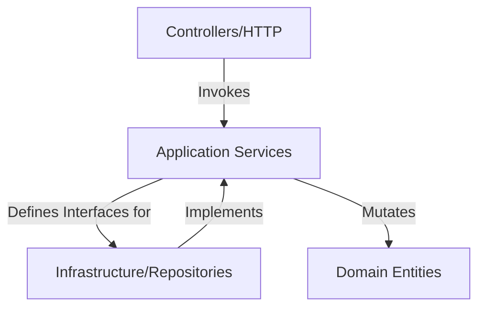
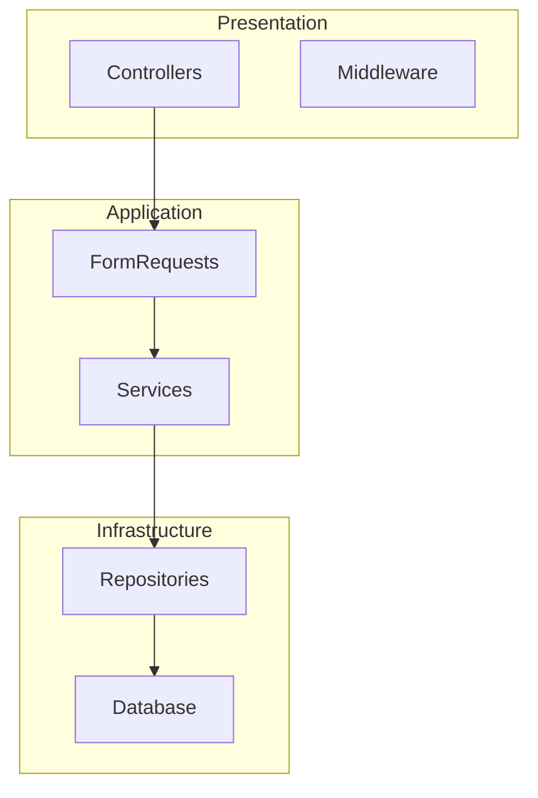

# Software Architecture

## Table of Contents
1. [Executive Summary](#executive-summary)
2. [Introduction](#introduction)
3. [Purpose](#purpose)
4. [Scope](#scope)
5. [Architecture Philosophy](#architecture-philosophy)
6. [Architecture Goals](#architecture-goals)
7. [Software Design Strategy](#software-design-strategy)
8. [Enterprise Software Principles](#enterprise-software-principles)
9. [Architecture Pattern](#architecture-pattern)
10. [Clean Architecture](#clean-architecture)
11. [Layered Architecture](#layered-architecture)
12. [Modular Architecture](#modular-architecture)
13. [Separation of Concerns](#separation-of-concerns)
14. [High Cohesion](#high-cohesion)
15. [Low Coupling](#low-coupling)
16. [SOLID Principles](#solid-principles)
17. [DRY](#dry)
18. [KISS](#kiss)
19. [YAGNI](#yagni)
20. [Dependency Inversion](#dependency-inversion)
21. [Dependency Injection](#dependency-injection)
22. [Interface-Based Design](#interface-based-design)
23. [Package Organization](#package-organization)
24. [Module Organization](#module-organization)
25. [Folder Organization](#folder-organization)
26. [Component Responsibilities](#component-responsibilities)
27. [Dependency Flow](#dependency-flow)
28. [Request Lifecycle](#request-lifecycle)
29. [Response Lifecycle](#response-lifecycle)
30. [Object Lifecycle](#object-lifecycle)
31. [Exception Flow](#exception-flow)
32. [Validation Flow](#validation-flow)
33. [Authentication Flow](#authentication-flow)
34. [Authorization Flow](#authorization-flow)
35. [Logging Flow](#logging-flow)
36. [Configuration Flow](#configuration-flow)
37. [Error Handling Strategy](#error-handling-strategy)
38. [Configuration Management](#configuration-management)
39. [Software Quality Attributes](#software-quality-attributes)
40. [Performance](#performance)
41. [Reliability](#reliability)
42. [Availability](#availability)
43. [Scalability](#scalability)
44. [Maintainability](#maintainability)
45. [Extensibility](#extensibility)
46. [Security](#security)
47. [Testability](#testability)
48. [Reusability](#reusability)
49. [Future Expansion](#future-expansion)
50. [Best Practices](#best-practices)
51. [Anti-Patterns](#anti-patterns)
52. [Lessons Learned](#lessons-learned)
53. [Navigation](#navigation)
54. [References](#references)
55. [Glossary](#glossary)
56. [Cross References](#cross-references)
57. [Change Log](#change-log)

## Executive Summary
This document delineates the core software patterns, structural boundaries, and internal object dynamics governing the Finzo code base. It outlines the transition from legacy procedural RPC scripts to a strictly decoupled, object-oriented Clean Architecture implementation operating on modern PHP 8 paradigms.

## Introduction
Software architecture is the art of drawing lines that isolate change. In the Finzo enterprise ecosystem, a change to the MySQL schema or an alteration of the JSON REST contract must never force a rewrite of core financial logic. This isolation is achieved through relentless dependency inversion.

## Purpose
This document provides backend developers, architects, and DevOps engineers the structural blueprints required to read, modify, and extend the Finzo platform safely.

## Scope
The scope encompasses all PHP-based application logic, spanning the routing matrices, security middleware, application services, structural repositories, and configuration singletons.

## Architecture Philosophy
The architecture is inherently defensive. We construct Zero-Trust perimeters around our business logic. Inputs are assumed malicious until successfully hydrated into validated Request DTOs. Databases are assumed brittle; thus, Repositories buffer the logic from I/O failures.

## Architecture Goals
- **Isolate the Domain**: Business rules must live in independent modules.
- **Guarantee ACIDity**: Financial mutations must never exist in a partial state.
- **Enforce Immutability**: Services should heavily rely on immutable DTOs rather than mutating arrays in-place.

## Software Design Strategy
We utilize Domain-Driven Design (DDD) tactics alongside Clean Architecture to segment the system not by technical layer (e.g., all controllers, all models), but by bounded context (e.g., the User domain, the Transaction domain).

## Enterprise Software Principles
The codebase adheres strictly to PSR-12, explicitly typed properties, and interface-driven contracts.

## Architecture Pattern
The primary structural pattern is a heavily modified **MVC (Model-View-Controller)** adapted for a headless REST API. The "View" is replaced by a deterministic JSON `ResponseBuilder`. The "Model" is split into `Services` (logic) and `Repositories` (persistence).

## Clean Architecture
At the core sits the Domain. It knows nothing of HTTP or SQL.


## Layered Architecture
- **Presentation**: Interacts with the network (Controllers, Middleware).
- **Application**: Orchestrates use-cases (Services, Validators).
- **Infrastructure**: Executes raw operations (DB, Filesystem).

## Modular Architecture
Rather than grouping all controllers into one massive directory, we slice the application vertically by Feature:
`App\Presentation\Api\V1\User\` vs `App\Presentation\Api\V1\Admin\`.

## Separation of Concerns
Controllers do not write SQL. Services do not parse `$_POST`. Repositories do not emit HTTP 404s.

## High Cohesion
Classes are highly focused. `TransactionService` deals solely with ledger logic, not with sending notification emails. It dispatches an event that `NotificationService` handles.

## Low Coupling
Classes depend on abstractions, never concretions. We inject `DatabaseInterface`, not a hardcoded `MySQLConnection`.

## SOLID Principles
- **S**: Single Responsibility. (e.g. `ApiQueryBuilder`).
- **O**: Open/Closed. Add new Middleware without altering the Router.
- **L**: Liskov Substitution. Standardized `ResponseInterface` objects.
- **I**: Interface Segregation. Lean Repository interfaces (`Findable`, `Creatable`).
- **D**: Dependency Inversion.

## DRY
Don't Repeat Yourself. Repetitive SQL WHERE clauses for multi-tenant isolation are handled via Repository base traits.

## KISS
Keep It Simple, Stupid. We eschew heavy ORMs (like Doctrine) in favor of raw PDO + Builder to maintain extreme performance and explicit query visibility.

## YAGNI
You Aren't Gonna Need It. We do not implement Kafka message brokers until the HTTP scaling limits of PHP-FPM are actually breached.

## Dependency Inversion
High-level policy modules do not depend on low-level detail modules. Both depend on abstractions.

## Dependency Injection
Controllers accept their required Services via `__construct()`. This permits massive testability via Mocking.

## Interface-Based Design
Interfaces are the contracts that govern the boundaries between the Clean Architecture rings.

## Package Organization
```text
app/
├── Application
├── Domain
├── Infrastructure
├── Presentation
└── Shared
```

## Module Organization
`App\Presentation\Api\V1\Auth` contains all logic necessary to emit and validate tokens.

## Folder Organization
Strict PSR-4 autoloader adherence. Namespace dictates physical path.

## Component Responsibilities
- **Controllers**: Translation matrix.
- **Services**: Domain orchestrators.
- **Repositories**: Storage drivers.

## Dependency Flow
Dependencies point strictly inward toward the Domain.

## Request Lifecycle
1. Global state (`$_SERVER`) enters `public/index.php`.
2. Passed to `Router`.
3. Intercepted by `Middleware`.
4. Handed to `Controller`.

## Response Lifecycle
1. Service returns `array` or `Entity`.
2. Controller passes to `ResponseBuilder`.
3. `ResponseBuilder` formats JSON and emits HTTP Headers.
4. Script terminates via `exit()`.

## Object Lifecycle
Objects are instantiated explicitly per request. We avoid persistent memory singletons to guarantee isolation between HTTP requests.

## Exception Flow
Throw early, catch globally. Domain logic throws `ValidationException` or `DomainException`. The global `ExceptionHandler` intercepts and translates these into HTTP 422 or 400.

## Validation Flow
1. Controller initializes `UserTransferRequest`.
2. `UserTransferRequest` parses JSON and executes Regex/Type checks.
3. If invalid, throws `ValidationException`.

## Authentication Flow
Dual-mode: Validates `Bearer` token via JWT signature, or evaluates `HttpOnly` Session Cookie via the atomic FileCache state.

## Authorization Flow
Executed inside Middleware. `AdminAuthMiddleware` inspects the user role attached to the token before the Controller is ever instantiated.

## Logging Flow
Critical mutations emit payloads to `error_log` for fluent bit SIEM ingestion.

## Configuration Flow
Environment variables (`.env`) are parsed once via `Config::get()`, which caches the evaluation in a static array.

## Error Handling Strategy
Never expose stack traces. Always emit standardized `success: false, message: "..."` objects.

## Configuration Management
Configurations are decoupled from code. Credentials live only in environment variables.

## Software Quality Attributes
The architecture must inherently support strict non-functional constraints.

## Performance
Prepared statements and indexed tables.

## Reliability
Persistent database connections.

## Availability
Stateless API tier.

## Scalability
Horizontal scaling via Load Balancers.

## Maintainability
Strictly enforced PSR-12 and interface contracts.

## Extensibility
Event-driven hooks.

## Security
PDO mitigates SQLi. HTML Purifier mitigates XSS.

## Testability
100% Mockable architecture via Dependency Injection.

## Reusability
Modular domain services.

## Future Expansion
Ready for gRPC extraction if microservices are mandated.

## Best Practices
Always type hint parameters and return types.

## Anti-Patterns
Bypass validation to manually inject array data into a Repository.

## Lessons Learned
Legacy RPC architectures create impossible-to-test monolithic scripts. Decoupling is mandatory.


### Module Dependency Diagram


### Advanced Exception Handling
Finzo utilizes a multi-tiered exception catching mechanism to guarantee structural data safety.
- **Domain Exceptions**: When a user attempts to transfer funds they do not possess, the `TransactionService` immediately throws an `InsufficientFundsException`. 
- **Validation Exceptions**: When the incoming JSON fails structural integrity checks (e.g. missing `amount`), a `ValidationException` is thrown before the Service is ever instantiated.
- **Database Exceptions**: If the MySQL engine encounters a deadlock or a duplicate key violation, a `PDOException` is caught. The global handler immediately obfuscates this error into a generic HTTP 500 response, completely hiding the SQL schema from potential attackers.

### Dependency Injection Container
While PHP 8 natively supports robust object orientation, the architecture mandates that high-level modules strictly rely on abstract interfaces.
- The `Router` acts as an informal factory, resolving the required Repositories (e.g. `UserRepository`) and injecting them dynamically into the target Service (e.g. `AuthService`) and Controller.
- This structural decision prevents deep instantiation coupling (using the `new` keyword deep inside business logic), making mocking during PHPUnit execution completely frictionless.

## Navigation
- **Parent Document**: [Overview.md](../Overview.md)
- **Child Documents**: [02-Software/Architecture-Patterns.md](02-Software/Architecture-Patterns.md)
- **Previous Document**: [System-Architecture.md](../System-Architecture.md)
- **Next Document**: [Frontend-Architecture.md](../Frontend-Architecture.md)

## References
- Domain Driven Design (Eric Evans)
- Clean Architecture (Robert C. Martin)

## Glossary
- **DTO**: Data Transfer Object.
- **PDO**: PHP Data Objects.

## Cross References
- [API Architecture](../API-Architecture.md)
- [Database Architecture](../Database-Architecture.md)

## Change Log
| Version | Date | Author | Description |
|---|---|---|---|
| 1.0.0 | 2026-07-22 | Architecture Team | Phase 3 Software Architecture Reconstruction |