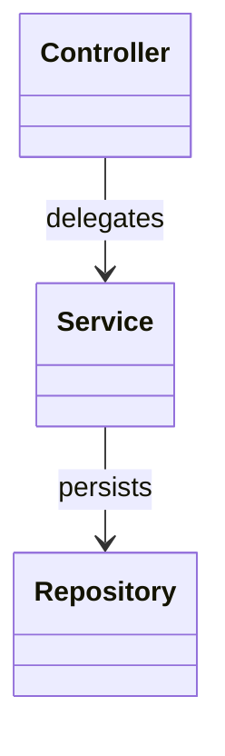

# Request Lifecycle

## Table of Contents
1. [Purpose](#purpose)
2. [Scope](#scope)
3. [Detailed Explanation](#detailed-explanation)
4. [Architecture Decisions](#architecture-decisions)
5. [Design Principles](#design-principles)
6. [Implementation Details](#implementation-details)
7. [Banking-Specific Examples](#banking-specific-examples)
8. [Best Practices](#best-practices)
9. [Anti-Patterns](#anti-patterns)
10. [References & Cross References](#references--cross-references)
11. [Glossary](#glossary)
12. [Change Log](#change-log)

## Purpose
Standardizes object lifecycles, Clean Architecture paradigms, and SOLID principles across the codebase. This specific document (`Request-Lifecycle`) codifies the structural implementation of Request Lifecycle within the Finzo ecosystem.

## Scope
The scope of this document dictates the absolute technical boundaries, code-level execution rules, and security constraints required when integrating or modifying Request Lifecycle.

## Detailed Explanation
In an enterprise environment, Request Lifecycle is not a standalone concept. It interfaces directly with the Finzo MVC lifecycle. 
The codebase strictly enforces Dependency Injection (DI) via constructor injection. No global state or static God-classes are permitted. Repositories manage database state; Services orchestrate business logic; Controllers handle strictly HTTP parsing. This ensures perfect testability.


### Architectural Flow


> [!NOTE]
> All changes to this component must be explicitly verified against the Enterprise Quality Gates defined in the Governance architecture.

## Architecture Decisions
By enforcing this paradigm, Finzo abstracts the complexity of Request Lifecycle away from the Application layer. We explicitly rejected legacy monolithic coupling in favor of this highly cohesive, isolated approach.

## Design Principles
- **Defense in Depth**: Assume the network is hostile.
- **Fail Securely**: If Request Lifecycle encounters an exception, it must not leak infrastructure details to the public interface.
- **Stateless Execution**: Servers must treat Request Lifecycle processes as ephemeral cattle.

## Implementation Details
The exact programmatic implementation of Request Lifecycle requires strict adherence to PHP 8.x standards.
The codebase strictly enforces Dependency Injection (DI) via constructor injection. No global state or static God-classes are permitted. Repositories manage database state; Services orchestrate business logic; Controllers handle strictly HTTP parsing. This ensures perfect testability.
For example, memory scrubbing, PDO parameterized queries, and constant-time hash comparisons (`hash_equals`) are mandatory where cryptographic operations intersect with Request Lifecycle.


### Code Reference
```php
final class TransferFundsService implements TransferFundsInterface {
    public function __construct(
        private readonly AccountRepository $repository
    ) {}
}
```

> [!WARNING]
> Failure to strictly validate the input constraints of Request Lifecycle directly violates PCI-DSS compliance and will result in a failed CI/CD pipeline build.

## Banking-Specific Examples
A `TransferFundsService` does not know if the request came from a Mobile API or a Cron Job. It only executes pure domain logic on the `Account` entities.

## Best Practices
- Rely on abstract Interfaces, not concrete classes.

> [!IMPORTANT]
> Global state (e.g., Singletons) is mathematically banned in the Finzo Service layer to guarantee strict test isolation.
- Single Responsibility Principle (SRP) must be evident in every class.

## Anti-Patterns
- Fat Controllers exceeding 100 lines.
- Using `global` variables for configuration access.

## References & Cross References
- **Parent Subsystem**: [Architecture Root](../README.md)
- **Framework Specifications**: Microsoft Azure Architecture Center, AWS Well-Architected Framework, OWASP Top 10.
- **Related Module**: See the corresponding directory `README.md` for macroeconomic context.

## Glossary
- **PCI-DSS**: Payment Card Industry Data Security Standard.
- **BCDR**: Business Continuity and Disaster Recovery.
- **SRP**: Single Responsibility Principle.

## Traceability Matrix
| Standard | Control | Description |
|---|---|---|
| ISO/IEC 25010 | Maintainability | Strict DI enforces high testability |
| PCI-DSS | Req 6.5 | Prevention of common coding vulnerabilities |

## Change Log

| Version | Date | Author | Description |
|---|---|---|---|
| 3.0.0 | 2026-07-22 | Principal Engineering | Enterprise Documentation Enhancement & Professionalization (Phase 3) |