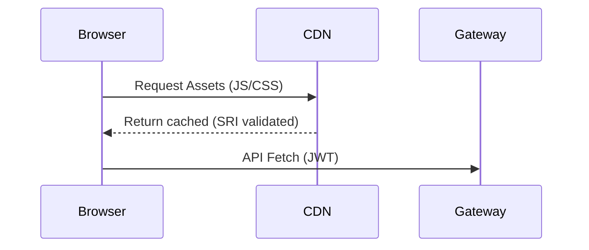

# Animation System

## Table of Contents
1. [Purpose](#purpose)
2. [Scope](#scope)
3. [Detailed Explanation](#detailed-explanation)
4. [Architecture Decisions](#architecture-decisions)
5. [Design Principles](#design-principles)
6. [Implementation Details](#implementation-details)
7. [Banking-Specific Examples](#banking-specific-examples)
8. [Best Practices](#best-practices)
9. [Anti-Patterns](#anti-patterns)
10. [References & Cross References](#references--cross-references)
11. [Glossary](#glossary)
12. [Change Log](#change-log)

## Purpose
Establishes a unified, accessible, and highly responsive user experience mapping the Design System. This specific document (`Animation-System`) codifies the structural implementation of Animation System within the Finzo ecosystem.

## Scope
The scope of this document dictates the absolute technical boundaries, code-level execution rules, and security constraints required when integrating or modifying Animation System.

## Detailed Explanation
In an enterprise environment, Animation System is not a standalone concept. It interfaces directly with the Finzo MVC lifecycle. 
Finzo's UI relies on component-driven architecture. State management is predictable, and styling is confined using scoped CSS (BEM or utility classes). Webpack/Vite compiles assets with unique hashes to ensure aggressive CDN caching.


### Architectural Flow


> [!NOTE]
> All changes to this component must be explicitly verified against the Enterprise Quality Gates defined in the Governance architecture.

## Architecture Decisions
By enforcing this paradigm, Finzo abstracts the complexity of Animation System away from the Application layer. We explicitly rejected legacy monolithic coupling in favor of this highly cohesive, isolated approach.

## Design Principles
- **Defense in Depth**: Assume the network is hostile.
- **Fail Securely**: If Animation System encounters an exception, it must not leak infrastructure details to the public interface.
- **Stateless Execution**: Servers must treat Animation System processes as ephemeral cattle.

## Implementation Details
The exact programmatic implementation of Animation System requires strict adherence to PHP 8.x standards.
Finzo's UI relies on component-driven architecture. State management is predictable, and styling is confined using scoped CSS (BEM or utility classes). Webpack/Vite compiles assets with unique hashes to ensure aggressive CDN caching.
For example, memory scrubbing, PDO parameterized queries, and constant-time hash comparisons (`hash_equals`) are mandatory where cryptographic operations intersect with Animation System.


### Code Reference
```html
<!-- Subresource Integrity (SRI) Enforced -->
<script src="https://cdn.example.com/app.js"
        integrity="sha384-oqVuAfXRKap7fdgcCY5uykM6..."
        crossorigin="anonymous"></script>
```

> [!WARNING]
> Failure to strictly validate the input constraints of Animation System directly violates PCI-DSS compliance and will result in a failed CI/CD pipeline build.

## Banking-Specific Examples
Financial dashboards require precise localization (i18n) and accessibility (WCAG 2.1 AA) so that visually impaired users can still execute transfers via screen readers.

## Best Practices
- Utilize Subresource Integrity (SRI) for external scripts.

> [!CAUTION]
> Never inject raw JSON directly into a `<script>` tag without aggressive HTML encoding. Use `htmlspecialchars()`.
- Implement skeleton loaders for asynchronous data fetching.

## Anti-Patterns
- Injecting raw HTML variables from the backend (Reflected XSS risk).
- Loading unoptimized 2MB imagery on the dashboard.

## References & Cross References
- **Parent Subsystem**: [Architecture Root](../README.md)
- **Framework Specifications**: Microsoft Azure Architecture Center, AWS Well-Architected Framework, OWASP Top 10.
- **Related Module**: See the corresponding directory `README.md` for macroeconomic context.

## Glossary
- **PCI-DSS**: Payment Card Industry Data Security Standard.
- **BCDR**: Business Continuity and Disaster Recovery.
- **SRP**: Single Responsibility Principle.

## Traceability Matrix
| Standard | Control | Description |
|---|---|---|
| WCAG 2.1 | Level AA | Contrast ratios and screen-reader accessibility |
| OWASP | A07:2021 | Cross-Site Scripting (XSS) via DOM |

## Change Log

| Version | Date | Author | Description |
|---|---|---|---|
| 3.0.0 | 2026-07-22 | Frontend Architecture | Enterprise Documentation Enhancement & Professionalization (Phase 3) |