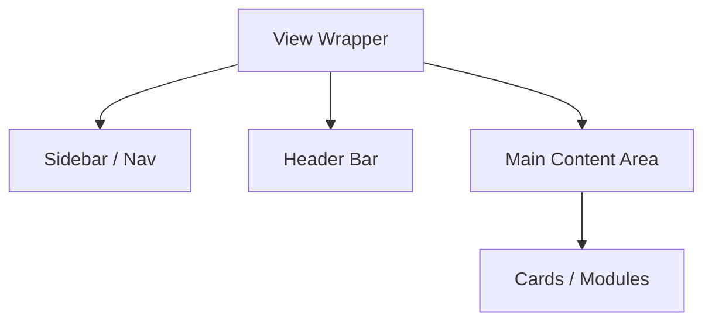
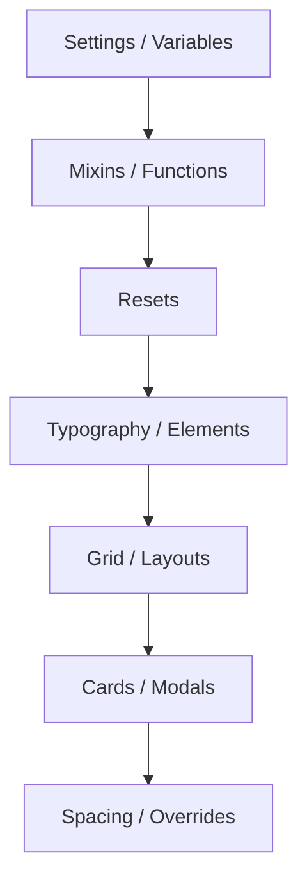
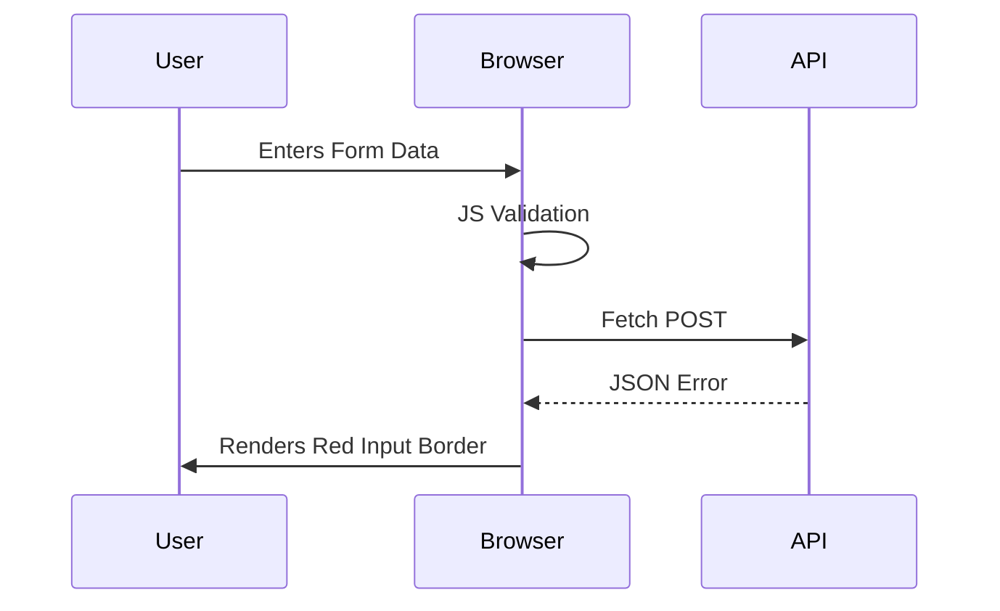

# Frontend Architecture

## Table of Contents
1. [Executive Summary](#executive-summary)
2. [Purpose](#purpose)
3. [Scope](#scope)
4. [Frontend Overview](#frontend-overview)
5. [UI Philosophy](#ui-philosophy)
6. [User Experience Goals](#user-experience-goals)
7. [Folder Structure](#folder-structure)
8. [Project Structure](#project-structure)
9. [Design System](#design-system)
10. [Layout Architecture](#layout-architecture)
11. [Navigation Architecture](#navigation-architecture)
12. [Routing Architecture](#routing-architecture)
13. [Component Architecture](#component-architecture)
14. [Asset Architecture](#asset-architecture)
15. [CSS Organization](#css-organization)
16. [JavaScript Organization](#javascript-organization)
17. [Theme Management](#theme-management)
18. [Typography](#typography)
19. [Icon System](#icon-system)
20. [Color Palette](#color-palette)
21. [Responsive Design](#responsive-design)
22. [Mobile First Strategy](#mobile-first-strategy)
23. [Tablet Layout](#tablet-layout)
24. [Desktop Layout](#desktop-layout)
25. [Large Screen Support](#large-screen-support)
26. [Form Architecture](#form-architecture)
27. [Validation](#validation)
28. [User Flow](#user-flow)
29. [Authentication UI](#authentication-ui)
30. [Dashboard UI](#dashboard-ui)
31. [Admin UI](#admin-ui)
32. [Staff UI](#staff-ui)
33. [Customer UI](#customer-ui)
34. [Error Pages](#error-pages)
35. [Loading States](#loading-states)
36. [Empty States](#empty-states)
37. [Accessibility](#accessibility)
38. [Performance Optimization](#performance-optimization)
39. [Browser Compatibility](#browser-compatibility)
40. [Best Practices](#best-practices)
41. [Anti-Patterns](#anti-patterns)
42. [Future Improvements](#future-improvements)
43. [Navigation](#navigation)
44. [References](#references)
45. [Cross References](#cross-references)
46. [Change Log](#change-log)

## Executive Summary
This document outlines the UI topography, asset bundling strategies, and strictly decoupled JavaScript implementations that power the Finzo Enterprise Banking UI. By leveraging Vanilla HTML5/CSS3 augmented with ES6 Modules, Finzo achieves massive rendering speeds without the bloat of Virtual DOM frameworks.

## Purpose
This document provides Frontend Engineers the baseline structural awareness required to build and integrate accessible, responsive, and performant UI modules.

## Scope
The scope includes all visual boundaries: HTML page structures, atomic CSS architectures, static asset loading vectors, and the asynchronous JavaScript HTTP pipelines.

## Frontend Overview
The Finzo Frontend operates as a completely decoupled consumer of the `v1` Enterprise API. It is entirely stateless, utilizing Web Storage APIs merely for superficial UI state (like Dark Mode toggles).

## UI Philosophy
**Vibrant Enterprise.** Banking software should inspire trust through cleanliness while avoiding the sterile, archaic grid layouts of legacy systems. We utilize glassmorphism subtly, favor bold, accessible contrasts, and animate micro-interactions to create a living dashboard.

## User Experience Goals
1. **Instant Feedback**: No button click should ever feel dead. Loading states must fire instantaneously.
2. **Contextual Awareness**: Users should never wonder what branch or context they are operating in.
3. **Impenetrable Workflows**: A user should never be able to submit a form containing erroneous data.

## Folder Structure
```text
/public
  /assets
    /css
      /components
      /layouts
      style.css
    /js
      /modules
      /api
      app.js
    /images
    /fonts
```

## Project Structure
The frontend avoids heavy node_modules abstraction. Assets are compiled once and served statically via aggressive HTTP caching directives.

## Design System
The Finzo Enterprise Design System enforces strict CSS custom properties (Variables) for colors, spacing, and typography. No hardcoded hex values are permitted outside `root.css`.

## Layout Architecture



### CSS Dependency Flow


### Advanced UI State Management
Finzo avoids complex, heavy state-management libraries (like Redux or Vuex) by leveraging the native DOM and HTML5 attributes as the Single Source of Truth where possible.
- **Form State**: Validation state is managed by adding/removing specific modifier classes (e.g., `is-invalid`) on the input container.
- **Global Context**: The active user's permissions are injected as `data-*` attributes on the `<body>` tag during the initial page load, allowing isolated JavaScript components to check authorization synchronously (e.g., `document.body.dataset.role === 'admin'`).

### Print Stylesheets
Enterprise reporting requires clean paper outputs. We aggressively implement `@media print` directives to hide sidebars, nullify background colors, and force dark text on white backgrounds to save printer ink and improve report legibility.

### Cross-Site Scripting (XSS) Defenses on the Frontend
While the backend aggressively purifies inputs, the frontend must also practice defensive rendering.
- When dynamically inserting data from the API (such as transaction memos or user names), JavaScript MUST use `element.textContent = data;` instead of `element.innerHTML = data;`.
- Bypassing this rule is an immediate violation of the Finzo Enterprise Security Policy and will fail the CI/CD pipeline code review.

### Animation and Layout Reflow Minimization
Browser repaints are expensive, especially on mobile devices.
- **Rule**: Never animate CSS properties that trigger geometry calculations (`width`, `height`, `padding`, `margin`, `top`, `left`).
- **Rule**: Exclusively animate `transform` (e.g., `translateY(10px)`) and `opacity`. These are handed off to the GPU and will not cause layout recalculation across the wider DOM tree.

## Navigation Architecture
Navigation is state-aware. When the `AuthService` confirms a role (e.g., Staff), the navigation tree dynamically trims inaccessible routes to prevent frustrating 403 barriers.

## Routing Architecture
Routing is handled primarily via server-rendered entry points (e.g. `dashboard.php`), but interior navigation relies heavily on semantic `href` anchors to leverage native browser history buffers.

## Component Architecture
Components are constructed utilizing the BEM (Block Element Modifier) CSS methodology.
```html
<div class="card card--primary">
  <div class="card__header">...</div>
</div>
```

## Asset Architecture
Images are aggressively compressed to WebP. SVGs are utilized exclusively for iconography to guarantee infinite vector scaling.

## CSS Organization
CSS is segmented into an ITCSS (Inverted Triangle CSS) architecture:
1. **Settings**: Variables, Colors.
2. **Tools**: Mixins.
3. **Generic**: Resets.
4. **Base**: Raw HTML elements.
5. **Objects**: Wrappers, Grids.
6. **Components**: Cards, Buttons.
7. **Utilities**: `.mt-2`, `.d-none`.

## JavaScript Organization
We rely on ES6 native `import/export`. Global window pollution is banned.
```javascript
import { ApiClient } from './api/client.js';
import { Validator } from './modules/validator.js';
```

## Theme Management
Theme toggling operates via a data attribute on the HTML root: `<html data-theme="dark">`. CSS Custom Properties automatically invert.

## Typography
We utilize the `Inter` and `Outfit` font families. Base font size is `16px` (1rem), ensuring WCAG compliance for readability.

## Icon System
SVG Icons are embedded via inline HTML or pseudo-elements to avoid additional HTTP requests.

## Color Palette
Primary: Azure Blue (`#0052FF`).
Success: Emerald (`#10B981`).
Danger: Crimson (`#EF4444`).

## Responsive Design
We employ a fluid-grid system. Breakpoints are explicitly defined at `768px`, `1024px`, and `1440px`.

## Mobile First Strategy
`style.css` defines mobile layouts natively. `@media (min-width: ...)` overrides expand the layout for tablets and desktops.

## Tablet Layout
The sidebar transitions into a collapsible hamburger menu. Grid structures flow from 1 column to 2.

## Desktop Layout
The sidebar is permanently fixed. Dashboard modules occupy complex 3-column configurations.

## Large Screen Support
Containers are strictly max-width (`1440px`) to prevent UI elements from stretching infinitely on ultra-wide monitors.

## Form Architecture
Forms utilize floating labels and explicit input types (`tel`, `email`) to trigger correct mobile device keyboards.

## Validation
Validation is dual-layered. HTML5 constraints (`required`, `pattern`) block baseline submission, while JavaScript parses intricate business logic (e.g., matching passwords).

## User Flow


## Authentication UI
Minimalist, distraction-free layouts.

## Dashboard UI
Data-dense, utilizing interactive Chart.js modules and financial quick-actions.

## Admin UI
Heavy focus on data-tables, pagination, and multi-select filtering logic.

## Staff UI
Context-switching headers to denote currently managed branches.

## Customer UI
Simplified, readable, highly focused on balance visibility and transfer simplicity.

## Error Pages
Friendly 404/500 pages with immediate routes back to the user's dashboard.

## Loading States
Skeletons (animated shimmers) replace traditional spinning wheels to decrease perceived wait times.

## Empty States
Empty tables display vector illustrations and explicit Call-to-Action buttons.

## Accessibility
A core mandate. ARIA roles are strictly applied to dynamic regions.

## Performance Optimization
We lazy-load images below the fold using `loading="lazy"`. CSS/JS is minified via automated build steps before production deployment.

## Browser Compatibility
Supports the last 2 versions of Evergreen browsers (Chrome, Edge, Firefox, Safari).

## Best Practices
Never attach event listeners to thousands of table rows. Utilize Event Delegation on the parent `<tbody>`.

## Anti-Patterns
Avoid generic `<div class="box">`. Avoid `!important` in CSS.

## Future Improvements
Implement Service Workers to provide offline caching of structural assets.


### CSS Dependency Flow


### Advanced UI State Management
Finzo avoids complex, heavy state-management libraries (like Redux or Vuex) by leveraging the native DOM and HTML5 attributes as the Single Source of Truth where possible.
- **Form State**: Validation state is managed by adding/removing specific modifier classes (e.g., `is-invalid`) on the input container.
- **Global Context**: The active user's permissions are injected as `data-*` attributes on the `<body>` tag during the initial page load, allowing isolated JavaScript components to check authorization synchronously (e.g., `document.body.dataset.role === 'admin'`).

### Print Stylesheets
Enterprise reporting requires clean paper outputs. We aggressively implement `@media print` directives to hide sidebars, nullify background colors, and force dark text on white backgrounds to save printer ink and improve report legibility.

### Cross-Site Scripting (XSS) Defenses on the Frontend
While the backend aggressively purifies inputs, the frontend must also practice defensive rendering.
- When dynamically inserting data from the API (such as transaction memos or user names), JavaScript MUST use `element.textContent = data;` instead of `element.innerHTML = data;`.
- Bypassing this rule is an immediate violation of the Finzo Enterprise Security Policy and will fail the CI/CD pipeline code review.

### Animation and Layout Reflow Minimization
Browser repaints are expensive, especially on mobile devices.
- **Rule**: Never animate CSS properties that trigger geometry calculations (`width`, `height`, `padding`, `margin`, `top`, `left`).
- **Rule**: Exclusively animate `transform` (e.g., `translateY(10px)`) and `opacity`. These are handed off to the GPU and will not cause layout recalculation across the wider DOM tree.

## Navigation
- **Parent Document**: [Overview.md](../Overview.md)
- **Child Documents**: See `02-Frontend/` directory.
- **Previous Document**: [Software Architecture](../Software-Architecture.md)
- **Next Document**: [Database Architecture](../Database-Architecture.md)


### Extended Accessibility (WCAG 2.1 AA)
Accessibility is not an afterthought in the Finzo Enterprise Design System. We aggressively implement ARIA attributes to bridge the gap between complex visual interfaces and assistive technologies.
- **Focus Management**: Modals actively trap keyboard focus. When a modal opens, focus is immediately shifted to the first interactive element. When closed, focus returns to the triggering button.
- **Color Contrast**: All text on background colors exceeds the `4.5:1` contrast ratio standard.
- **Screen Reader Only Text**: The `.sr-only` CSS class hides text visually while maintaining it in the DOM for screen readers (useful for icon-only buttons).

### Core Web Vitals Optimization
To guarantee top-tier Search Engine Optimization (SEO) and user retention, the frontend heavily optimizes for Google's Core Web Vitals:
- **LCP (Largest Contentful Paint)**: Critical CSS is inlined. The hero graphics (if any) are preloaded using `<link rel="preload">`.
- **FID (First Input Delay)**: JavaScript bundles are deferred (`<script defer>`) to prevent render-blocking the main thread.
- **CLS (Cumulative Layout Shift)**: Images and dynamic DOM insertions strictly specify explicit `width` and `height` attributes to prevent the page from jumping during load.
## References
- WCAG 2.1 Guidelines
- BEM Naming Convention

## Cross References
- [UI Architecture](02-Frontend/UI-Architecture.md)
- [CSS Architecture](02-Frontend/CSS-Architecture.md)

## Change Log
| Version | Date | Author | Description |
|---|---|---|---|
| 1.0.0 | 2026-07-22 | Architecture Team | Initial Phase 4 Generation |