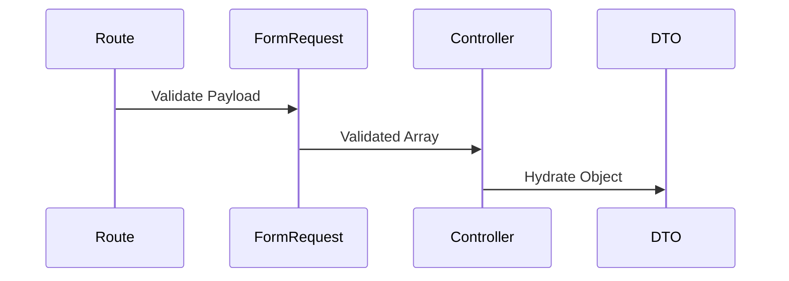

# Exception Architecture

## Table of Contents
1. [Purpose](#purpose)
2. [Scope](#scope)
3. [Detailed Explanation](#detailed-explanation)
4. [Architecture Decisions](#architecture-decisions)
5. [Design Principles](#design-principles)
6. [Implementation Details](#implementation-details)
7. [Banking-Specific Examples](#banking-specific-examples)
8. [Best Practices](#best-practices)
9. [Anti-Patterns](#anti-patterns)
10. [References & Cross References](#references--cross-references)
11. [Glossary](#glossary)
12. [Change Log](#change-log)

## Purpose
Defines the MVC request lifecycle, HTTP Middleware interceptors, and strict Data Transfer Objects (DTOs). This specific document (`Exception-Architecture`) codifies the structural implementation of Exception Architecture within the Finzo ecosystem.

## Scope
The scope of this document dictates the absolute technical boundaries, code-level execution rules, and security constraints required when integrating or modifying Exception Architecture.

## Detailed Explanation
In an enterprise environment, Exception Architecture is not a standalone concept. It interfaces directly with the Finzo MVC lifecycle. 
All incoming payloads are strictly verified via FormRequests before hitting the Controller. The Controller parses the payload into a strictly typed DTO and passes it to the Service layer. Data mutations utilize `PDO::ATTR_EMULATE_PREPARES = false` to eliminate SQL injection at the driver level.


### Architectural Flow


> [!NOTE]
> All changes to this component must be explicitly verified against the Enterprise Quality Gates defined in the Governance architecture.

## Architecture Decisions
By enforcing this paradigm, Finzo abstracts the complexity of Exception Architecture away from the Application layer. We explicitly rejected legacy monolithic coupling in favor of this highly cohesive, isolated approach.

## Design Principles
- **Defense in Depth**: Assume the network is hostile.
- **Fail Securely**: If Exception Architecture encounters an exception, it must not leak infrastructure details to the public interface.
- **Stateless Execution**: Servers must treat Exception Architecture processes as ephemeral cattle.

## Implementation Details
The exact programmatic implementation of Exception Architecture requires strict adherence to PHP 8.x standards.
All incoming payloads are strictly verified via FormRequests before hitting the Controller. The Controller parses the payload into a strictly typed DTO and passes it to the Service layer. Data mutations utilize `PDO::ATTR_EMULATE_PREPARES = false` to eliminate SQL injection at the driver level.
For example, memory scrubbing, PDO parameterized queries, and constant-time hash comparisons (`hash_equals`) are mandatory where cryptographic operations intersect with Exception Architecture.


### Code Reference
```php
// Strict PDO Emulation disabled for maximum security
$pdo->setAttribute(PDO::ATTR_EMULATE_PREPARES, false);
$stmt = $pdo->prepare('SELECT * FROM accounts WHERE id = :id');
$stmt->execute(['id' => $dto->accountId]);
```

> [!WARNING]
> Failure to strictly validate the input constraints of Exception Architecture directly violates PCI-DSS compliance and will result in a failed CI/CD pipeline build.

## Banking-Specific Examples
When transferring funds, the `TransactionDTO` strictly enforces integer constraints for currency (in cents) to prevent floating-point rounding errors.

## Best Practices
- Controllers must be completely thin, delegating everything to Services.

> [!TIP]
> FormRequests must reject unexpected parameters instantly. Never use `$request->all()` in a production controller.
- Always utilize explicit type-hinting (`int`, `string`, `bool`) in function signatures.

## Anti-Patterns
- Returning raw database models from an API endpoint instead of formatting via a Resource layer.
- Floating point math for financial ledgers.

## References & Cross References
- **Parent Subsystem**: [Architecture Root](../README.md)
- **Framework Specifications**: Microsoft Azure Architecture Center, AWS Well-Architected Framework, OWASP Top 10.
- **Related Module**: See the corresponding directory `README.md` for macroeconomic context.

## Glossary
- **PCI-DSS**: Payment Card Industry Data Security Standard.
- **BCDR**: Business Continuity and Disaster Recovery.
- **SRP**: Single Responsibility Principle.

## Traceability Matrix
| Standard | Control | Description |
|---|---|---|
| OWASP | A03:2021 | Injection Prevention via PDO |
| PCI-DSS | Req 6.5.1 | Mitigation of SQL Injection |

## Change Log

| Version | Date | Author | Description |
|---|---|---|---|
| 3.0.0 | 2026-07-22 | Backend Engineering | Enterprise Documentation Enhancement & Professionalization (Phase 3) |