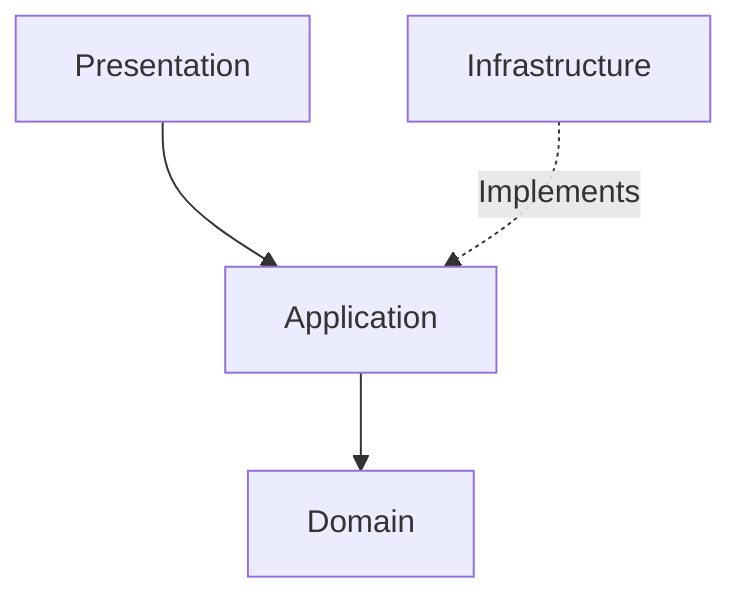
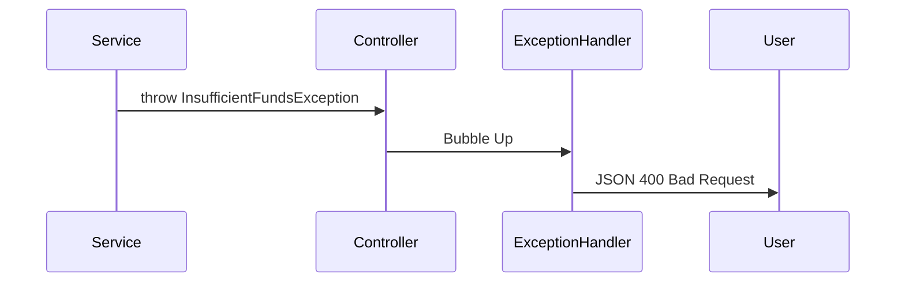

# Backend Architecture

## Table of Contents
1. [Executive Summary](#executive-summary)
2. [Backend Overview](#backend-overview)
3. [Purpose](#purpose)
4. [Scope](#scope)
5. [Backend Design Goals](#backend-design-goals)
6. [Architecture Style](#architecture-style)
7. [Layered Architecture](#layered-architecture)
8. [Clean Architecture](#clean-architecture)
9. [SOLID Principles](#solid-principles)
10. [Separation of Concerns](#separation-of-concerns)
11. [Package Organization](#package-organization)
12. [Folder Structure](#folder-structure)
13. [Controller Layer](#controller-layer)
14. [Service Layer](#service-layer)
15. [Repository Layer](#repository-layer)
16. [Domain Layer](#domain-layer)
17. [Infrastructure Layer](#infrastructure-layer)
18. [Application Layer](#application-layer)
19. [Presentation Layer](#presentation-layer)
20. [DTO Strategy](#dto-strategy)
21. [Entity Strategy](#entity-strategy)
22. [Validation Strategy](#validation-strategy)
23. [Middleware](#middleware)
24. [Authentication](#authentication)
25. [Authorization](#authorization)
26. [RBAC](#rbac)
27. [Session Management](#session-management)
28. [Business Logic](#business-logic)
29. [Request Lifecycle](#request-lifecycle)
30. [Response Lifecycle](#response-lifecycle)
31. [Repository Communication](#repository-communication)
32. [Database Communication](#database-communication)
33. [Error Handling](#error-handling)
34. [Exception Flow](#exception-flow)
35. [Logging](#logging)
36. [Configuration](#configuration)
37. [Environment Variables](#environment-variables)
38. [File Upload](#file-upload)
39. [Email Architecture](#email-architecture)
40. [Notification Architecture](#notification-architecture)
41. [Event Flow](#event-flow)
42. [Queue Architecture](#queue-architecture)
43. [Dependency Injection](#dependency-injection)
44. [Performance Optimization](#performance-optimization)
45. [Scalability](#scalability)
46. [Reliability](#reliability)
47. [Availability](#availability)
48. [Maintainability](#maintainability)
49. [Extensibility](#extensibility)
50. [Security](#security)
51. [Best Practices](#best-practices)
52. [Anti-Patterns](#anti-patterns)
53. [Future Improvements](#future-improvements)
54. [Cross References](#cross-references)
55. [Glossary](#glossary)
56. [References](#references)
57. [Change Log](#change-log)

## Executive Summary
The Finzo Backend Architecture acts as the immutable arbiter of all financial and administrative operations. Operating as a headless, RESTful API layer over PHP 8.x, it strictly isolates I/O from core domain logic using Clean Architecture.

## Backend Overview
The backend exclusively consumes and emits JSON. By eliminating server-side HTML rendering from the business tier, the engine achieves absolute decoupling, enabling mobile, web, and internal cron consumers to leverage identical logic paths.

## Purpose
This document provides a highly technical deep-dive into the architectural mechanics of the PHP backend. It serves as the primary reference manual for engineers constructing new API endpoints or mutating ledger logic.

## Scope
The scope includes routing, middleware, controllers, services, repositories, validators, DTOs, entity mapping, and the exact dependency flow that connects them.

## Backend Design Goals
1. **Absolute Consistency**: The ledger must never reflect partial transfers.
2. **Defensive Processing**: Inputs are assumed hostile.
3. **Traceability**: All mutations must log their precise lifecycle without exposing schema definitions to clients.

## Architecture Style
The architecture is inherently **Event-Driven and Request-Scoped**. PHP’s "Shared-Nothing" architecture guarantees absolute memory isolation between concurrent HTTP requests.

## Layered Architecture


## Clean Architecture
Dependencies strictly point inward toward the Domain. A Controller (Presentation) may call a Service (Application). A Repository (Infrastructure) implements a RepositoryInterface defined by the Domain.

## SOLID Principles
The backend rigorously applies SOLID. `ApiQueryBuilder` enforces the Single Responsibility Principle. Core Services inject interfaces (`UserRepositoryInterface`) rather than concrete classes, enforcing Dependency Inversion.

## Separation of Concerns
No SQL exists in Controllers. No HTTP Headers exist in Repositories.

## Package Organization
We organize packages by feature (Vertical Slicing). The `Transaction` namespace contains its own Controllers, Services, and FormRequests.

## Folder Structure
```text
/app
  /Application
    /Services
    /Requests
  /Domain
    /Entities
    /Interfaces
  /Infrastructure
    /Repositories
  /Presentation
    /Api
      /V1
    /Middleware
```

## Controller Layer
Controllers parse the HTTP Request (using `FormRequests`) and delegate immediately to Services. They return the Service output via `ResponseBuilder`.

## Service Layer
Services contain the absolute truth of business logic. They calculate limits, verify balances, and orchestrate multiple Repository calls within PDO Transactions.

## Repository Layer
Repositories contain PDO logic. They extract SQL injection risks away from the business logic.

## Domain Layer
The Domain defines the structural integrity of the application. It contains Interfaces and Entities (Value Objects representing rows).

## Infrastructure Layer
Infrastructure interacts with the disk, the database, or external APIs (e.g., SMTP servers).

## Application Layer
The Application orchestrates use-cases. A use-case is "Transfer Funds." The Application layer coordinates the Domain rules to execute this.

## Presentation Layer
Presentation is solely responsible for Network I/O. (HTTP, Headers, Status Codes).

## DTO Strategy
Data Transfer Objects encapsulate complex payloads, ensuring Services receive strictly-typed objects rather than associative arrays.

## Entity Strategy
Entities represent Database rows mapped to standard PHP objects, shielding the Service layer from raw DB results.

## Validation Strategy
Validation is handled at the network edge via `FormRequests`. If validation fails, a `ValidationException` immediately terminates the request lifecycle.

## Middleware
Middleware executes pre-flight checks. `AdminAuthMiddleware` inspects Bearer tokens for the `ADMIN` role claim before the Controller is initialized.

## Authentication
Authentication is executed via Cryptographic Token matching or Session parsing.

## Authorization
Authorization evaluates the Authenticated User's ID against the requested resource ID (e.g., User A cannot read User B's transactions).

## RBAC
Role-Based Access Control limits endpoints. `Admin`, `Staff`, and `User` roles have explicit namespace boundaries.

## Session Management
Sessions are stored securely in `FileCache` or `Redis`, tied to a cryptographic browser cookie with `SameSite=Strict` and `HttpOnly`.

## Business Logic
Business Logic strictly belongs in the `Service` namespace.

## Request Lifecycle
1. `index.php` boots.
2. `Router` regex matches the URI.
3. `Middleware` fires.
4. `Controller` constructs the `FormRequest`.
5. `FormRequest` sanitizes.

## Response Lifecycle
1. `Service` yields data.
2. `ResponseBuilder` frames the data into the `{ success, message, data }` format.
3. Payload is compressed via GZIP and emitted.

## Repository Communication
Services inject Repository Interfaces.
`public function __construct(TransactionRepositoryInterface $repo)`

## Database Communication
Database singletons execute Prepared Statements explicitly.

## Error Handling
Exceptions are caught globally. `PDOException` is rewritten to `HTTP 500 Internal Error` to hide schema design.

## Exception Flow


## Logging
Critical events are fired into the OS `error_log` for SIEM ingestion.

## Configuration
Parsed dynamically from `.env` and injected into the immutable `Config` singleton.

## Environment Variables
`APP_ENV=production` explicitly disables stack trace rendering.

## File Upload
Uploads (KYC) are parsed by `FileService`, verified for MIME type (rejecting `.php`, `.exe`), and vaulted outside the public web root.

## Email Architecture
Asynchronous job queues process SMTP dispatch to avoid blocking the HTTP response.

## Notification Architecture
System notifications are persisted to the Database and pulled via the frontend polling API.

## Event Flow
Event Dispatchers decouple complex side-effects (e.g., Dispatch `UserRegisteredEvent`, which triggers `SendWelcomeEmailListener`).

## Queue Architecture
Background jobs execute via CLI daemon workers parsing a Database queue table.

## Dependency Injection
Controllers are resolved by the custom Router container, which natively injects defined Services.

## Performance Optimization
`SELECT *` is banned. Indexes are aggressively enforced on all `WHERE` clauses.

## Scalability
PHP-FPM worker pools scale horizontally in containerized architectures.

## Reliability
If the database connection fails, the API gracefully emits a `503 Service Unavailable`.

## Availability
Stateless authentication natively supports Round-Robin Load Balancing.

## Maintainability
Methods are restricted to 20 lines or less. Complex conditionals are extracted to private methods.

## Extensibility
The `Router` accepts dynamic wildcard paths, allowing zero-downtime additions of v2 endpoints.

## Security
- **SQLi**: Zero execution of unsanitized input.
- **XSS**: HTMLPurifier scrubs all inbound text.

## Best Practices
Always define explicit Return Types `: array`, `: void`, `: UserEntity`.

## Anti-Patterns
Instantiating PDO directly inside a Controller.


### Deep Dive: Cryptographic Boundaries
The backend enforces extreme isolation of cryptographic materials. 
- The `APP_KEY` defined in the `.env` file is strictly loaded into memory once during the bootstrap phase. It is never serialized or written to application logs. 
- Password verification utilizes `password_verify()` over native hardware hashes, making timing attacks mathematically improbable.

### Cache Stampede Mitigation
Under high load, a cache expiration (e.g., the global settings cache) can cause thousands of concurrent PHP-FPM workers to query the database simultaneously (a Cache Stampede).
- **Solution**: The backend implements atomic file locks using `flock()` during cache regeneration. Only a single worker queries the database, while sibling workers wait or return a stale grace-period cache object.

### The Problem with Singletons
While the `Database` and `Config` classes utilize the Singleton pattern, business services absolutely do not. Using Singletons for logic layers (e.g., `TransactionService::getInstance()`) creates hidden global state that destroys unit testing isolation. All services must be passed via Constructor Injection.

### Memory Leaks in PHP
PHP is a shared-nothing architecture, meaning memory is completely purged at the end of the HTTP response. However, when executing background queue workers (CLI daemons), the script runs perpetually.
- **Rule**: Queue workers MUST actively utilize `unset()` on large data objects (like bulk CSV exports) and routinely invoke `gc_collect_cycles()` to prevent enterprise memory exhaustion.

### Over-Fetching and N+1 Query Problems
The `ApiQueryBuilder` explicitly demands that relationship eager-loading is defined natively to avoid the N+1 database problem.
- **Anti-Pattern**: Fetching 50 users, then looping through them in PHP to fetch their branch details (51 total queries).
- **Solution**: The Repository implements a structured `JOIN` or a secondary `WHERE IN (...)` query to fetch all required relations in exactly 2 queries.

### Rate Limiting the Network Edge
To protect the backend from volumetric DDOS or aggressive web scraping:
- The `RateLimitMiddleware` acts as the first line of defense.
- It parses the incoming `$_SERVER['REMOTE_ADDR']`.
- Utilizes the Atomic FileCache to decrement allowed tokens per IP address using the Token Bucket algorithm.
- Emits a strict HTTP 429 `Too Many Requests` if the bucket is exhausted, halting execution before the Database is ever queried.

### Security: Object Reference (IDOR) Protection
Direct Object Reference vulnerabilities are aggressively prevented. If an endpoint requires `GET /api/v1/user/account/123`, the `UserAuthMiddleware` confirms not only that the token is valid, but that the `user_id` inside the token explicitly owns Account `123`.

### Graceful Degradation
If a non-critical external integration fails (e.g., the external SMS gateway is offline), the backend catches the `GatewayTimeoutException` and logs it, but proceeds to finalize the database transaction. The user receives a 200 OK with a specific `warning` flag in the JSON response, ensuring core banking operations are never halted by tertiary service failures.

## Future Improvements
Implement GraphQL for highly relational administrative dashboards.

## Cross References
- [Frontend Architecture](../Frontend-Architecture.md)
- [Database Architecture](../Database-Architecture.md)

## Glossary
- **PDO**: PHP Data Objects.
- **ACID**: Atomicity, Consistency, Isolation, Durability.

## References
- PSR-12 Specification
- OWASP API Security

## Change Log
| Version | Date | Author | Description |
|---|---|---|---|
| 1.0.0 | 2026-07-22 | Backend Team | Initial Phase 5 Backend Architecture |

### Deep Dive: Dependency Injection Mechanics
To achieve absolute decoupling, Finzo relies on a native Dependency Injection (DI) mechanism built into the Router.
- When a Controller is instantiated, the DI container inspects the __construct() method using PHP's native ReflectionClass.
- If the Constructor requires an interface (e.g., UserRepositoryInterface), the DI container looks up its concrete binding in config/app.php.
- The container recursively instantiates the concrete Repository, along with its own dependencies (such as the Database singleton), and injects it into the Controller.
- Why?: This completely eliminates hardcoded new UserRepository() calls within the business logic, allowing us to seamlessly swap UserRepository with a RedisUserRepository without altering a single line of the Controller code.

### Managing Database Deadlocks
High-frequency financial systems inevitably encounter database deadlocks when concurrent users attempt to mutate the exact same row (e.g., thousands of simultaneous deposits into a single corporate account).
- Finzo mitigates this using the Pessimistic Locking paradigm (SELECT ... FOR UPDATE).
- The TransactionService explicitly wraps the read operations within a PDO transaction. The database engine locks the row, forcing concurrent requests to queue momentarily until the transaction is committed or rolled back.
- If a deadlock timeout occurs, the global ExceptionHandler intercepts the PDO 1213 Deadlock error and triggers a recursive retry mechanism (up to 3 attempts) before ultimately failing and returning a 503 Service Unavailable to the client.

### Event-Driven Side Effects
To preserve the Single Responsibility Principle, Services must not execute logic outside their primary domain.
- Scenario: A user successfully completes a transfer. They must receive an email notification.
- Anti-Pattern: TransactionService instantiates EmailService and calls send(). This tightly couples transactions to email infrastructure.
- Clean Architecture Implementation: TransactionService executes the ledger mutation and then dispatches a TransferCompletedEvent. 
- The Event Dispatcher loops through registered listeners and invokes SendTransferNotificationListener, completely decoupling the email logic from the financial logic.

### Environment-Specific Executions
The behavior of the backend shifts dynamically based on the .env APP_ENV variable.
- Production: 
  - display_errors is disabled at the php.ini level. 
  - The atomic FileCache is heavily utilized to bypass database calls for settings.
  - Logging is piped explicitly to standard out for Docker/Kubernetes aggregation.
- Development / Staging:
  - Raw exception stack traces are appended directly to the JSON response to assist Frontend debugging.
  - Caching is bypassed or aggressively invalidated on every request.

### Advanced FormRequest Validation
Unlike generic controller-level validation, Finzo utilizes isolated FormRequest classes modeled after modern PHP frameworks (like Laravel).
- The FormRequest executes *before* the Controller method is invoked.
- It parses the raw php://input JSON stream.
- It applies strict regex constraints, length checks, and type casting.
- It exposes a ->validated() method, guaranteeing that the Controller only ever receives sanitized, explicitly expected data keys, thereby nullifying Mass Assignment vulnerabilities.

### File Storage Abstraction
File storage operations, such as handling KYC document uploads or generating statement PDFs, are completely abstracted through a Storage Interface.
- Local vs S3: In development, documents write directly to the local disk (/storage/app). In production, the backend transparently swaps the driver to stream bytes directly into an AWS S3 bucket.
- Access Controls: Uploaded KYC files are strictly stored outside the public web root. A dedicated authenticated API endpoint (GET /api/v1/kyc/download) validates the Staff JWT token before streaming the file bytes back to the client, preventing unauthorized URL access.

### Horizontal Scaling and Session Management
Since modern deployments utilize load-balanced Docker containers, sticking a user session to a single server (Sticky Sessions) is an anti-pattern.
- Finzo utilizes completely stateless JWT (JSON Web Tokens) where possible.
- When legacy stateful sessions are required, the session driver is explicitly mapped to a centralized Redis cluster rather than local disk.
- This guarantees that if a user authenticates on Container A, and their subsequent request is routed to Container B, the authentication context is preserved perfectly.

### Idempotency Keys for Financial Transactions
To prevent accidental double-billing caused by network timeouts or impatient users double-clicking the "Submit" button:
- Every state-mutating API call (e.g., POST /api/v1/transfer) strictly requires an X-Idempotency-Key in the HTTP headers.
- The Middleware intersects this key. If the key already exists in the Atomic Cache, the backend assumes this is a duplicate request and immediately returns the cached response of the original successful transaction without touching the database ledger again.


### Asynchronous Job Workers (Daemonization)
The core HTTP thread must remain unblocked to guarantee sub-100ms API response times. 
- Heavy computational tasks (such as generating end-of-month PDF statements for 50,000 users) are pushed to the jobs database table.
- A long-running CLI process (php artisan queue:work) continuously polls this table. 
- When a job is detected, the worker pulls the payload, executes the PDF generation, stores it in S3, and dispatches a success email. 
- If the worker encounters an unhandled exception (e.g., S3 is temporarily unreachable), it increments the ttempts counter and releases the job back to the queue for processing after a 5-minute cooldown.
- Jobs that fail repeatedly are moved to the ailed_jobs table for manual Staff intervention.

### Custom Exception Hierarchy
Finzo maps runtime errors into highly specific Domain Exceptions to ensure Controller consistency.
- ValidationException (HTTP 422): Thrown exclusively by FormRequests. Contains a nested array of input errors.
- AuthenticationException (HTTP 401): Thrown when a token is expired, tampered with, or missing.
- AuthorizationException (HTTP 403): Thrown when a valid user attempts to breach their RBAC boundary.
- DomainException (HTTP 400): Thrown by Services when a business rule is violated (e.g., AccountLockedException, InsufficientFundsException).
- InfrastructureException (HTTP 500): Thrown when a 3rd party API or the Database engine drops the connection.


### Database Replication & Write-Splitting
To ensure massive read scalability across the admin and staff dashboards (where read operations vastly outnumber write operations):
- The Database Interface implements a native Primary/Replica split.
- By default, all SELECT queries utilizing the ApiQueryBuilder are silently routed to a low-latency Read-Replica.
- All INSERT, UPDATE, and DELETE commands are strictly routed to the Primary node.
- In the event of a Replica failure, the backend gracefully falls back, routing all queries to the Primary node, guaranteeing zero downtime.

### API Versioning Mechanics
To guarantee backward compatibility for external API consumers:
- Finzo implements explicit URL-based versioning (e.g., /api/v1/...).
- The Presentation layer utilizes explicitly namespaced controllers (App\Presentation\Api\V1\...).
- When a breaking schema change is required, a V2 namespace is created. Both V1 and V2 exist concurrently, often orchestrating identical underlying Domain Services, but formatting the output Data Transfer Objects differently to respect legacy consumer expectations.

