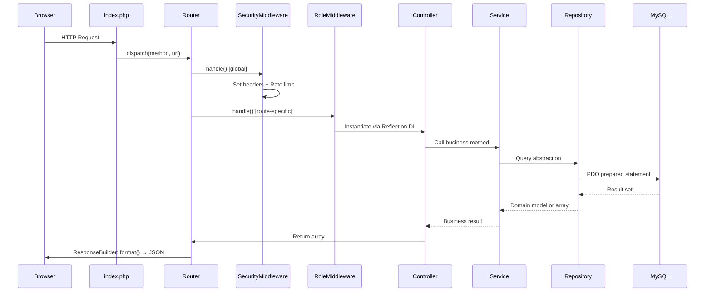

# Backend Architecture

## Table of Contents
1. [Purpose](#purpose)
2. [Folder Structure](#folder-structure)
3. [Request Lifecycle](#request-lifecycle)
4. [Layer Responsibilities](#layer-responsibilities)
5. [Dependency Injection](#dependency-injection)
6. [Events System](#events-system)
7. [Exception Handling](#exception-handling)
8. [Response Format](#response-format)
9. [Best Practices](#best-practices)
10. [Anti-Patterns](#anti-patterns)
11. [Traceability Matrix](#traceability-matrix)
12. [Change Log](#change-log)

## Purpose
Documents the concrete implementation of Finzo's backend, spanning the four Clean Architecture layers: Presentation, Application, Infrastructure, and Domain. Every class reference below maps to an actual file in the `app/` directory.

## Folder Structure

```
app/
├── Application/
│   ├── Events/          # Domain events (KYCApproved, TransactionCompleted, etc.)
│   ├── Jobs/            # Async queue jobs (SendWelcomeEmailJob, ExportCsvJob, etc.)
│   ├── Listeners/       # WriteAuditLogListener
│   ├── Requests/        # FormRequest base + LoginRequest, RegisterRequest, QueryRequest
│   └── Services/        # AuthService, UserService, AdminManagementService, etc.
├── Domain/
│   └── Models/          # User, Branch, Staff, Transaction (entity value objects)
├── Infrastructure/
│   └── Repositories/    # BaseRepository + domain repositories (AuthRepository, UserRepository, etc.)
├── Presentation/
│   ├── Api/V1/          # Controllers (Admin, Auth, Staff, User, Upload, Pdf)
│   ├── Controllers_backup/ # Legacy controllers (Strangler Fig fallback)
│   ├── Middleware/      # SecurityMiddleware, AdminAuthMiddleware, StaffAuthMiddleware, UserAuthMiddleware
│   ├── Validators/      # Per-domain input validators
│   └── Views/Pdf/       # DOMPDF statement/receipt templates
└── Shared/
    ├── Core/            # Router, Database, ResponseBuilder, ExceptionHandler, Cache, Queue
    └── Security/        # Auth, Gate, RateLimiter, SecurityService
```

## Request Lifecycle

Every HTTP request travels through the following chain:



1. **`index.php`**: Front Controller. Boots the autoloader and invokes `Router::dispatch()`.
2. **`SecurityMiddleware`**: Runs on every request. Sets OWASP headers, enforces rate limits.
3. **Role Middleware**: `AdminAuthMiddleware`, `StaffAuthMiddleware`, or `UserAuthMiddleware` calls `Auth::requireAuth()`.
4. **Controller**: Thin. Reads validated request data, calls the Service, returns an array.
5. **Service**: Business logic only. Orchestrates one or more Repository calls, fires Events.
6. **Repository**: Extends `BaseRepository`. All SQL is parameterized PDO. Returns domain models or arrays.
7. **`ResponseBuilder::format()`**: Standardizes JSON, scrubs sensitive fields, adds `X-Runtime` and `X-Memory` response headers.

## Layer Responsibilities

| Layer | Class Examples | Must NOT |
|---|---|---|
| Presentation | `AdminManagementController`, `AuthController` | Contain SQL or business logic |
| Application | `AuthService`, `UserService`, `AdminManagementService` | Directly query the database |
| Infrastructure | `AuthRepository`, `UserRepository`, `BaseRepository` | Contain business rules |
| Domain | `User`, `Transaction`, `Branch` | Import from Infrastructure or Presentation |

## Dependency Injection

The `Router` resolves controller dependencies via PHP Reflection at dispatch time:

```php
// Router::instantiateController() — simplified view
$reflection = new ReflectionClass($controllerClass);
foreach ($reflection->getConstructor()->getParameters() as $param) {
    $type = $param->getType()->getName();
    if (str_ends_with($type, 'Service')) {
        $dependencies[] = $this->instantiateController($type); // recursive DI
    } elseif (str_ends_with($type, 'Repository')) {
        $dependencies[] = new $type();
    }
}
return $reflection->newInstanceArgs($dependencies);
```

All Repositories receive their PDO connection via `Database::getInstance()` in the `BaseRepository` constructor — there is no `global $pdo` in the application layer.

## Events System

Finzo uses a synchronous event dispatcher (`app/Shared/Core/Events/EventDispatcher.php`). Domain events are fired from Services after successful business operations:

| Event | Trigger |
|---|---|
| `UserLoggedIn` | Successful authentication |
| `KYCSubmitted` / `KYCApproved` | KYC document upload or admin approval |
| `TransactionCompleted` | Fund deposit/withdrawal confirmed |
| `TransferCompleted` | Inter-account transfer confirmed |
| `LoanRequested` / `LoanApproved` | Loan lifecycle stages |
| `PasswordChanged` | Password reset or update |
| `AuditLogEvent` | Any auditable action |

The `WriteAuditLogListener` handles `AuditLogEvent` and persists an immutable record to the `audit_log` table.

> [!NOTE]
> The Queue system (`app/Shared/Core/Queue/QueueManager.php`) supports async job processing. Jobs like `SendWelcomeEmailJob`, `GenerateReportJob`, and `ExportCsvJob` are dispatched here to avoid blocking HTTP responses.

## Exception Handling

All Throwables in the request chain are caught by `Router::dispatch()` and forwarded to `ExceptionHandler::handle()`, which maps to HTTP status codes:

| Exception Class | HTTP Status |
|---|---|
| `ValidationException` | 422 Unprocessable Entity |
| `AuthenticationException` | 401 Unauthorized |
| `AuthorizationException` | 403 Forbidden |
| `ResourceNotFoundException` | 404 Not Found |
| `ConflictException` | 409 Conflict |
| `BusinessRuleException` | 400 Bad Request |
| `ApiException` | Configurable |
| Unexpected `\Throwable` | 500 (logged, generic message) |

No raw stack traces are ever returned to the client.

## Response Format

Every response is normalized by `ResponseBuilder::format()`:

```json
{
  "success": true,
  "status": 200,
  "message": "Request successful.",
  "timestamp": "2026-07-22T18:00:00+05:30",
  "request_id": "a3f9b2c1d4e5",
  "data": { }
}
```

Error responses include an `errors` key. The `scrub()` method automatically removes `password`, `password_hash`, `token`, and `reset_token` from all responses.

## Best Practices
- Controllers must never contain `if/else` business logic — delegate everything to Services.
- Services must call `BaseRepository::beginTransaction()` before multi-step mutations.
- Validators must reject unknown fields; never pass `$_POST` or `$_GET` directly to a Repository.
- Fire domain Events after a successful commit, not before.

> [!TIP]
> Use `QueryRequest` for all paginated list endpoints. It normalizes `page`, `limit`, `sort`, and `filter` parameters with safe defaults, preventing unbounded queries.

## Anti-Patterns
- Instantiating a Repository inside a Controller (violates DI contract).
- Using `global $pdo` — all PDO access must go through `Database::getInstance()` via `BaseRepository`.
- Returning raw PDO result arrays directly from a Controller (bypasses `ResponseBuilder::scrub()`).
- Calling `exit()` or `die()` inside a Service or Repository.

## Traceability Matrix

| Standard | Control | Description |
|---|---|---|
| OWASP | A03:2021 | Injection: PDO ATTR_EMULATE_PREPARES = false |
| OWASP | A04:2021 | Insecure Design: Thin controllers, layered architecture |
| PCI-DSS | Req 6.5 | Address common coding vulnerabilities |
| ISO/IEC 25010 | Maintainability | Clean separation of concerns |

## Change Log

| Version | Date | Author | Description |
|---|---|---|---|
| 4.0.0 | 2026-07-22 | Backend Engineering | Phase 4: Complete accuracy rewrite from source audit |
| 3.0.0 | 2026-07-22 | Backend Engineering | Phase 3 Enhancement |