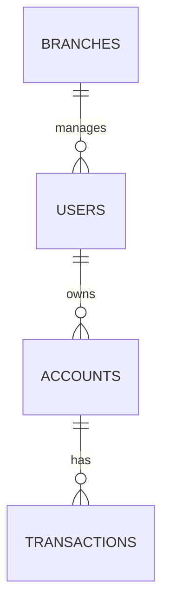

# ERD

## Entity Relationship Diagram

## Navigation
- **Parent Document**: [Database Architecture](../Database-Architecture.md)

## Change Log
| Version | Date | Author | Description |
|---|---|---|---|
| 1.0.0 | 2026-07-22 | DB Team | Initial Phase 6 Generation |