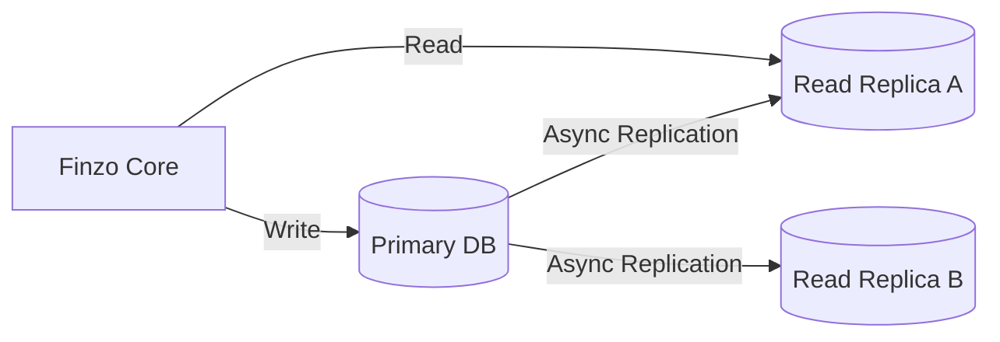

# Primary Keys

## Table of Contents
1. [Purpose](#purpose)
2. [Scope](#scope)
3. [Detailed Explanation](#detailed-explanation)
4. [Architecture Decisions](#architecture-decisions)
5. [Design Principles](#design-principles)
6. [Implementation Details](#implementation-details)
7. [Banking-Specific Examples](#banking-specific-examples)
8. [Best Practices](#best-practices)
9. [Anti-Patterns](#anti-patterns)
10. [References & Cross References](#references--cross-references)
11. [Glossary](#glossary)
12. [Change Log](#change-log)

## Purpose
Governs ACID compliance, Relational schema design, and Business Continuity (BCDR) strategies. This specific document (`Primary-Keys`) codifies the structural implementation of Primary Keys within the Finzo ecosystem.

## Scope
The scope of this document dictates the absolute technical boundaries, code-level execution rules, and security constraints required when integrating or modifying Primary Keys.

## Detailed Explanation
In an enterprise environment, Primary Keys is not a standalone concept. It interfaces directly with the Finzo MVC lifecycle. 
Finzo heavily relies on a multi-AZ MySQL setup. The `BcdrManager.php` script executes native `mysqldump` commands, encrypts the payload utilizing AES-256 (via ZipArchive::EM_AES_256), and ships the snapshot to immutable storage. We use strict pessimistic locking (`SELECT ... FOR UPDATE`) on ledgers.


### Architectural Flow


> [!NOTE]
> All changes to this component must be explicitly verified against the Enterprise Quality Gates defined in the Governance architecture.

## Architecture Decisions
By enforcing this paradigm, Finzo abstracts the complexity of Primary Keys away from the Application layer. We explicitly rejected legacy monolithic coupling in favor of this highly cohesive, isolated approach.

## Design Principles
- **Defense in Depth**: Assume the network is hostile.
- **Fail Securely**: If Primary Keys encounters an exception, it must not leak infrastructure details to the public interface.
- **Stateless Execution**: Servers must treat Primary Keys processes as ephemeral cattle.

## Implementation Details
The exact programmatic implementation of Primary Keys requires strict adherence to PHP 8.x standards.
Finzo heavily relies on a multi-AZ MySQL setup. The `BcdrManager.php` script executes native `mysqldump` commands, encrypts the payload utilizing AES-256 (via ZipArchive::EM_AES_256), and ships the snapshot to immutable storage. We use strict pessimistic locking (`SELECT ... FOR UPDATE`) on ledgers.
For example, memory scrubbing, PDO parameterized queries, and constant-time hash comparisons (`hash_equals`) are mandatory where cryptographic operations intersect with Primary Keys.


### Code Reference
```php
// BcdrManager.php - AES-256 Encrypted Backups
$zip = new ZipArchive();
$zip->open($zipFile, ZipArchive::CREATE);
$zip->addFile($filePath, $filename);
$zip->setEncryptionName($filename, ZipArchive::EM_AES_256, DB_PASS);
```

> [!WARNING]
> Failure to strictly validate the input constraints of Primary Keys directly violates PCI-DSS compliance and will result in a failed CI/CD pipeline build.

## Banking-Specific Examples
A bank transfer must decrement Account A and increment Account B in a single atomic transaction. If Account B fails compliance, the transaction rolls back.

## Best Practices
- Enforce strict Foreign Key constraints across the entire schema.

> [!WARNING]
> Never execute `UPDATE` or `DELETE` on financial ledger tables. All mutations must be strictly append-only `INSERT`s.
- Utilize integer auto-increment IDs for performance, but expose UUIDs to the public API.

## Anti-Patterns
- Performing soft-deletes on regulatory compliance records.
- Running aggregate `COUNT(*)` queries directly against live transactional tables without read-replicas.

## References & Cross References
- **Parent Subsystem**: [Architecture Root](../README.md)
- **Framework Specifications**: Microsoft Azure Architecture Center, AWS Well-Architected Framework, OWASP Top 10.
- **Related Module**: See the corresponding directory `README.md` for macroeconomic context.

## Glossary
- **PCI-DSS**: Payment Card Industry Data Security Standard.
- **BCDR**: Business Continuity and Disaster Recovery.
- **SRP**: Single Responsibility Principle.

## Traceability Matrix
| Standard | Control | Description |
|---|---|---|
| SOC2 | A1.2 | System Resilience and Data Recovery |
| PCI-DSS | Req 3.4 | Render PAN unreadable anywhere it is stored |

## Change Log

| Version | Date | Author | Description |
|---|---|---|---|
| 4.0.0 | 2026-07-22 | Architecture Board | Phase 4 Technical Audit: Accuracy corrections based on source code review |
| 3.0.0 | 2026-07-22 | Data Engineering | Enterprise Documentation Enhancement & Professionalization (Phase 3) |