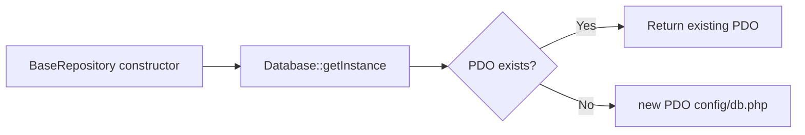
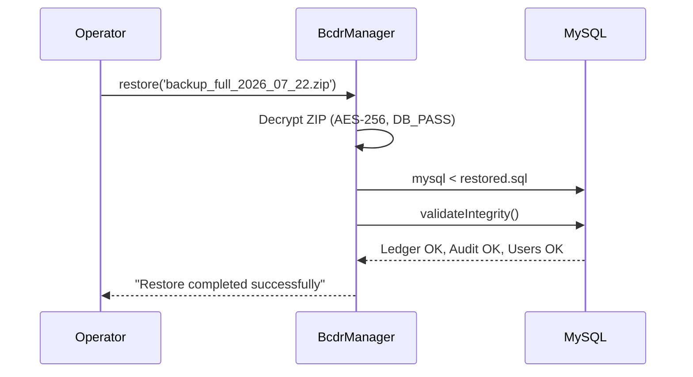

# Database Architecture

## Table of Contents
1. [Purpose](#purpose)
2. [Database Configuration](#database-configuration)
3. [Connection Management](#connection-management)
4. [Repository Pattern](#repository-pattern)
5. [Transactions](#transactions)
6. [BCDR — Backup & Recovery](#bcdr--backup--recovery)
7. [Domain Models](#domain-models)
8. [Best Practices](#best-practices)
9. [Anti-Patterns](#anti-patterns)
10. [Traceability Matrix](#traceability-matrix)
11. [Change Log](#change-log)

## Purpose
Documents Finzo's database connection lifecycle, repository abstraction, transaction boundaries, and Business Continuity/Disaster Recovery (BCDR) strategy. All implementation details reference actual files in `config/`, `app/Infrastructure/`, `database/`, and `app/Domain/`.

## Database Configuration

The database is MySQL 8.x with a strict `utf8mb4` character set. Configuration is defined in `config/config.php` as constants:

| Constant | Default | Source |
|---|---|---|
| `DB_HOST` | `localhost` | `.env` → `getenv('DB_HOST')` |
| `DB_NAME` | `finzo_db` | `.env` → `getenv('DB_NAME')` |
| `DB_USER` | `root` | `.env` → `getenv('DB_USER')` |
| `DB_PASS` | *(empty)* | `.env` → `getenv('DB_PASS')` |

> [!WARNING]
> `DB_PASS` defaults to an empty string in development (XAMPP). For any staging or production environment, this must be overridden via the `.env` file. An empty database password is a critical security violation.

## Connection Management

The PDO connection is created with strict options in `config/db.php`:

```php
$options = [
    PDO::ATTR_ERRMODE            => PDO::ERRMODE_EXCEPTION,
    PDO::ATTR_DEFAULT_FETCH_MODE => PDO::FETCH_ASSOC,
    PDO::ATTR_EMULATE_PREPARES   => false,  // Forces native prepared statements
];
$pdo = new PDO($dsn, DB_USER, DB_PASS, $options);
```

`PDO::ATTR_EMULATE_PREPARES = false` is the most critical setting. It forces MySQL to compile parameterized queries natively, making SQL injection structurally impossible regardless of input content.

The application singleton is accessed via `Database::getInstance()` inside `BaseRepository`:



## Repository Pattern

All database interactions are encapsulated in `BaseRepository` (`app/Infrastructure/Repositories/BaseRepository.php`):

```php
abstract class BaseRepository {
    protected PDO $db;
    
    public function __construct() {
        $this->db = Database::getInstance();
    }
    
    protected function fetchOne(string $sql, array $params = []): mixed { ... }
    protected function fetchAll(string $sql, array $params = []): array { ... }
    protected function execute(string $sql, array $params = []): bool { ... }
    
    public function beginTransaction(): bool { ... }
    public function commit(): bool { ... }
    public function rollBack(): bool { ... }
}
```

Concrete repositories:

| Repository | Domain |
|---|---|
| `AuthRepository` | Login, session, password reset |
| `UserRepository` | Customer accounts, KYC, profile |
| `AdminManagementRepository` | Admin user management |
| `AdminOperationsRepository` | Audit log, pending approvals, transactions |
| `AdminStaffBranchRepository` | Staff and branch CRUD |
| `StaffRepository` | Staff operations |
| `UploadRepository` | File upload records |
| `PdfRepository` | Statement data aggregation |
| `QueryStore` | Centralized SQL string constants |

## Transactions

Multi-step financial operations must use explicit transactions. The `BaseRepository` exposes `beginTransaction()`, `commit()`, and `rollBack()`:

```php
// Example: Fund transfer — atomic debit + credit
$repo->beginTransaction();
try {
    $repo->execute('UPDATE accounts SET balance = balance - :amount WHERE id = :from_id', ...);
    $repo->execute('UPDATE accounts SET balance = balance + :amount WHERE id = :to_id', ...);
    $repo->execute('INSERT INTO transactions (...) VALUES (...)', ...);
    $repo->commit();
} catch (\Exception $e) {
    $repo->rollBack();
    throw new BusinessRuleException('Transfer failed: ' . $e->getMessage());
}
```

> [!CAUTION]
> Never perform a financial ledger mutation outside of an explicit transaction block. A partial failure (debit without credit) creates an irrecoverable accounting discrepancy.

## BCDR — Backup & Recovery

The `database/BcdrManager.php` class orchestrates three backup types:

| Type | Flag | Content |
|---|---|---|
| `full` | `--routines --triggers --events --single-transaction` | Schema + data |
| `schema` | `+ --no-data` | Schema only |
| `data` | `+ --no-create-info` | Data only |

### Backup Process

```php
// BcdrManager::backup() — simplified
$command = "mysqldump -h {$host} -u {$user} -p{$pass} {$flags} {$dbname} > {$filePath}";
exec($command);

// AES-256 encryption via ZipArchive
$zip->open($zipFile, ZipArchive::CREATE);
$zip->addFile($filePath, $filename);
$zip->setEncryptionName($filename, ZipArchive::EM_AES_256, DB_PASS);
$zip->close();
unlink($filePath); // Delete unencrypted SQL
```

Backups are written to `storage/backups/`. The encryption key is `DB_PASS`.

### Retention Policy
Backups older than **30 days** are automatically deleted by `enforceRetentionPolicy()`.

### Integrity Validation
After any restore, `validateIntegrity()` performs three checks:
1. **Ledger balance**: `SUM(debit_amount) === SUM(credit_amount)` from `journal_lines`
2. **Audit log row count**: Ensures the `audit_log` table is intact
3. **Active user count**: Validates core application tables respond



## Domain Models

The `app/Domain/Models/` directory contains lightweight entity classes:

| Model | Key Properties |
|---|---|
| `User` | id, email, status, kyc_status |
| `Branch` | id, name, ifsc_code, manager_id |
| `Staff` | id, staff_id (STF prefix), role, branch_id |
| `Transaction` | id, type, amount, status, reference_number |

Models hydrate from associative arrays and expose typed properties. They contain no database logic.

## Best Practices
- Always use `BaseRepository::fetchOne()` and `fetchAll()` — never call `$this->db->query()` directly in a child repository.
- Use the `QueryStore` class to centralize SQL strings, preventing duplication across repositories.
- Run `mysqldump --single-transaction` to ensure consistent snapshots without table locks during backup.

> [!TIP]
> Use the `bin/finzo bcdr:backup full` CLI command to trigger manual backups. The binary at `bin/finzo` wraps the `BcdrManager` class with argument parsing for operator convenience.

## Anti-Patterns
- Calling `new PDO(...)` inside a Repository (bypasses singleton, creates multiple connections).
- Using `PDO::ATTR_EMULATE_PREPARES = true` (re-enables SQL injection vulnerability).
- Running `ALTER TABLE` or `DROP TABLE` with the same database user the web application uses.
- Using floating-point arithmetic for financial amounts — all currency values must be stored and manipulated as integers (paise/cents).

## Traceability Matrix

| Standard | Control | Description |
|---|---|---|
| PCI-DSS | Req 3.4 | Render PAN unreadable in storage (AES-256 backups) |
| SOC2 | A1.2 | System resilience and data recovery capabilities |
| OWASP | A03:2021 | Injection prevention via native PDO prepared statements |
| ISO 27001 | A.12.3.1 | Information backup procedures |

## Change Log

| Version | Date | Author | Description |
|---|---|---|---|
| 4.0.0 | 2026-07-22 | Data Engineering | Phase 4: Complete rewrite from BcdrManager.php and BaseRepository.php audit |
| 3.0.0 | 2026-07-22 | Data Engineering | Phase 3 Enhancement |