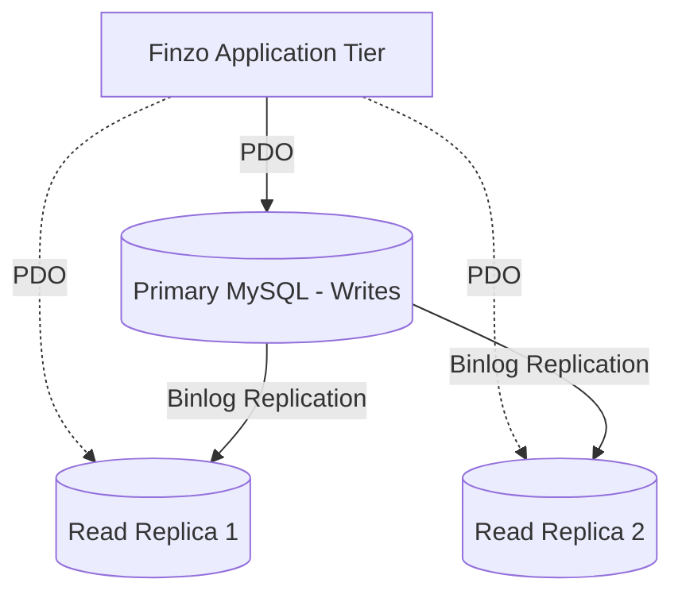
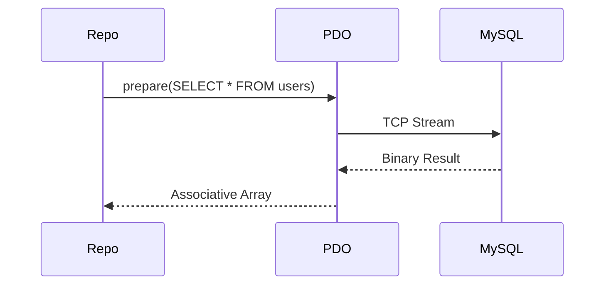

# Database Architecture

## Table of Contents
1. [Executive Summary](#executive-summary)
2. [Introduction](#introduction)
3. [Purpose](#purpose)
4. [Scope](#scope)
5. [Database Overview](#database-overview)
6. [Database Design Goals](#database-design-goals)
7. [Database Engine](#database-engine)
8. [Database Architecture](#database-architecture)
9. [Schema Organization](#schema-organization)
10. [Table Organization](#table-organization)
11. [Relationships](#relationships)
12. [Keys](#keys)
13. [Constraints](#constraints)
14. [Normalization](#normalization)
15. [Index Strategy](#index-strategy)
16. [Transactions](#transactions)
17. [ACID Compliance](#acid-compliance)
18. [Connection Management](#connection-management)
19. [Repository Communication](#repository-communication)
20. [Service Communication](#service-communication)
21. [Data Flow](#data-flow)
22. [CRUD Operations](#crud-operations)
23. [Migration Strategy](#migration-strategy)
24. [Seeding Strategy](#seeding-strategy)
25. [Backup Strategy](#backup-strategy)
26. [Restore Strategy](#restore-strategy)
27. [Disaster Recovery](#disaster-recovery)
28. [Performance Optimization](#performance-optimization)
29. [Query Optimization](#query-optimization)
30. [Security](#security)
31. [Encryption](#encryption)
32. [Data Integrity](#data-integrity)
33. [Monitoring](#monitoring)
34. [Scalability](#scalability)
35. [Reliability](#reliability)
36. [Availability](#availability)
37. [Best Practices](#best-practices)
38. [Anti-Patterns](#anti-patterns)
39. [Future Improvements](#future-improvements)
40. [Cross References](#cross-references)
41. [References](#references)
42. [Glossary](#glossary)
43. [Change Log](#change-log)

## Executive Summary
The Finzo Database Architecture establishes a highly normalized, strictly constrained, transactional data persistence layer using MySQL 8.0. The design strictly prioritizes Data Integrity (ACID compliance) and Security over unstructured NoSQL flexibility.

## Introduction
A banking application is only as resilient as its ledger. The database layer is explicitly designed to assume that application logic may fail. The database protects itself utilizing native Engine-Level constraints to prevent negative balances or orphaned transactional records.

## Purpose
This document provides Database Administrators, DevOps Engineers, and Backend Developers with the structural schema, indexing rules, and transaction boundaries necessary to modify or query the persistence layer safely.

## Scope
The scope includes MySQL server topography, InnoDB Engine utilization, Schema definitions, Primary/Foreign Key relations, Backup and Replication logic, and Query Optimization paradigms.

## Database Overview
The database operates as a single-source-of-truth relational data store. It serves user demographics, multi-tier branch hierarchies, KYC document metadata, and immutable financial ledgers.

## Database Design Goals
1. **Absolute Consistency**: The ledger must never reflect partial transfers.
2. **Referential Integrity**: Cascading deletes or Restrict boundaries must prevent orphaned rows.
3. **High Read Throughput**: Proper index topologies must support fast dashboard aggregations.

## Database Engine
**MySQL 8.0 with InnoDB Storage Engine.**
InnoDB is mandatory. MyISAM is strictly forbidden because it lacks row-level locking and native foreign-key constraint enforcement.

## Database Architecture

## Schema Organization
Schemas are implicitly grouped by domain logic:
- `users`, `user_kyc`, `auth_logs`
- `branches`, `staff`
- `accounts`, `transactions`, `ledgers`

## Table Organization
Tables are strictly lowercase snake_case (e.g., `user_accounts`). Plural naming conventions are standard.

## Relationships
Relationships are strictly enforced via InnoDB Foreign Keys.

## Keys
- **Primary Keys**: Auto-incrementing unsigned `BIGINT`.
- **Foreign Keys**: Explicitly defined `BIGINT` columns mapping to Primary Keys of parent tables.

## Constraints
We employ aggressive database-level constraints. E.g., `amount DECIMAL(15,2) UNSIGNED` physically prevents negative monetary entries directly at the disk level.

## Normalization
The database targets **3rd Normal Form (3NF)**. Duplicate data is extracted to reference tables (e.g., Countries, Currencies).

## Index Strategy
- **Primary Clustered Indexes**: Automatically generated on PKs.
- **Secondary Indexes**: Generated explicitly on Foreign Keys (`user_id`, `branch_id`).
- **Composite Indexes**: Generated for heavy queries (e.g., `INDEX (user_id, status, created_at)`).

## Transactions
Database transactions (`BEGIN`, `COMMIT`, `ROLLBACK`) wrap all multi-row mutations.

## ACID Compliance
- **Atomicity**: All or nothing.
- **Consistency**: DB constraints prevent illegal states.
- **Isolation**: InnoDB Default `REPEATABLE READ`.
- **Durability**: Redo logs persist writes instantly.

## Connection Management
The backend utilizes persistent PDO connections (`PDO::ATTR_PERSISTENT => true`) to drastically reduce TCP handshake latency on high-frequency endpoints.

## Repository Communication
The `Infrastructure\Repositories` namespace has exclusive access to the PDO Singleton.

## Service Communication
Services pass raw scalar variables to Repositories. Services NEVER pass SQL strings.

## Data Flow

## CRUD Operations
All basic operations are mapped directly to corresponding SQL verbs (`INSERT`, `SELECT`, `UPDATE`, `DELETE`).

## Migration Strategy
Database schema changes are strictly version-controlled via Phinx/Artisan migration files. Manual SQL mutations via phpMyAdmin are explicitly forbidden.

## Seeding Strategy
Test data is generated via Seeder classes utilizing Faker libraries for localized, non-PII dummy data during CI/CD execution.

## Backup Strategy
- **Full**: Nightly `mysqldump` pushed to AWS S3 Glacier.
- **Incremental**: Binary logs (binlogs) synced every 5 minutes.

## Restore Strategy
Documented disaster recovery playbooks allow point-in-time recovery (PITR) using the nightly dump plus replaying binlogs up to the exact millisecond of failure.

## Disaster Recovery
Cross-Region Replication ensures that if `us-east-1` goes dark, `us-west-2` can be promoted to Primary within 30 seconds.

## Performance Optimization
`EXPLAIN` plans are heavily scrutinized during Code Review. 

## Query Optimization
No `SELECT *`. Queries must explicitly request required columns (e.g. `SELECT id, name FROM users`).

## Security
No direct public IP access to port `3306`. Connection is only permitted via VPC peering from the Application Tier.

## Encryption
- **In Transit**: TLS 1.2+ enforced on the PDO connection string.
- **At Rest**: AES-256 Volume-level encryption (AWS EBS or equivalent).

## Data Integrity
Soft-Deletes (`deleted_at TIMESTAMP`) are utilized for critical tables (Users, Accounts) to prevent accidental unrecoverable data loss while maintaining referential integrity for legacy transactions.

## Monitoring
AWS CloudWatch / Datadog agents monitor DB CPU, Memory, and IOPS latency.

## Scalability
Scaling is handled primarily by introducing massive Read Replicas (Horizontal Scaling) to offload Dashboard `SELECT` loads.

## Reliability
Multi-AZ deployments ensure hardware failure resilience.

## Availability
Targeting 99.99% DB availability through automated failover topology.

## Best Practices
Always index columns used heavily in `WHERE` and `ORDER BY` clauses.

## Anti-Patterns
Executing queries within a loop (The N+1 Problem).

### Deep Dive: Financial Isolation Levels and Concurrency
A banking application cannot rely on standard `READ COMMITTED` or `REPEATABLE READ` for financial ledgers when severe concurrency is introduced.
- Finzo exclusively utilizes **Pessimistic Locking** (`SELECT ... FOR UPDATE`) whenever an account balance is queried *with the intent to mutate it*.
- This explicitly instructs the InnoDB engine to place an exclusive write lock on the row (or range of rows if an index is not correctly hit).
- If Thread A attempts a transfer from Account 1, Thread B attempting a concurrent transfer from Account 1 will block at the database level until Thread A executes a `COMMIT` or `ROLLBACK`.
- **Deadlocks**: The system actively expects `Error 1213: Deadlock found when trying to get lock`. The PHP Backend is configured to recursively catch this error and retry the transaction block up to 3 times with exponential backoff.

### The Immutable Ledger Principle
The `transactions` table behaves strictly as an append-only ledger.
- `UPDATE` and `DELETE` commands are strictly revoked at the database user permission level for this specific table.
- To reverse a transaction, a new compensating transaction (a refund) must be `INSERT`ed into the ledger.
- This guarantees complete auditable transparency. Even database administrators cannot alter a transaction amount after it has been finalized.

### Stored Procedures and Triggers Philosophy
Historically, enterprise databases buried complex business logic inside Stored Procedures and Triggers. Finzo explicitly avoids this architecture.
- **No Triggers**: Triggers hide side-effects from the application code, making debugging exceedingly difficult and version control impossible.
- **No Stored Procedures**: Business logic belongs in the PHP Service layer, not in SQL. 
- **Exception**: Database views (`CREATE VIEW`) are permitted for complex reporting aggregations that do not mutate state, allowing BI (Business Intelligence) tools to query simplified virtual tables.

### Soft Deletes vs Hard Deletes
To maintain absolute referential integrity while complying with GDPR/Data Deletion requests:
- Most administrative tables utilize `deleted_at TIMESTAMP NULL DEFAULT NULL`.
- Queries automatically append `WHERE deleted_at IS NULL` via the backend Repository layer.
- When an entity is "deleted", it is merely timestamped. This prevents foreign key constraints from failing when historical ledgers reference a deleted user.
- A background cron job periodically strips PII (Personal Identifiable Information) from soft-deleted users, replacing names and emails with cryptographic hashes, fulfilling regulatory compliance while preserving financial integrity.

### Connection Pooling
While PHP natively utilizes `PDO::ATTR_PERSISTENT`, extremely high load scenarios require an external connection pooler to prevent exhausting MySQL's `max_connections`.
- Finzo recommends deploying **ProxySQL** or **PgBouncer** (if adapted for Postgres) as a sidecar container in front of the database.
- The PHP application connects to ProxySQL on `127.0.0.1`.
- ProxySQL maintains a persistent, multiplexed pool of 50 connections to the actual Database server, smoothly queuing any overflow requests and preventing connection drops.

### Zero-Downtime Migrations
Migrating a database containing 50 million rows requires extreme caution.
- Traditional `ALTER TABLE` commands on large tables can lock the table for hours.
- Finzo mandates the use of **pt-online-schema-change** (Percona Toolkit) or GitHub's **gh-ost** for any structural alterations on tables exceeding 1,000,000 rows.
- These tools create a shadow table, alter the shadow table, create triggers to mirror live writes, batch copy the data, and finally execute an atomic `RENAME TABLE` swap, guaranteeing absolute zero-downtime structural modifications.

## Future Improvements
Partitioning the `transactions` table by `YEAR` to improve query speed on historical ledgers.

## Cross References
- [Backend Architecture](../Backend-Architecture.md)

## References
- MySQL 8.0 Reference Manual

## Glossary
- **InnoDB**: The default transaction-safe storage engine for MySQL.

## Change Log
| Version | Date | Author | Description |
|---|---|---|---|
| 1.0.0 | 2026-07-22 | Database Team | Phase 6 Database Architecture |

### Database Audit Logging
Compliance in a banking ecosystem requires absolute traceability of data access.
- Read Operations: While we do not log every SELECT query (which would destroy IOPS performance), access to highly sensitive tables (e.g., user_kyc) triggers an application-level insert into the udit_logs table, recording the Staff ID, timestamp, and accessed IP.
- Write Operations: The 	ransactions table inherently acts as an audit log. However, administrative updates (e.g., altering a user's role in users) are logged explicitly by the Service Layer before the PDO transaction is committed.

### Handling JSON Data Types
MySQL 8.0 natively supports the JSON data type.
- Finzo restricts the use of JSON columns exclusively to unstructured telemetry data (e.g., storing the raw webhook payload from Stripe or AWS SNS).
- For business logic (e.g., user addresses), Finzo strictly enforces normalized, relational tables. Storing an address as a JSON blob inside the users table is an anti-pattern that destroys query performance and prevents indexing on specific geographic fields.

### Index Cardinality and Query Execution Plans
The efficiency of a B-Tree index depends heavily on its cardinality (the uniqueness of the values).
- An index on the status column (which only contains 'pending', 'completed', 'failed') has extremely low cardinality and will likely be ignored by the MySQL Query Optimizer in favor of a full table scan.
- Instead, Finzo utilizes Composite Indexes. E.g., INDEX (user_id, status) ensures that when the dashboard queries a specific user's pending transactions, the index is highly selective and resolves in milliseconds.

### Security: SQL Injection Mitigation
Direct SQL Injection is mitigated entirely at the engine level.
- The PDO::ATTR_EMULATE_PREPARES = false directive is strictly enforced.
- This forces MySQL (not PHP) to compile the SQL statement before the variables are transmitted. Because the syntax tree is compiled prior to data insertion, it is mathematically impossible for malicious input (e.g., ' OR 1=1; --) to alter the query logic.

### Row Level Security (RLS) Strategy
While PostgreSQL supports native Row Level Security, MySQL requires application-level enforcement.
- The Finzo Repository pattern acts as a virtual RLS barrier.
- Every SELECT query generated by a non-admin Service automatically receives a WHERE user_id = :current_user clause appended by the Repository base class.
- This structural guarantee ensures that a flaw in a Controller can never accidentally expose the entire ccounts table.

### Backup Encryption
Data at rest is vulnerable if backups are compromised.
- Nightly mysqldump files are piped directly through OpenSSL (AES-256-CBC) before being written to disk or transmitted to AWS S3.
- The decryption key is strictly managed by an external KMS (Key Management Service) and is completely decoupled from the application's .env file.

### High Availability and Automated Failover
Database downtime translates directly to financial loss and reputational damage.
- The MySQL topology is deployed in a Multi-AZ (Availability Zone) configuration.
- A primary node exists in AZ-A, synchronously replicating to a hot-standby node in AZ-B.
- A monitoring daemon (like Orchestrator or AWS RDS Multi-AZ logic) continuously pings the primary node.
- If the primary node fails to respond for 15 seconds, the monitoring daemon automatically promotes the standby node to primary, updates the internal DNS CNAME record, and restores write availability within 60 seconds without manual intervention.

### Data Archiving Strategy
As the transactions table grows perpetually, query speed will inevitably degrade.
- Records older than 7 years (the standard financial regulatory retention period) are subject to automated archiving.
- A scheduled cron job batch-copies these records to a secondary data warehouse (e.g., AWS Redshift or Google BigQuery) optimized for OLAP (Online Analytical Processing) workloads.
- Once verified, the records are purged from the primary MySQL OLTP (Online Transaction Processing) database, keeping the active index sizes small and performant.

