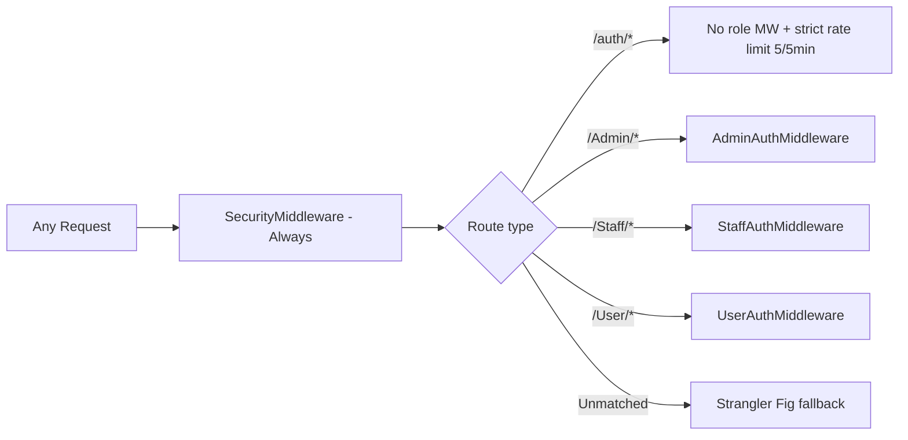
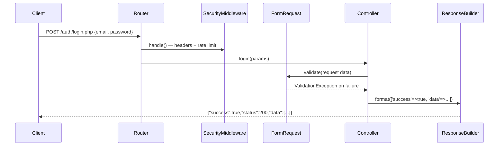

# API Architecture

## Table of Contents
1. [Purpose](#purpose)
2. [Routing](#routing)
3. [Endpoint Catalogue](#endpoint-catalogue)
4. [Request Lifecycle](#request-lifecycle)
5. [Response Format](#response-format)
6. [Error Handling](#error-handling)
7. [Rate Limiting](#rate-limiting)
8. [Authentication](#authentication)
9. [Best Practices](#best-practices)
10. [Anti-Patterns](#anti-patterns)
11. [Traceability Matrix](#traceability-matrix)
12. [Change Log](#change-log)

## Purpose
Documents the complete API surface of Finzo. All routes are defined in `routes/api.php` and handled by the custom `Router` class. Every endpoint is guarded by `SecurityMiddleware` globally and by role-specific Middleware per route.

## Routing

Routes are registered in `routes/api.php` via a fluent Router interface:

```php
$router->post('/auth/login.php', [AuthController::class, 'login']);
$router->get('/Admin/users.php', [AdminOperationsController::class, 'users'],
    [AdminAuthMiddleware::class]);
```

The Router normalizes base paths from XAMPP-style URIs:
- `/Finzo/public/api` → stripped to `/resource`
- `/Finzo/api` → stripped to `/resource`

Unmatched routes fall back to the **Strangler Fig pattern**: if a file exists in `app/Presentation/Controllers_backup{uri}`, it is `require`d to maintain backward compatibility during the incremental refactor.

## Endpoint Catalogue

### Authentication Routes (Public)
| Method | Path | Handler | Notes |
|---|---|---|---|
| POST | `/auth/login.php` | `AuthController::login` | Customer login |
| POST | `/auth/admin-login.php` | `AuthController::adminLogin` | Admin login |
| POST | `/auth/staff-login.php` | `AuthController::staffLogin` | Staff login |
| POST | `/auth/logout.php` | `AuthController::logout` | Destroy session |
| POST | `/auth/register.php` | `AuthController::register` | Customer registration |
| POST | `/auth/forgot-password.php` | `AuthController::forgotPassword` | Initiate password reset |
| POST | `/auth/reset-password.php` | `AuthController::resetPassword` | Complete password reset |
| GET | `/auth/get-csrf-token.php` | `AuthController::getCsrfToken` | Fetch CSRF token |

### Admin Routes (AdminAuthMiddleware required)
| Method | Path | Handler |
|---|---|---|
| POST | `/Admin/add-admin.php` | `AdminManagementController::addAdmin` |
| GET | `/Admin/get-admins.php` | `AdminManagementController::getAdmins` |
| GET | `/Admin/dashboard.php` | `AdminOperationsController::dashboard` |
| GET | `/Admin/audit-log.php` | `AdminOperationsController::auditLog` |
| GET | `/Admin/users.php` | `AdminOperationsController::users` |
| POST | `/Admin/user-action.php` | `AdminOperationsController::userAction` |
| GET | `/Admin/transactions.php` | `AdminOperationsController::transactions` |
| POST | `/Admin/review-application.php` | `AdminOperationsController::reviewApplication` |
| GET | `/Admin/pending-approvals.php` | `AdminOperationsController::pendingApprovals` |
| POST | `/Admin/add-staff.php` | `AdminStaffController::addStaff` |
| POST | `/Admin/staff-action.php` | `AdminStaffController::staffAction` |
| GET | `/Admin/get-branches.php` | `AdminBranchController::getBranches` |

### Middleware Protection Matrix


## Request Lifecycle



## Response Format

All responses follow a standardized envelope produced by `ResponseBuilder::format()`:

**Success (2xx)**:
```json
{
  "success": true,
  "status": 200,
  "message": "Request successful.",
  "timestamp": "2026-07-22T18:00:00+05:30",
  "request_id": "a3f9b2c1d4e5",
  "data": {}
}
```

**Error (4xx/5xx)**:
```json
{
  "success": false,
  "status": 422,
  "message": "Validation failed.",
  "errors": {
    "email": ["The email field is required."]
  }
}
```

Response headers automatically include:
- `X-Runtime: {ms}` — request execution time
- `X-Memory: {MB}` — peak memory usage

> [!NOTE]
> Sensitive fields (`password`, `token`, `reset_token`, `password_hash`) are **automatically scrubbed** from all response payloads by `ResponseBuilder::scrub()`.

## Error Handling

The `ExceptionHandler` maps exception classes to HTTP status codes:

| Exception | Status | Payload |
|---|---|---|
| `ValidationException` | 422 | `{message, errors:[]}` |
| `AuthenticationException` | 401 | `{message}` |
| `AuthorizationException` | 403 | `{message}` |
| `ResourceNotFoundException` | 404 | `{message}` |
| `ConflictException` | 409 | `{message}` |
| `BusinessRuleException` | 400 | `{message}` |
| Any `\Throwable` | 500 | `{"message":"Internal Server Error"}` (details logged only) |

## Rate Limiting

Implemented via `RateLimiter::check()` using file-based atomic locking (`flock()` on `storage/framework/cache/rate_limits.json`):

| Scope | Limit | Window |
|---|---|---|
| Global (all IPs) | 60 requests | 1 minute |
| Auth endpoints (`/auth/*`) | 5 requests | 5 minutes |

```php
// SecurityMiddleware.php
RateLimiter::check("global_api_{$ip}", 60, 1);
if (strpos($uri, '/auth/') !== false) {
    RateLimiter::check("auth_api_{$ip}", 5, 5);
}
```

Exceeding the limit throws `ApiException('Too Many Requests', 429)`.

## Authentication

All protected routes require an active PHP session. No JWTs are used. The session state is validated by `Auth::requireAuth()` inside the relevant Middleware class:

```php
// Auth::requireAuth() — idle timeout enforcement
if (time() - $_SESSION['last_activity'] > 1800) {
    Auth::logout();
    throw new AuthenticationException('Session expired.');
}
```

## Best Practices
- Always return an array from controllers — never `echo` or `print` inside a controller.
- Use domain-specific validators (`KYCValidator`, `TransactionValidator`) rather than ad-hoc `$_POST` checks.
- Register all new routes in `routes/api.php` — never create standalone PHP files as endpoints.

> [!IMPORTANT]
> The `OPTIONS` preflight request is handled explicitly in `SecurityMiddleware`. All CORS headers are set there. Never set CORS headers inside individual controllers.

## Anti-Patterns
- Calling `header()` or `http_response_code()` inside a Controller (bypasses `ResponseBuilder`).
- Using `$_GET['id']` directly without validation (SQL injection / type coercion risk).
- Creating standalone `.php` endpoint files (violates the Front Controller pattern).
- Trusting `$_SERVER['REMOTE_ADDR']` for security decisions without validating proxy headers.

## Traceability Matrix

| Standard | Control | Description |
|---|---|---|
| OWASP | A04:2021 | Insecure Design (missing rate limits) |
| OWASP | A09:2021 | Security Logging and Monitoring |
| PCI-DSS | Req 6.5.1 | SQL Injection via parameterized queries |
| RFC 7807 | Problem Details | Standardized HTTP error response format |

## Change Log

| Version | Date | Author | Description |
|---|---|---|---|
| 4.0.0 | 2026-07-22 | API Integrations | Phase 4: Full accuracy rewrite from routes/api.php and Router.php |
| 3.0.0 | 2026-07-22 | API Integrations | Phase 3 Enhancement |