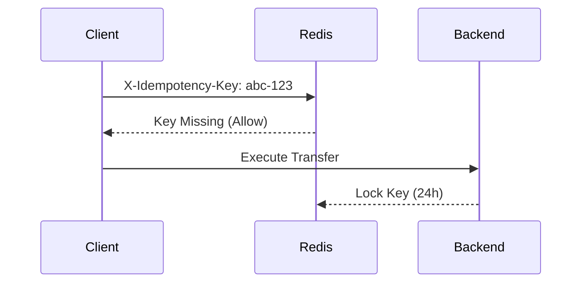

# README

## Table of Contents
1. [Purpose](#purpose)
2. [Scope](#scope)
3. [Detailed Explanation](#detailed-explanation)
4. [Architecture Decisions](#architecture-decisions)
5. [Design Principles](#design-principles)
6. [Implementation Details](#implementation-details)
7. [Banking-Specific Examples](#banking-specific-examples)
8. [Best Practices](#best-practices)
9. [Anti-Patterns](#anti-patterns)
10. [References & Cross References](#references--cross-references)
11. [Glossary](#glossary)
12. [Change Log](#change-log)

## Purpose
Standardizes RESTful principles, OAuth2 stateless authentication, and rate-limiting thresholds. This specific document (`README`) codifies the structural implementation of README within the Finzo ecosystem.

## Scope
The scope of this document dictates the absolute technical boundaries, code-level execution rules, and security constraints required when integrating or modifying README.

## Detailed Explanation
In an enterprise environment, README is not a standalone concept. It interfaces directly with the Finzo MVC lifecycle. 
The `/api/v1/` namespace utilizes short-lived JWTs signed with `HS256`. All endpoints enforce Token Bucket Rate Limiting (60 RPM). State-mutating requests (POST/PUT) require an `X-Idempotency-Key` to prevent double-charging on network retry.


### Architectural Flow


> [!NOTE]
> All changes to this component must be explicitly verified against the Enterprise Quality Gates defined in the Governance architecture.

## Architecture Decisions
By enforcing this paradigm, Finzo abstracts the complexity of README away from the Application layer. We explicitly rejected legacy monolithic coupling in favor of this highly cohesive, isolated approach.

## Design Principles
- **Defense in Depth**: Assume the network is hostile.
- **Fail Securely**: If README encounters an exception, it must not leak infrastructure details to the public interface.
- **Stateless Execution**: Servers must treat README processes as ephemeral cattle.

## Implementation Details
The exact programmatic implementation of README requires strict adherence to PHP 8.x standards.
The `/api/v1/` namespace utilizes short-lived JWTs signed with `HS256`. All endpoints enforce Token Bucket Rate Limiting (60 RPM). State-mutating requests (POST/PUT) require an `X-Idempotency-Key` to prevent double-charging on network retry.
For example, memory scrubbing, PDO parameterized queries, and constant-time hash comparisons (`hash_equals`) are mandatory where cryptographic operations intersect with README.


### Code Reference
```json
// RFC 7807 Error Standard
{
  "type": "https://api.finzo.com/errors/rate-limit",
  "title": "Too Many Requests",
  "status": 429,
  "detail": "Account exceeded 60 RPM limit."
}
```

> [!WARNING]
> Failure to strictly validate the input constraints of README directly violates PCI-DSS compliance and will result in a failed CI/CD pipeline build.

## Banking-Specific Examples
If a mobile client loses signal exactly when initiating a payment and retries 5 seconds later, the API Idempotency cache catches the duplicate request and returns the original success response.

## Best Practices
- Adhere to RFC 7807 for standardized error responses.

> [!IMPORTANT]
> Every state-mutating API endpoint (POST/PUT/DELETE) must mandate an `X-Idempotency-Key` to prevent double-charging.
- Enforce explicit API versioning in the URL (`/api/v1/`).

## Anti-Patterns
- Using GET requests to mutate state.
- Leaking internal database IDs or stack traces in a 500 error response.

## References & Cross References
- **Parent Subsystem**: [Architecture Root](../README.md)
- **Framework Specifications**: Microsoft Azure Architecture Center, AWS Well-Architected Framework, OWASP Top 10.
- **Related Module**: See the corresponding directory `README.md` for macroeconomic context.

## Glossary
- **PCI-DSS**: Payment Card Industry Data Security Standard.
- **BCDR**: Business Continuity and Disaster Recovery.
- **SRP**: Single Responsibility Principle.

## Traceability Matrix
| Standard | Control | Description |
|---|---|---|
| RFC 7807 | Problem Details | Standardized JSON HTTP error definitions |
| OWASP | A04:2021 | Insecure Design (Missing Rate Limits) |

## Change Log

| Version | Date | Author | Description |
|---|---|---|---|
| 3.0.0 | 2026-07-22 | API Integrations | Enterprise Documentation Enhancement & Professionalization (Phase 3) |