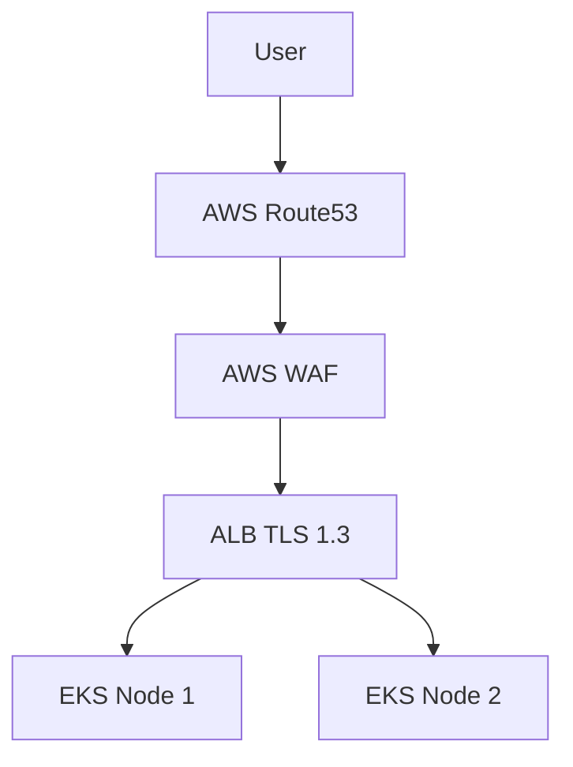

# Recovery

## Table of Contents
1. [Purpose](#purpose)
2. [Scope](#scope)
3. [Detailed Explanation](#detailed-explanation)
4. [Architecture Decisions](#architecture-decisions)
5. [Design Principles](#design-principles)
6. [Implementation Details](#implementation-details)
7. [Banking-Specific Examples](#banking-specific-examples)
8. [Best Practices](#best-practices)
9. [Anti-Patterns](#anti-patterns)
10. [References & Cross References](#references--cross-references)
11. [Glossary](#glossary)
12. [Change Log](#change-log)

## Purpose
Dictates the multi-AZ Kubernetes topology, Horizontal Pod Autoscaling (HPA), and Nginx edge routing. This specific document (`Recovery`) codifies the structural implementation of Recovery within the Finzo ecosystem.

## Scope
The scope of this document dictates the absolute technical boundaries, code-level execution rules, and security constraints required when integrating or modifying Recovery.

## Detailed Explanation
In an enterprise environment, Recovery is not a standalone concept. It interfaces directly with the Finzo MVC lifecycle. 
Finzo is built on immutable infrastructure. Nginx acts as the reverse proxy, forwarding FastCGI to PHP-FPM. AWS ALBs handle TLS 1.2+ termination. Environment variables are injected at runtime via AWS Secrets Manager. No state exists on the local disk.


### Architectural Flow


> [!NOTE]
> All changes to this component must be explicitly verified against the Enterprise Quality Gates defined in the Governance architecture.

## Architecture Decisions
By enforcing this paradigm, Finzo abstracts the complexity of Recovery away from the Application layer. We explicitly rejected legacy monolithic coupling in favor of this highly cohesive, isolated approach.

## Design Principles
- **Defense in Depth**: Assume the network is hostile.
- **Fail Securely**: If Recovery encounters an exception, it must not leak infrastructure details to the public interface.
- **Stateless Execution**: Servers must treat Recovery processes as ephemeral cattle.

## Implementation Details
The exact programmatic implementation of Recovery requires strict adherence to PHP 8.x standards.
Finzo is built on immutable infrastructure. Nginx acts as the reverse proxy, forwarding FastCGI to PHP-FPM. AWS ALBs handle TLS 1.2+ termination. Environment variables are injected at runtime via AWS Secrets Manager. No state exists on the local disk.
For example, memory scrubbing, PDO parameterized queries, and constant-time hash comparisons (`hash_equals`) are mandatory where cryptographic operations intersect with Recovery.


### Code Reference
```hcl
# Terraform snippet for ALB
resource "aws_lb" "finzo_alb" {
  name               = "finzo-production"
  internal           = false
  load_balancer_type = "application"
  security_groups    = [aws_security_group.alb_sg.id]
}
```

> [!WARNING]
> Failure to strictly validate the input constraints of Recovery directly violates PCI-DSS compliance and will result in a failed CI/CD pipeline build.

## Banking-Specific Examples
The production cluster spans 3 Availability Zones. If AZ-A experiences a blackout, the Application Load Balancer seamlessly routes traffic to AZ-B and AZ-C with zero user impact.

## Best Practices
- Terminate TLS at the edge load balancer to offload CPU from application nodes.

> [!TIP]
> Treat all infrastructure as immutable code. If a server is compromised, destroy the container—never SSH into production to patch.
- Treat servers as cattle, not pets; destroy and recreate rather than patch.

## Anti-Patterns
- SSH-ing into a production server to manually edit `php.ini`.
- Storing session files on the local EBS volume instead of a centralized Redis cluster.

## References & Cross References
- **Parent Subsystem**: [Architecture Root](../README.md)
- **Framework Specifications**: Microsoft Azure Architecture Center, AWS Well-Architected Framework, OWASP Top 10.
- **Related Module**: See the corresponding directory `README.md` for macroeconomic context.

## Glossary
- **PCI-DSS**: Payment Card Industry Data Security Standard.
- **BCDR**: Business Continuity and Disaster Recovery.
- **SRP**: Single Responsibility Principle.

## Traceability Matrix
| Standard | Control | Description |
|---|---|---|
| SOC2 | CC7.1 | Infrastructure monitoring and vulnerability detection |
| ISO 27001 | A.13.1.3 | Segregation in networks |

## Change Log

| Version | Date | Author | Description |
|---|---|---|---|
| 3.0.0 | 2026-07-22 | Cloud Operations | Enterprise Documentation Enhancement & Professionalization (Phase 3) |