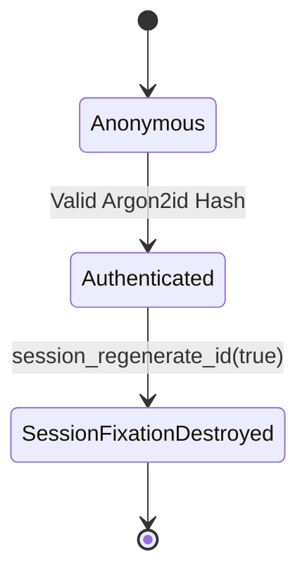

# Authentication

## Table of Contents
1. [Purpose](#purpose)
2. [Scope](#scope)
3. [Detailed Explanation](#detailed-explanation)
4. [Architecture Decisions](#architecture-decisions)
5. [Design Principles](#design-principles)
6. [Implementation Details](#implementation-details)
7. [Banking-Specific Examples](#banking-specific-examples)
8. [Best Practices](#best-practices)
9. [Anti-Patterns](#anti-patterns)
10. [References & Cross References](#references--cross-references)
11. [Glossary](#glossary)
12. [Change Log](#change-log)

## Purpose
Enforces Zero-Trust networks, Cryptographic hashing, and mitigation of OWASP Top 10 vulnerabilities. This specific document (`Authentication`) codifies the structural implementation of Authentication within the Finzo ecosystem.

## Scope
The scope of this document dictates the absolute technical boundaries, code-level execution rules, and security constraints required when integrating or modifying Authentication.

## Detailed Explanation
In an enterprise environment, Authentication is not a standalone concept. It interfaces directly with the Finzo MVC lifecycle. 
Passwords are computationally secured via `PASSWORD_ARGON2ID`. Memory scrubbing is explicitly invoked via `sodium_memzero()` after processing sensitive secrets in RAM. Timing attacks are neutralized utilizing `hash_equals()` for all cryptographic comparisons.


### Architectural Flow


> [!NOTE]
> All changes to this component must be explicitly verified against the Enterprise Quality Gates defined in the Governance architecture.

## Architecture Decisions
By enforcing this paradigm, Finzo abstracts the complexity of Authentication away from the Application layer. We explicitly rejected legacy monolithic coupling in favor of this highly cohesive, isolated approach.

## Design Principles
- **Defense in Depth**: Assume the network is hostile.
- **Fail Securely**: If Authentication encounters an exception, it must not leak infrastructure details to the public interface.
- **Stateless Execution**: Servers must treat Authentication processes as ephemeral cattle.

## Implementation Details
The exact programmatic implementation of Authentication requires strict adherence to PHP 8.x standards.
Passwords are computationally secured via `PASSWORD_ARGON2ID`. Memory scrubbing is explicitly invoked via `sodium_memzero()` after processing sensitive secrets in RAM. Timing attacks are neutralized utilizing `hash_equals()` for all cryptographic comparisons.
For example, memory scrubbing, PDO parameterized queries, and constant-time hash comparisons (`hash_equals`) are mandatory where cryptographic operations intersect with Authentication.


### Code Reference
```php
// Constant-Time String Comparison & Memory Scrubbing
if (hash_equals($knownSignature, $userSignature)) {
    // Execute sensitive logic
}
sodium_memzero($plaintextSecret);
```

> [!WARNING]
> Failure to strictly validate the input constraints of Authentication directly violates PCI-DSS compliance and will result in a failed CI/CD pipeline build.

## Banking-Specific Examples
To prevent IDOR (Insecure Direct Object Reference) on account statements, the Repository automatically appends `AND user_id = ?` to every query, entirely blocking lateral movement.

## Best Practices
- Fail securely. If an authentication provider is offline, deny access.

> [!CAUTION]
> Never use `==` or `===` when comparing HMAC signatures or cryptographic hashes. Timing attacks will leak the secret.
- Use `Content-Security-Policy` to absolutely neutralize DOM-based XSS vectors.

## Anti-Patterns
- Using `==` instead of `hash_equals()` when validating Webhook HMAC signatures.
- Storing encryption keys directly in the Git repository.

## References & Cross References
- **Parent Subsystem**: [Architecture Root](../README.md)
- **Framework Specifications**: Microsoft Azure Architecture Center, AWS Well-Architected Framework, OWASP Top 10.
- **Related Module**: See the corresponding directory `README.md` for macroeconomic context.

## Glossary
- **PCI-DSS**: Payment Card Industry Data Security Standard.
- **BCDR**: Business Continuity and Disaster Recovery.
- **SRP**: Single Responsibility Principle.

## Traceability Matrix
| Standard | Control | Description |
|---|---|---|
| PCI-DSS | Req 8.2.1 | Strong Cryptography for Authentication |
| OWASP | A02:2021 | Cryptographic Failures |

## Change Log

| Version | Date | Author | Description |
|---|---|---|---|
| 3.0.0 | 2026-07-22 | InfoSec Team | Enterprise Documentation Enhancement & Professionalization (Phase 3) |