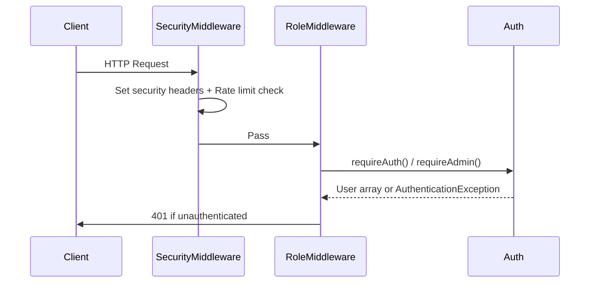

# Security Architecture

## Table of Contents
1. [Purpose](#purpose)
2. [Scope](#scope)
3. [Authentication](#authentication)
4. [Authorization & RBAC](#authorization--rbac)
5. [Session Security](#session-security)
6. [Security Headers](#security-headers)
7. [Rate Limiting](#rate-limiting)
8. [Input Validation](#input-validation)
9. [Password Security](#password-security)
10. [BCDR Security](#bcdr-security)
11. [CSRF Protection](#csrf-protection)
12. [Best Practices](#best-practices)
13. [Anti-Patterns](#anti-patterns)
14. [Traceability Matrix](#traceability-matrix)
15. [Change Log](#change-log)

## Purpose
This document describes the implemented security controls in the Finzo Banking Management System. Every control documented here maps directly to code in the `app/Shared/Security/`, `app/Presentation/Middleware/`, and `config/` directories.

## Scope
Covers: Authentication flow, session management, role-based access control (RBAC), rate limiting, HTTP security headers, input validation, password handling, KYC document security, and encrypted database backups.

## Authentication

Authentication is session-based. There are three distinct login flows, each writing to a dedicated session key:

| Actor | Session Key | Login Route |
|---|---|---|
| Customer | `$_SESSION['user_id']` | `POST /auth/login.php` |
| Staff | `$_SESSION['staff_id']` | `POST /auth/staff-login.php` |
| Admin | `$_SESSION['admin_id']` | `POST /auth/admin-login.php` |

The `Auth` class in `app/Shared/Security/Auth.php` provides static helpers consumed by Middleware:

```php
// Auth::requireAuth() — enforces session and idle timeout
$timeout = 1800; // 30-minute idle timeout
if (isset($_SESSION['last_activity']) && (time() - $_SESSION['last_activity'] > $timeout)) {
    Auth::logout(); // session_unset() + session_destroy()
    throw new AuthenticationException('Session expired. Please log in again.');
}
$_SESSION['last_activity'] = time();
```

### Architectural Flow



> [!NOTE]
> There are **no JWTs** in the current implementation. All authentication is handled via PHP native sessions stored in `storage/sessions/`.

## Authorization & RBAC

Authorization is enforced by the `Gate` class in `app/Shared/Security/Gate.php`. The Gate defines a static policy map:

```php
private static array $policies = [
    'manage_admins' => ['super_admin'],
    'manage_staff'  => ['super_admin', 'admin'],
    'manage_users'  => ['super_admin', 'admin', 'manager', 'staff'],
    'approve_loans' => ['super_admin', 'admin', 'manager'],
    'view_reports'  => ['super_admin', 'admin', 'auditor'],
    'view_audit'    => ['super_admin', 'auditor'],
];
```

Six roles are active: `super_admin`, `admin`, `manager`, `staff`, `auditor`, `customer`. The `super_admin` role bypasses all policy checks unconditionally.

Route-level authorization is enforced by three distinct Middleware classes:
- `AdminAuthMiddleware` — for Admin routes
- `StaffAuthMiddleware` — for Staff routes
- `UserAuthMiddleware` — for Customer routes

## Session Security

Session configuration is applied in two places:

**`config/config.php`** (global startup):
```php
ini_set('session.cookie_httponly', '1');
ini_set('session.cookie_secure', ...); // based on HTTPS detection
ini_set('session.cookie_samesite', 'Lax');
ini_set('session.save_path', STORAGE_PATH . 'sessions');
```

**`SecurityMiddleware`** (per-request enforcement):
```php
session_set_cookie_params([
    'secure'   => true,
    'httponly' => true,
    'samesite' => 'Strict',
    'lifetime' => 1800
]);
```

> [!WARNING]
> The `samesite` value differs between `config.php` (`Lax`) and `SecurityMiddleware` (`Strict`). The Middleware value takes precedence for API routes. Ensure consistency is enforced in the next refactor pass.

## Security Headers

All security headers are emitted by `SecurityMiddleware::handle()` on every request:

| Header | Value |
|---|---|
| `X-Content-Type-Options` | `nosniff` |
| `X-Frame-Options` | `DENY` |
| `Strict-Transport-Security` | `max-age=31536000; includeSubDomains` |
| `X-XSS-Protection` | `1; mode=block` |
| `Content-Security-Policy` | `default-src 'self'; script-src 'self'; object-src 'none'` |
| `Referrer-Policy` | `strict-origin-when-cross-origin` |

## Rate Limiting

Rate limiting uses file-based atomic locking — no Redis required:

```php
// RateLimiter::check() — storage/framework/cache/rate_limits.json
$fp = fopen($file, 'c+');
if (flock($fp, LOCK_EX)) {
    // Sliding window: discard timestamps older than $decayMinutes
    // Reject if count($data[$key]) >= $maxRequests
}
```

Two rate limits are enforced by `SecurityMiddleware`:
- **Global**: 60 requests/minute per IP
- **Auth endpoints** (`/auth/*`): 5 requests per 5 minutes per IP

> [!CAUTION]
> Never use `==` or `===` for comparing cryptographic hashes. Always use `hash_equals()` to prevent timing-based side-channel attacks.

## Input Validation

All requests are validated before reaching controllers. The `Validator` class in `app/Shared/Core/Validation/Validator.php` is called inside FormRequest subclasses. Domain-specific Validators exist for every entity:

- `AuthValidator`, `UserValidator`, `StaffValidator`, `KYCValidator`, `TransactionValidator`, `LoanValidator`, `BranchValidator`

Failures throw a `ValidationException`, which the `ExceptionHandler` catches and serializes as HTTP 422 with an `errors` array.

## Password Security

Passwords are hashed with `PASSWORD_ARGON2ID` via PHP's native `password_hash()`. Brute-force protection is implemented at the application layer using the `system_settings` table:
- `max_failed_login_attempts`: 5 (default, overridable)
- `customer_lockout_duration`: 1800 seconds (30 minutes)

## BCDR Security

Database backups produced by `BcdrManager::backup()` are AES-256 encrypted before being written to `storage/backups/`:

```php
$zip->setEncryptionName($filename, ZipArchive::EM_AES_256, DB_PASS);
```

The password used to encrypt the backup is `DB_PASS`. Backups older than 30 days are automatically deleted by `enforceRetentionPolicy()`.

## CSRF Protection

A dedicated endpoint issues CSRF tokens: `GET /auth/get-csrf-token.php → AuthController::getCsrfToken()`. All state-mutating requests must include this token in the payload.

## Best Practices
- Always call `Auth::requireAuth()` as the first line of any protected controller.
- Use `Gate::authorize('ability')` for permission checks within business logic.
- Store KYC documents in `storage/kyc-documents/` — never inside the `public/` webroot.
- Validate MIME types server-side using PHP `finfo` before accepting any file upload.

> [!TIP]
> The `ResponseBuilder::scrub()` method automatically strips `password`, `password_hash`, `token`, and `reset_token` from all JSON API responses, preventing accidental credential exposure.

## Anti-Patterns
- Calling `Auth::check()` without `Auth::requireAuth()` — `check()` does **not** enforce idle timeout.
- Storing session files outside `storage/sessions/` (violates isolation).
- Using `md5()` or `sha1()` for any password or token comparison.
- Writing KYC document paths to a database with publicly accessible URLs.

## Traceability Matrix

| Standard | Control | Description |
|---|---|---|
| PCI-DSS | Req 8.2.1 | Strong cryptography for credential storage |
| PCI-DSS | Req 6.5.10 | Broken authentication protection |
| OWASP | A02:2021 | Cryptographic Failures |
| OWASP | A07:2021 | Identification and Authentication Failures |
| SOC2 | CC6.1 | Logical access security controls |

## Change Log

| Version | Date | Author | Description |
|---|---|---|---|
| 4.0.0 | 2026-07-22 | InfoSec Team | Phase 4: Full accuracy rewrite from source code audit |
| 3.0.0 | 2026-07-22 | InfoSec Team | Phase 3 Enhancement |