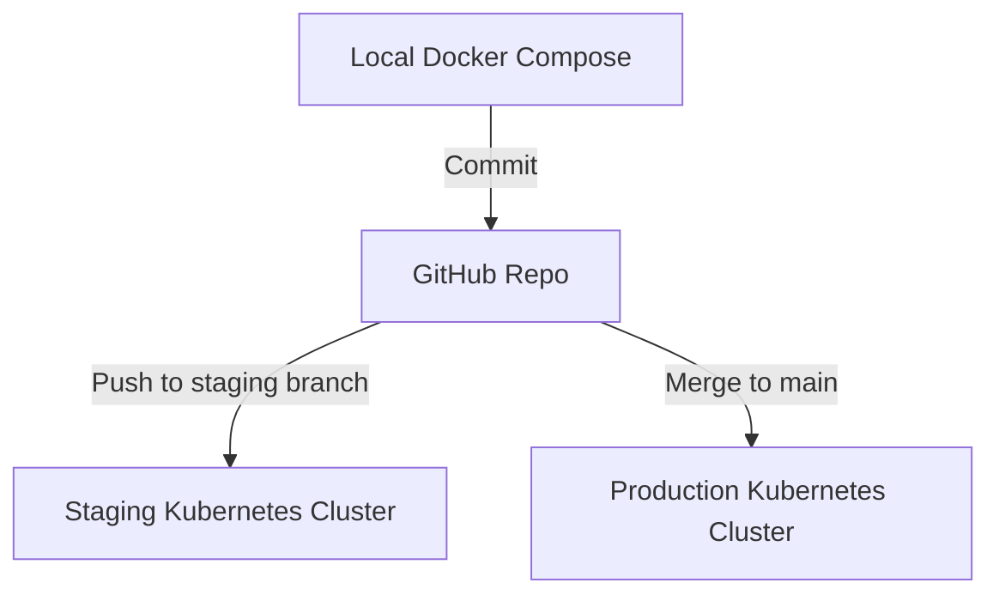
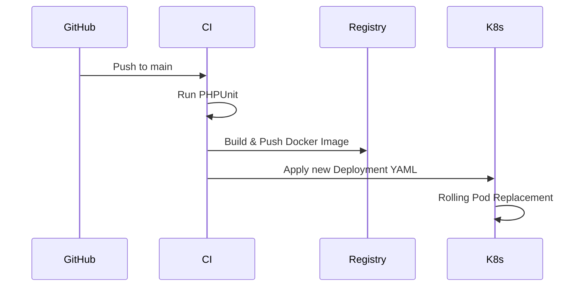

# Deployment Architecture

## Table of Contents
1. [Executive Summary](#executive-summary)
2. [Deployment Overview](#deployment-overview)
3. [Purpose](#purpose)
4. [Scope](#scope)
5. [Deployment Goals](#deployment-goals)
6. [Deployment Strategy](#deployment-strategy)
7. [Infrastructure Overview](#infrastructure-overview)
8. [Environment Architecture](#environment-architecture)
9. [Development Environment](#development-environment)
10. [Testing Environment](#testing-environment)
11. [Staging Environment](#staging-environment)
12. [Production Environment](#production-environment)
13. [Configuration Management](#configuration-management)
14. [Environment Variables](#environment-variables)
15. [Build Process](#build-process)
16. [Deployment Pipeline](#deployment-pipeline)
17. [CI/CD Integration](#cicd-integration)
18. [Docker](#docker)
19. [Docker Compose](#docker-compose)
20. [Containerization](#containerization)
21. [Web Server](#web-server)
22. [Reverse Proxy](#reverse-proxy)
23. [SSL/TLS](#ssltls)
24. [Static Asset Deployment](#static-asset-deployment)
25. [Database Deployment](#database-deployment)
26. [Application Deployment](#application-deployment)
27. [Monitoring](#monitoring)
28. [Logging](#logging)
29. [Backup Strategy](#backup-strategy)
30. [Disaster Recovery](#disaster-recovery)
31. [Rollback Strategy](#rollback-strategy)
32. [High Availability](#high-availability)
33. [Scalability](#scalability)
34. [Infrastructure Security](#infrastructure-security)
35. [Performance](#performance)
36. [Best Practices](#best-practices)
37. [Anti-Patterns](#anti-patterns)
38. [Future Improvements](#future-improvements)
39. [References](#references)
40. [Cross References](#cross-references)
41. [Glossary](#glossary)
42. [Change Log](#change-log)

## Executive Summary
The Finzo Deployment Architecture orchestrates a zero-downtime, immutable, containerized release pipeline via GitHub Actions. Utilizing Blue/Green paradigms, the architecture ensures that broken code is never fully promoted to live routing.

## Deployment Overview
Code merges to `main` trigger an automated build pipeline. The application is packaged into stateless Docker containers, strictly separated by environment (Staging vs. Production), and deployed to Kubernetes clusters or clustered EC2 instances behind application load balancers.

## Purpose
This document provides the DevOps team and Principal Engineers the exact playbook for deploying, scaling, and rolling back the Finzo ecosystem without degrading the end-user experience.

## Scope
The scope covers GitHub Actions CI/CD pipelines, Dockerfile anatomy, Nginx Reverse Proxy routing, SSL/TLS termination, and database migration sequences during live deployments.

## Deployment Goals
1. Zero-Downtime Releases.
2. 100% Immutable Artifacts.
3. Automated Rollbacks on Health Check failure.

## Deployment Strategy
Finzo utilizes **Blue/Green Deployment**. 
- Blue: Currently active production environment.
- Green: Newly deployed, idle environment.
- Traffic is shifted 100% via Load Balancer only after Green passes all smoke tests.

## Infrastructure Overview
Deployed in a cloud-agnostic container orchestration system (AWS EKS or standard Docker Swarm), abstracting hardware failure away from the application state.

## Environment Architecture

## Development Environment
Local developer workstations utilize `docker-compose.yml` to spin up identical mirrors of the production stack (Nginx, PHP-FPM, MySQL, Redis) instantly.

## Testing Environment
Ephemeral environments generated dynamically by CI per Pull Request to execute E2E browser tests (e.g., Cypress or Playwright) against a real database.

## Staging Environment
A persistent, exact replica of Production (scaled down). Connected to an anonymized snapshot of the production database for final QA validation.

## Production Environment
Highly available, multi-AZ Kubernetes cluster actively processing live financial transactions.

## Configuration Management
Configurations are never hardcoded. All settings are resolved dynamically at boot via injected `.env` variables mapped from Kubernetes Secrets.

## Environment Variables
The `.env` file maps external service URIs, Database Passwords, and Cryptographic Salts. 

## Build Process
1. Composer installs PHP dependencies (`--no-dev --optimize-autoloader`).
2. Node/NPM compiles frontend assets via Vite/Webpack.
3. Docker builds the Image.

## Deployment Pipeline

## CI/CD Integration
GitHub Actions orchestrates the entire flow, utilizing OpenID Connect (OIDC) to authenticate with AWS/GCP without storing static, long-lived IAM keys in GitHub Secrets.

## Docker
The `Dockerfile` is based on Alpine Linux to minimize the attack surface and image size. It explicitly drops `root` privileges, executing the PHP-FPM daemon as `www-data`.

## Docker Compose
Used exclusively for local development, mounting host directories as volumes to allow hot-reloading without rebuilding images.

## Containerization
Containers are treated as cattle, not pets. If a container hangs, Kubernetes kills it and spins up a replacement. 

## Web Server
Nginx operates as the primary web server, handling static file serving directly and proxying `*.php` requests to PHP-FPM via FastCGI.

## Reverse Proxy
An AWS Application Load Balancer (ALB) or Cloudflare sits in front of the Nginx containers, acting as a reverse proxy, terminating external HTTP/2 connections.

## SSL/TLS
TLS 1.2+ is terminated at the Load Balancer. Internal traffic between the Load Balancer and Nginx is unencrypted (or utilizes mTLS in a strict Service Mesh). Certificates are auto-renewed via AWS ACM or Let's Encrypt.

## Static Asset Deployment
Frontend assets are compiled, fingerprinted (`app.v1.js`), and pushed to an S3 bucket fronted by a CDN, completely bypassing Nginx for asset delivery.

## Database Deployment
Schema migrations (`php artisan migrate --force`) execute via a Kubernetes `Job` *before* the new Pods boot. Migrations must be strictly additive to prevent crashing the old active Pods.

## Application Deployment
Kubernetes orchestrates a Rolling Update. It starts a new Pod, waits for the readiness probe, routes traffic to it, and then terminates an old Pod.

## Monitoring
Datadog agents run as DaemonSets, scraping container logs and APM metrics dynamically as pods scale up and down.

## Logging
Docker logs (`stdout`/`stderr`) are consumed by Fluent-Bit and pushed to a centralized ELK cluster.

## Backup Strategy
Database runs automated continuous snapshots. File storage buckets enforce strict Versioning.

## Disaster Recovery
Cross-region failover. Infrastructure-as-Code (Terraform) allows a complete redeployment of the cluster to a new AWS region within 10 minutes.

## Rollback Strategy
If the Green deployment health check fails, the Load Balancer preserves routing to Blue. If failure is detected post-deployment, `kubectl rollout undo deployment/finzo-app` instantly reverts to the previous Docker image.

## High Availability
The cluster spans 3 Availability Zones. Auto-Scaling groups ensure physical node availability.

## Scalability
Horizontal Pod Autoscaler (HPA) tracks CPU > 70% and dynamically injects new Pods.

## Infrastructure Security
No SSH access to nodes. Firewalls drop all traffic not originating from the Load Balancer. 

## Performance
Brotli compression, OpCache preloading, and CDN edge caching maximize TTFB (Time to First Byte).

## Best Practices
Always pin Docker base image hashes (e.g., `php:8.2-fpm-alpine@sha256:...`) instead of using `latest` to prevent upstream poisoning.

## Anti-Patterns
Executing `composer update` inside a production container instead of building an immutable artifact in CI.

### The Immutable Build Artifact
Finzo categorically rejects the "git pull on production" anti-pattern.
- A deployment artifact is a completely self-contained Docker Image.
- During the CI phase, `composer install` is executed, and all `.php` files are baked directly into the image filesystem.
- The image is tagged with the Git Commit SHA (e.g., `finzo/app:a1b2c3d`) and pushed to the Elastic Container Registry (ECR).
- When a deployment occurs, Kubernetes simply pulls the pre-compiled image. This guarantees that Staging and Production run the exact same binary bits, eliminating "it works on my machine" anomalies.

### Automated Database Migrations in CI/CD
Deploying code is stateless; deploying database schemas is highly stateful and dangerous.
- **The Problem**: If a deployment takes 2 minutes to roll out across 50 servers, old code and new code will be accessing the database simultaneously.
- **The Finzo Rule**: Migrations must be backward-compatible.
- **Execution**: The CI/CD pipeline triggers a Kubernetes `Job` to run `php artisan migrate`. This job executes *before* the rolling update begins.
- If the migration requires dropping a column, it MUST be split into two deployments. Deployment 1 removes the code dependency on the column. Deployment 2 (weeks later) actually drops the column. This strict discipline guarantees zero-downtime during live financial trading hours.

### Readiness and Liveness Probes
Kubernetes needs to know exactly when a new container is ready to accept traffic.
- **Liveness Probe**: A ping to `/api/health`. If PHP-FPM crashes entirely and returns a 502, Kubernetes kills the Pod and restarts it.
- **Readiness Probe**: A deeper ping that actually tests the MySQL and Redis connections. During a deployment, Kubernetes boots the new container but holds it in "Pending" status until the Readiness Probe returns a 200 OK. Only then is it added to the Load Balancer target group.

### Emergency Rollback Execution (The Red Button)
If a deployment bypasses QA and introduces a critical defect into Production:
- Reverting the Git commit and waiting 10 minutes for the CI/CD pipeline to rebuild the image is too slow.
- The DevOps team executes a rollback directly via the deployment orchestrator (e.g., ArgoCD or Kubernetes native rollback).
- This instructs the cluster to instantly pull the *previous* Docker Image tag (which is already cached on the node) and instantly swap the pods, restoring the application to a known-good state within 5 seconds.
- Database rollbacks (`migrate:rollback`) are strictly avoided unless absolutely necessary, as rolling back a database risks destroying user transactions created during the flawed deployment window.

## Future Improvements
Implement Canary Deployments (routing 5% of traffic to the new release to monitor error rates before full promotion).

## References
- Kubernetes Documentation
- 12 Factor App Methodology

## Cross References
- [Infrastructure Architecture](Infrastructure-Architecture.md)

## Glossary
- **HPA**: Horizontal Pod Autoscaler.

## Change Log
| Version | Date | Author | Description |
|---|---|---|---|
| 1.0.0 | 2026-07-22 | DevOps Team | Phase 9 Deployment Architecture |

### Zero-Downtime Cache Warmup
Restarting the PHP-FPM service clears the OpCache, meaning the first few requests to the new container will suffer severe latency spikes while the framework recompiles.
- Finzo mitigates this via a Cache Warmup script executed during the Docker build phase.
- The Dockerfile runs php artisan optimize, which compiles all routes, configuration files, and dependency injection container bindings into highly optimized PHP arrays.
- Furthermore, a preload script (preload.php) is configured in the php.ini. When PHP-FPM boots, it automatically loads the core Finzo classes directly into RAM before accepting the first HTTP connection, guaranteeing sub-50ms TTFB instantly upon deployment.

