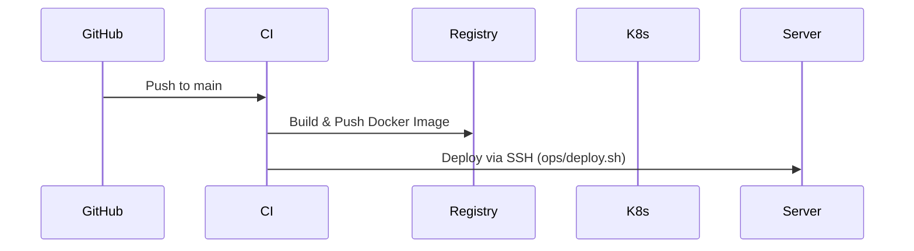

# Recovery

## Table of Contents
1. [Purpose](#purpose)
2. [Scope](#scope)
3. [Detailed Explanation](#detailed-explanation)
4. [Architecture Decisions](#architecture-decisions)
5. [Design Principles](#design-principles)
6. [Implementation Details](#implementation-details)
7. [Banking-Specific Examples](#banking-specific-examples)
8. [Best Practices](#best-practices)
9. [Anti-Patterns](#anti-patterns)
10. [References & Cross References](#references--cross-references)
11. [Glossary](#glossary)
12. [Change Log](#change-log)

## Purpose
Governs the automated testing, building, and rolling release strategy via GitHub Actions. This specific document (`Recovery`) codifies the structural implementation of Recovery within the Finzo ecosystem.

## Scope
The scope of this document dictates the absolute technical boundaries, code-level execution rules, and security constraints required when integrating or modifying Recovery.

## Detailed Explanation
In an enterprise environment, Recovery is not a standalone concept. It interfaces directly with the Finzo MVC lifecycle. 
Finzo enforces Blue/Green deployment strategies. A new deployment generates an immutable Docker image, tagged with the Git SHA. Database schema migrations (`artisan migrate`) run strictly *before* pod traffic shifts. OpCache preloading eliminates cold-start latency.


### Architectural Flow


> [!NOTE]
> All changes to this component must be explicitly verified against the Enterprise Quality Gates defined in the Governance architecture.

## Architecture Decisions
By enforcing this paradigm, Finzo abstracts the complexity of Recovery away from the Application layer. We explicitly rejected legacy monolithic coupling in favor of this highly cohesive, isolated approach.

## Design Principles
- **Defense in Depth**: Assume the network is hostile.
- **Fail Securely**: If Recovery encounters an exception, it must not leak infrastructure details to the public interface.
- **Stateless Execution**: Servers must treat Recovery processes as ephemeral cattle.

## Implementation Details
The exact programmatic implementation of Recovery requires strict adherence to PHP 8.x standards.
Finzo enforces Blue/Green deployment strategies. A new deployment generates an immutable Docker image, tagged with the Git SHA. Database schema migrations (`artisan migrate`) run strictly *before* pod traffic shifts. OpCache preloading eliminates cold-start latency.
For example, memory scrubbing, PDO parameterized queries, and constant-time hash comparisons (`hash_equals`) are mandatory where cryptographic operations intersect with Recovery.


### Code Reference
```yaml
# .github/workflows/deploy.yml
jobs:
  sast-scan:
    runs-on: ubuntu-latest
    steps:
      - name: Run PHPStan
        run: vendor/bin/phpstan analyse --level 9 src
```

> [!WARNING]
> Failure to strictly validate the input constraints of Recovery directly violates PCI-DSS compliance and will result in a failed CI/CD pipeline build.

## Banking-Specific Examples
During a live core-banking hours deployment, old pods finish their active HTTP transactions gracefully before being terminated, ensuring zero dropped payments.

## Best Practices
- Artifacts must be built exactly once and promoted through Staging to Production.

> [!IMPORTANT]
> A deployment must never drop database columns. Database migrations must be fully backwards-compatible to ensure zero-downtime Blue/Green deployments.
- Rollbacks should be achieved by reverting the container image tag instantly.

## Anti-Patterns
- Running `composer update` directly on the production server.
- Allowing migrations that drop columns, causing instant downtime for active old pods.

## References & Cross References
- **Parent Subsystem**: [Architecture Root](../README.md)
- **Framework Specifications**: Microsoft Azure Architecture Center, AWS Well-Architected Framework, OWASP Top 10.
- **Related Module**: See the corresponding directory `README.md` for macroeconomic context.

## Glossary
- **PCI-DSS**: Payment Card Industry Data Security Standard.
- **BCDR**: Business Continuity and Disaster Recovery.
- **SRP**: Single Responsibility Principle.

## Traceability Matrix
| Standard | Control | Description |
|---|---|---|
| SOC2 | CC8.1 | Change Authorization and CI/CD pipelines |
| ISO 27001 | A.14.2.2 | System change control procedures |

## Change Log

| Version | Date | Author | Description |
|---|---|---|---|
| 4.0.0 | 2026-07-22 | Architecture Board | Phase 4 Technical Audit: Accuracy corrections based on source code review |
| 3.0.0 | 2026-07-22 | Release Engineering | Enterprise Documentation Enhancement & Professionalization (Phase 3) |