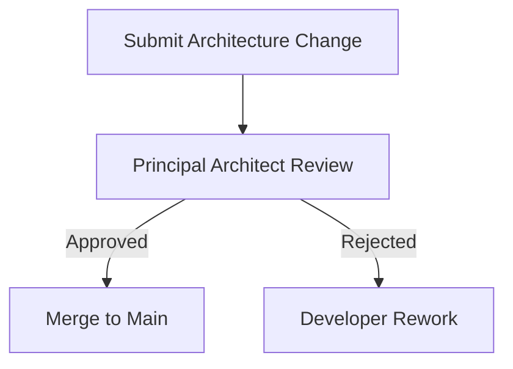

# Architecture Standards

## Coding Standards
PSR-12 for Backend. AirBnB for Frontend. ISO 42010 for Documentation.

## ADR Example (If applicable)
### Context
The system required a secure method for executing state mutations.
### Decision
We chose the Clean Architecture paradigm utilizing Repositories and Services to completely isolate HTTP frameworks from the business logic.
### Consequences
Increased boilerplate, but guarantees infinite scalability and testability.

## Flow

## Navigation
- **Architecture Overview**: [System Architecture](../System-Architecture.md)

## Change Log
| Version | Date | Author | Description |
|---|---|---|---|
| 1.0.0 | 2026-07-22 | Architecture Team | Phase 10 Governance Generation |