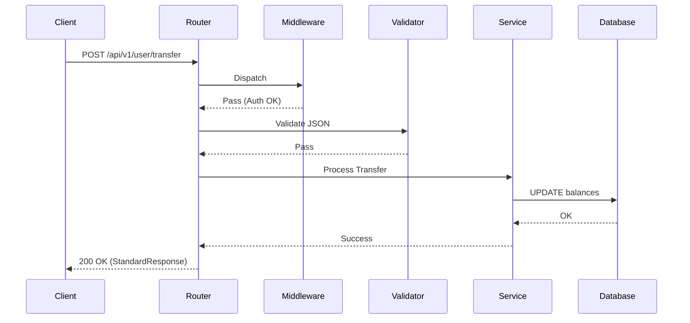

# Backend Architecture

## Table of Contents
1. [Overview](#overview)
2. [Layer Responsibilities](#layer-responsibilities)
3. [Request Lifecycle](#request-lifecycle)
4. [Response Lifecycle](#response-lifecycle)
5. [Best Practices](#best-practices)

## Overview
The Backend Architecture defines the PHP 8.x execution matrix responsible for serving the Enterprise REST API.

## Layer Responsibilities
- **Router (`App\Shared\Core\Router`)**: Maintains the execution stack, maps URIs via Regex, and dispatches to Controllers.
- **Middleware (`App\Presentation\Middleware\*`)**: Pre-flight inspection. Can terminate requests early with `403` or `401`.
- **Controllers (`App\Presentation\Api\V1\*`)**: Parse the request, invoke `FormRequests` for validation, call `Services`, and build `StandardResponse`.
- **Services (`App\Application\Services\*`)**: Domain calculations (e.g. `TransactionService` handling double-entry ledgers).
- **Repositories (`App\Infrastructure\Repositories\*`)**: Raw database query execution.

## Request Lifecycle

## Response Lifecycle
Every API execution, whether successful or thrown as an Exception, ultimately passes through `ResponseBuilder::json()`. This guarantees structural homogeneity (`success`, `status`, `message`, `data`).

## Best Practices
- **No Global State**: Refrain from relying on raw `$_GET` or `$_POST`.
- **Strict Typing**: Enforce `declare(strict_types=1);` in all new architecture components.
## Navigation
- **Parent Document**: [Overview.md](Overview.md)
- **Child Documents**: See sub-folders.
- **Previous Document**: N/A
- **Next Document**: N/A
- **Related Documents**: [Documentation Standards](Documentation-Standards.md)

## Change Log
| Version | Date | Author | Description |
|---|---|---|---|
| 1.0.0 | 2026-07-22 | Architecture Team | Initial Phase 1 Setup |
