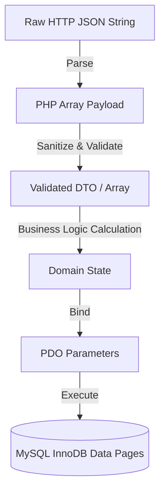

# Data Flow

## Table of Contents
1. [Overview](#overview)
2. [Data Lifecycle](#data-lifecycle)

## Overview
This document visually represents the physical state changes of data structures as they migrate from external network borders deep into the database repository.

## Data Lifecycle

## Navigation
- **Parent Document**: [Overview.md](Overview.md)
- **Child Documents**: See sub-folders.
- **Previous Document**: N/A
- **Next Document**: N/A
- **Related Documents**: [Documentation Standards](Documentation-Standards.md)

## Change Log
| Version | Date | Author | Description |
|---|---|---|---|
| 1.0.0 | 2026-07-22 | Architecture Team | Initial Phase 1 Setup |
