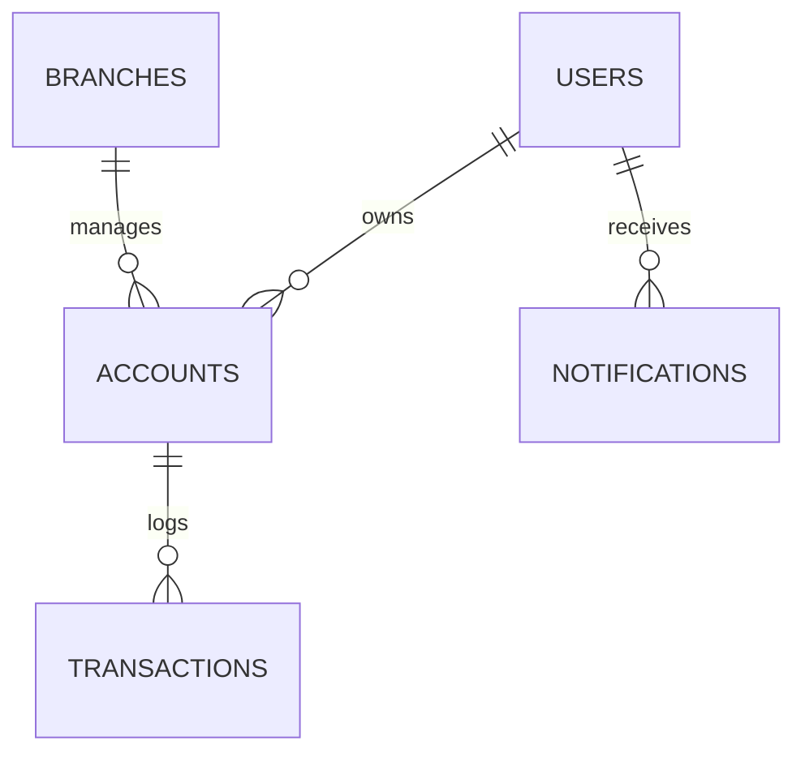

# Database Architecture

## Table of Contents
1. [Design Principles](#design-principles)
2. [ER Relationships](#er-relationships)
3. [Transactions](#transactions)
4. [Indexes and Performance](#indexes-and-performance)
5. [Migration Strategy](#migration-strategy)

## Design Principles
The schema enforces 3rd Normal Form (3NF). Data consistency is strictly maintained at the engine level (InnoDB) utilizing Foreign Key constraints and `ON DELETE CASCADE` appropriately.

## ER Relationships

## Transactions
Database interactions that modify multiple tables (e.g., executing a monetary transfer between two accounts) MUST be wrapped in PDO Transactions (`beginTransaction()`, `commit()`, `rollBack()`) natively exposed by the `Database::getInstance()` connector.

## Indexes and Performance
- `idx_user_email`: Unique index guaranteeing auth identity integrity.
- `idx_account_number`: Unique index accelerating transfer lookups.
- `idx_transaction_created`: Accelerates historical statement generation.

## Migration Strategy
The `phinx` package manages schema versioning via timestamped migration files residing in `db/migrations`. Manual structural alterations are heavily prohibited.
## Navigation
- **Parent Document**: [Overview.md](Overview.md)
- **Child Documents**: See sub-folders.
- **Previous Document**: N/A
- **Next Document**: N/A
- **Related Documents**: [Documentation Standards](Documentation-Standards.md)

## Change Log
| Version | Date | Author | Description |
|---|---|---|---|
| 1.0.0 | 2026-07-22 | Architecture Team | Initial Phase 1 Setup |
