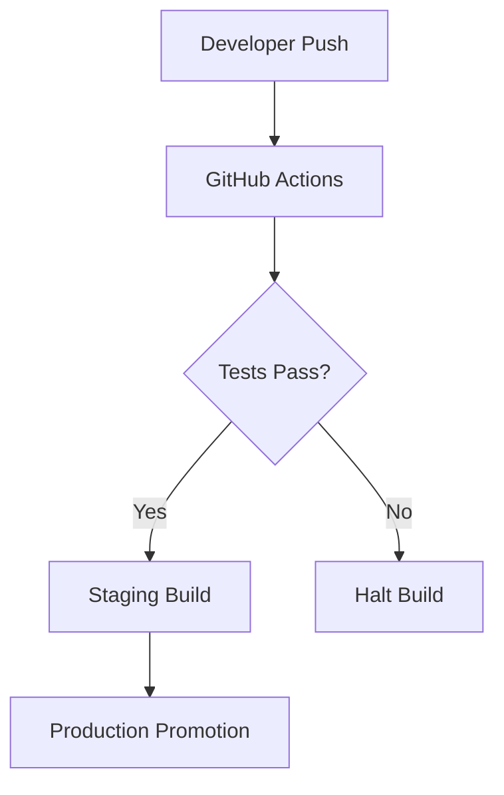

# Deployment Architecture

## Table of Contents
1. [Overview](#overview)
2. [CI/CD Pipeline](#cicd-pipeline)
3. [Environment Variables](#environment-variables)
4. [Deployment Flow](#deployment-flow)
5. [Rollback Strategy](#rollback-strategy)

## Overview
The CI/CD pipeline enforces automated testing, security validation, and safe promotion into production environments.

## CI/CD Pipeline
GitHub Actions (`.github/workflows/ci.yml`) is the primary integration engine.
- **Trigger**: Push to `main` or `develop`.
- **Stages**:
  1. Spin up Ubuntu latest.
  2. Provision MySQL 8 container.
  3. Execute `vendor/bin/phinx migrate` to construct the schema.
  4. Run `vendor/bin/phpunit` for isolated unit and integration assertion.

## Environment Variables
The application relies strictly on `.env` parsing (`App\Shared\Core\Config::get()`). Critical keys include:
- `DB_HOST`, `DB_USER`, `DB_PASS`, `DB_NAME`
- `APP_ENV`, `APP_DEBUG`

## Deployment Flow

## Rollback Strategy
Because the database relies on structured Phinx migrations, rollbacks execute `vendor/bin/phinx rollback -t <target>` followed by an immutable container/code revision swap.