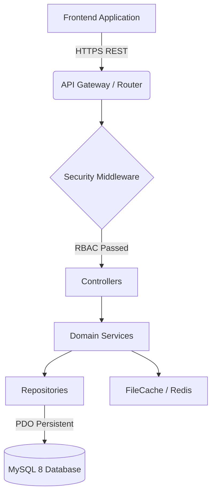

# Architecture Overview

## Table of Contents
1. [Purpose](#purpose)
2. [Scope](#scope)
3. [Architecture Overview](#architecture-overview)
4. [Design Goals](#design-goals)
5. [Business Rules](#business-rules)
6. [Cross References](#cross-references)

## Purpose
The Finzo Enterprise Banking Management System Architecture documentation defines the structural layout, communication boundaries, and technical constraints of the Finzo platform. It serves as the baseline for all subsequent design and implementation decisions.

## Scope
This document covers the high-level topological layout of the frontend presentation layer, backend API engine, persistence layer, and the strict security middleware bounding these tiers.

## Architecture Overview
Finzo utilizes a heavily isolated **Clean Architecture** topology built over a customized PHP 8 runtime. The frontend communicates with the backend exclusively via an enterprise REST API over HTTPS. 

## Design Goals
- **Zero-Trust Boundaries**: Ensure no data enters business logic without rigorous FormRequest validation.
- **Strict Decoupling**: Isolate persistence (Repositories) from logic (Services) and routing (Controllers).
- **High Concurrency**: Leverage persistent PDO connections and atomic filesystem-based locks for rate limiting and settings caching.

## Business Rules
- No raw database access is permitted outside `Infrastructure/Repositories`.
- Controllers may not house business logic.
- Validation must be deferred to isolated `FormRequest` class evaluations.

## Cross References
- [System Architecture](System-Architecture.md)
- [Backend Architecture](Backend-Architecture.md)
## Navigation
- **Parent Document**: [Overview.md](Overview.md)
- **Child Documents**: See sub-folders.
- **Previous Document**: N/A
- **Next Document**: N/A
- **Related Documents**: [Documentation Standards](Documentation-Standards.md)

## Change Log
| Version | Date | Author | Description |
|---|---|---|---|
| 1.0.0 | 2026-07-22 | Architecture Team | Initial Phase 1 Setup |
