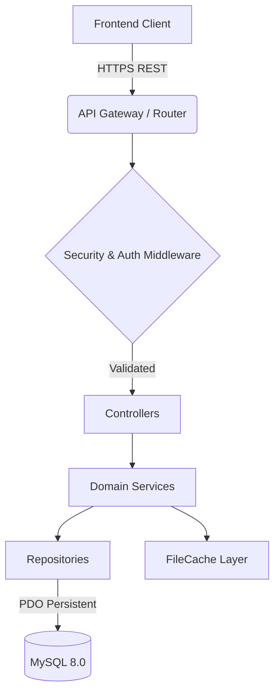

# Enterprise Architecture Overview

## Table of Contents
1. [Executive Summary](#executive-summary)
2. [Introduction](#introduction)
3. [Purpose](#purpose)
4. [Scope](#scope)
5. [Audience](#audience)
6. [Project Vision](#project-vision)
7. [Business Goals](#business-goals)
8. [Functional Overview](#functional-overview)
9. [Non-Functional Goals](#non-functional-goals)
10. [High-Level Architecture](#high-level-architecture)
11. [Documentation Map](#documentation-map)
12. [Reading Guide](#reading-guide)
13. [Technology Summary](#technology-summary)
14. [Module Summary](#module-summary)
15. [Navigation](#navigation)
16. [Cross References](#cross-references)
17. [Glossary](#glossary)
18. [References](#references)
19. [Change Log](#change-log)

## Executive Summary
The Finzo Enterprise Banking Management System provides a highly concurrent, zero-trust financial platform designed to manage customer accounts, branch operations, and immutable transactional ledgers. By migrating from a legacy RPC paradigm to a strict, standard-compliant RESTful architecture, the system guarantees determinism and infinite horizontal scalability.

## Introduction
Modern banking necessitates absolute data integrity, sub-second latency, and impenetrable security perimeters. Finzo addresses these enterprise requirements by decoupling its persistence layers from its business logic, strictly adhering to Clean Architecture principles.

## Purpose
This document serves as the macroscopic entry point for understanding the Finzo topological ecosystem. It establishes the baseline vocabulary and structural boundaries that are explored in depth throughout the remaining documentation suite.

## Scope
The scope of this document encompasses the entire application boundary:
- The Presentation Tier (Frontend & API Gateways).
- The Application Engine (Services & Domain Constraints).
- The Data Persistence Tier (MySQL & Atomic FileCache).

## Audience
This material is curated for:
- **Enterprise Architects**: Validating topological decisions.
- **Backend Engineers**: Understanding boundary contexts before modifying domain logic.
- **Security Engineers**: Auditing threat models and middleware perimeters.
- **DevOps Engineers**: Mapping CI/CD pipelines and caching mechanisms.

## Project Vision
To deliver a resilient, cloud-agnostic banking infrastructure that natively protects customer assets while providing frictionless onboarding for both staff operators and end-users.

## Business Goals
1. **Zero-Loss Transactions**: Guarantee financial integrity across concurrent execution threads.
2. **Regulatory Compliance**: Centralize KYC document retention and strictly audit staff access.
3. **Operational Efficiency**: Reduce API latency through aggressive memory caching.

## Functional Overview
Finzo provides:
- **Account Management**: Frictionless creation and management of user accounts.
- **Ledger Operations**: Double-entry execution of intra-bank transfers.
- **Branch Management**: Hierarchical oversight of regional banking hubs.
- **Security Access**: Granular Role-Based Access Control (RBAC).

## Non-Functional Goals
- **Availability**: Target 99.99% uptime via stateless API design.
- **Performance**: Sub-100ms response times for non-I/O bound endpoints.
- **Security**: Mitigate OWASP Top 10 vectors natively within the execution pipeline.

## High-Level Architecture

## Documentation Map
The documentation is hierarchically structured:
- `01-System`: Macroscopic architectures.
- `03-Backend`: Engine mechanics.
- `04-Database`: Schema constraints.
- `05-API`: REST specifications.

## Reading Guide
Readers should begin with this `Overview.md` and transition into `System-Architecture.md`. Developers writing features should consult `Software-Architecture.md` to understand dependency injection constraints.

## Technology Summary
- **Runtime**: PHP 8.x
- **Storage**: MySQL 8.0 (InnoDB)
- **Web Server**: Apache / Nginx
- **Architecture**: MVC + Clean Architecture

## Module Summary
- **Public**: Health checks and unauthenticated telemetry.
- **Admin**: Superuser controls and system configurations.
- **Staff**: Operational overrides and KYC audits.
- **User**: Financial interaction surface.

## Navigation
- **Parent Document**: None (Root)
- **Child Documents**: [01-System/Module-Overview.md](01-System/Module-Overview.md)
- **Previous Document**: None
- **Next Document**: [System-Architecture.md](System-Architecture.md)
- **Related Documents**: [Documentation Standards](Documentation-Standards.md)

## Cross References
- [System Architecture](System-Architecture.md)
- [Software Architecture](Software-Architecture.md)

## Glossary
- **RBAC**: Role-Based Access Control.
- **DTO**: Data Transfer Object.
- **PDO**: PHP Data Objects.

## References
- Clean Architecture (Robert C. Martin)
- Domain-Driven Design (Eric Evans)

## Change Log
| Version | Date | Author | Description |
|---|---|---|---|
| 1.0.0 | 2026-07-22 | Architecture Team | Initial Phase 2 System Overview Generation |
