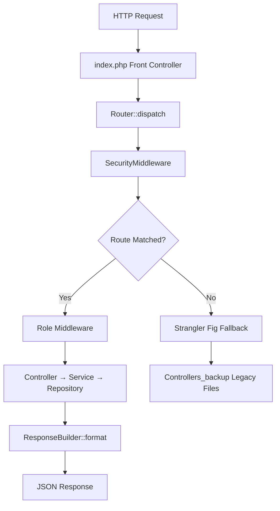

# Finzo Enterprise Architecture Documentation

> A PHP 8.x banking management system built on Clean Architecture principles, serving three distinct user roles: Customer, Staff, and Admin.

## Table of Contents
1. [System Overview](#system-overview)
2. [Architecture Philosophy](#architecture-philosophy)
3. [Technology Stack](#technology-stack)
4. [Folder Navigation](#folder-navigation)
5. [Key Design Decisions](#key-design-decisions)
6. [Quick Reference](#quick-reference)

## System Overview

Finzo is an enterprise banking management system implemented in PHP 8.x. The system manages the full lifecycle of a retail banking operation: customer onboarding (KYC), account management, fund transfers, loan processing, staff administration, and regulatory audit trails.

The application runs on an Apache/PHP-FPM stack (XAMPP for development), backed by a MySQL 8.x relational database. All HTTP traffic is routed through a single Front Controller (`index.php`) that dispatches to a custom `Router` class in `app/Shared/Core/Router.php`.

## Architecture Philosophy

Finzo enforces a strict four-layer Clean Architecture:

| Layer | Namespace | Responsibility |
|---|---|---|
| **Presentation** | `App\Presentation` | HTTP parsing, Middleware, Validators, Controllers |
| **Application** | `App\Application` | Services, FormRequests, Events, Jobs |
| **Infrastructure** | `App\Infrastructure` | Repositories, PDO queries, File I/O |
| **Domain** | `App\Domain` | Entities (User, Account, Branch, Transaction) |
| **Shared/Core** | `App\Shared` | Router, Auth, Gate, RateLimiter, Exceptions |

Dependencies flow strictly inward: Presentation → Application → Infrastructure → Domain. No layer imports from a higher layer.

## Technology Stack

| Component | Technology | Notes |
|---|---|---|
| Language | PHP 8.x | Strict typing enforced |
| Web Server | Apache 2.4 / Nginx | `.htaccess` routing to `index.php` |
| Database | MySQL 8.x | `utf8mb4`, strict mode |
| Session | PHP native sessions | File-based, `storage/sessions/` |
| Rate Limiting | File-based (`flock()`) | `storage/framework/cache/rate_limits.json` |
| Caching | FileCache | `storage/framework/cache/` |
| Email | PHPMailer (SMTP TLS) | Gmail SMTP, port 587 |
| PDF | DOMPDF | Statement and receipt generation |
| Auth | Session-based (web) | `$_SESSION[user_id/admin_id/staff_id]` |
| BCDR | Native `mysqldump` + ZipArchive AES-256 | `database/BcdrManager.php` |

## Folder Navigation

| Phase | Subsystem | Description |
|---|---|---|
| [01-System](01-System/README.md) | System Boundaries | Macro architecture, module boundaries, technology constraints |
| [02-Software](02-Software/README.md) | Software Patterns | Clean Architecture, DI, SOLID, request lifecycle |
| [03-Frontend](03-Frontend/README.md) | Frontend | HTML/CSS/JS structure, design system, accessibility |
| [04-Backend](04-Backend/README.md) | Backend Core | Controller/Service/Repository, FormRequests, Events |
| [05-Database](05-Database/README.md) | Database | Schema, constraints, BCDR, transactions |
| [06-API](06-API/README.md) | API Layer | REST routing, response format, error handling, rate limiting |
| [07-Infrastructure](07-Infrastructure/README.md) | Infrastructure | Configuration, caching, file storage, email, logging |
| [08-Security](08-Security/README.md) | Security | Auth, RBAC, Gate policies, CSRF, sessions, headers |
| [09-Deployment](09-Deployment/README.md) | Deployment | ops/deploy.sh, rollback.sh, environment setup |
| [10-Governance](10-Governance/README.md) | Governance | ADRs, quality gates, change management |
| [11-Diagrams](11-Diagrams/README.md) | Diagrams | System-wide Mermaid architecture diagrams |

## Key Design Decisions

### ADR-001: Session-Based Authentication (Not JWT)
Finzo uses PHP native sessions for web authentication. JWTs were rejected because they add complexity (token refresh, blacklisting) without meaningful benefit for a server-rendered or tightly-coupled SPA backend where session stickiness is acceptable.

### ADR-002: File-Based Rate Limiting (Not Redis)
The `RateLimiter` class uses PHP `flock()` on a JSON file. Redis was considered but excluded to avoid mandatory infrastructure dependencies for on-premise deployments.

### ADR-003: Strangler Fig Pattern for Legacy Migration
The Router supports a fallback to `Controllers_backup/` files. This allows incremental refactoring of legacy procedural controllers into the Clean Architecture pattern without a risky big-bang rewrite.

### ADR-004: Database as Single Source of Truth
No in-memory object store. All state mutations write directly to MySQL with ACID transactions. The `BaseRepository` wraps `beginTransaction()`, `commit()`, and `rollBack()` explicitly.

## Quick Reference

| Concept | Implementation |
|---|---|
| CSRF Token | `AuthController::getCsrfToken()` → `GET /auth/get-csrf-token.php` |
| Session expiry | 30 minutes of inactivity (`Auth::requireAuth()`) |
| Max login attempts | 5 (configurable via `system_settings` table) |
| Lockout duration | 30 minutes (`LOCKOUT_DURATION = 1800`) |
| KYC documents | Stored in `storage/kyc-documents/` (outside webroot) |
| Account prefix | `FNZ` + sequential number |
| Daily transfer limit | ₹10,000 (configurable) |
| Backup retention | 30 days (`BcdrManager::enforceRetentionPolicy()`) |

## Change Log

| Version | Date | Author | Description |
|---|---|---|---|
| 4.0.0 | 2026-07-22 | Architecture Board | Phase 4 Audit: Full accuracy rewrite, ADRs, real tech stack |
| 3.0.0 | 2026-07-22 | Architecture Board | Phase 3 Enhancement: Diagrams, Traceability |
| 2.0.0 | 2026-07-22 | Architecture Board | Phase 2 Initial Enterprise Rewrite |