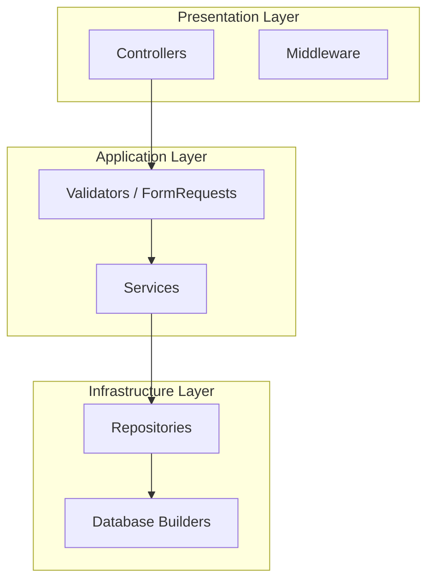

# Software Architecture

## Table of Contents
1. [Architecture Pattern](#architecture-pattern)
2. [Clean Architecture Implementation](#clean-architecture-implementation)
3. [SOLID Principles](#solid-principles)
4. [Folder Structure](#folder-structure)
5. [Exception Handling](#exception-handling)

## Architecture Pattern
The platform operates on a rigid interpretation of **Clean Architecture** (originating from Uncle Bob), heavily favoring inversion of control and separation of concerns.



## Clean Architecture Implementation
- **Presentation**: Translates HTTP semantics to Domain concepts.
- **Application**: The core banking logic. It remains entirely agnostic to HTTP or HTML.
- **Infrastructure**: Handles disk I/O, DB interactions, and caching.

## SOLID Principles
- **SRP**: E.g., `ApiQueryBuilder` handles *only* dynamic SQL construction.
- **OCP**: Middleware pipelines are dynamically extensible without modifying the `Router`.
- **DIP**: High-level services inject repositories rather than instantiating them directly.

## Folder Structure
```text
app/
├── Application/       # Logic (Services, Requests, DTOs)
├── Domain/            # Core models and entities
├── Infrastructure/    # Database, Repositories
├── Presentation/      # Controllers, Middleware, APIs
└── Shared/            # Core utilities (Cache, Router, Docs)
```

## Exception Handling
All exceptions bubble up to a unified `ExceptionHandler` located in `App\Shared\Core\Exceptions`. Raw stack traces are strictly prohibited from entering HTTP response streams.