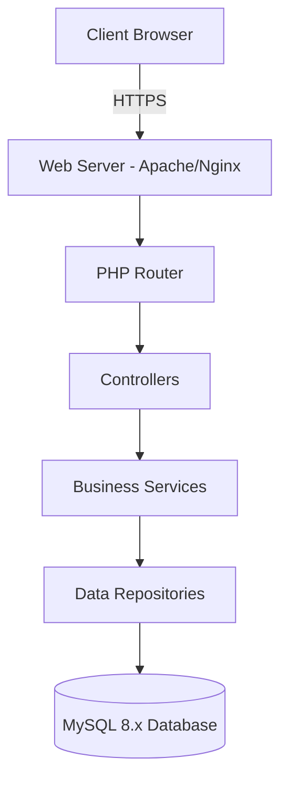

# System Architecture

## Metadata
- **Version:** 1.0.0
- **Status:** Approved
- **Owner:** Finzo Architecture Team
- **Last Updated:** July 2026
- **Related Documents:** [FEPS Core](../00-FEPS/00-Foundation/Chapter-00-Foundation.md)

## Purpose
To define the official System Architecture for the Finzo Banking Management System.

---

### Overview
Finzo follows a modular monolithic architecture, optimized for security and maintainability in a traditional shared-hosting or VPS environment.

### Component Diagram

---

## Revision History
| Version | Date | Author | Summary |
|---------|------|--------|---------|
| 1.0.0 | July 2026 | Architect | Initial creation |

## References
- FEPS Standards
