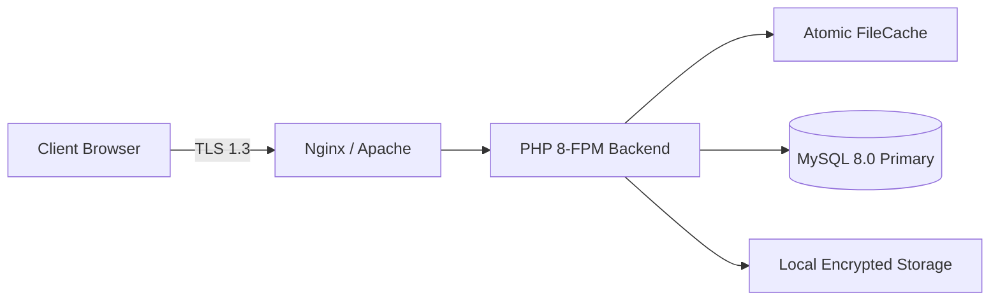

# System Architecture

## Table of Contents
1. [Purpose](#purpose)
2. [Overall Architecture](#overall-architecture)
3. [Module Relationships](#module-relationships)
4. [Data Flow](#data-flow)
5. [Security Layers](#security-layers)
6. [Technology Stack](#technology-stack)
7. [Cross References](#cross-references)

## Purpose
Details the macroscopic execution flow of the Finzo application across infrastructure barriers.

## Overall Architecture
The system employs a classic decoupled client-server architecture with a stateless API tier enforcing RESTful constraints.

## Module Relationships
- **Public**: Stats and unauthenticated endpoints.
- **Admin**: System-wide configuration, Branch, and Staff management.
- **Staff**: Direct customer operations and KYC processing.
- **User**: Financial operations, profile management, and history.

## Data Flow
Requests ingress through `public/index.php`, immediately delegating to `App\Shared\Core\Router`. Middleware intercepts for CORS, Rate-Limiting, and Security Headers before handing off to the designated Controller.

## Security Layers
1. **Network Layer**: TLS 1.3 enforced.
2. **Application Layer**: Rate limiting (120 req/min).
3. **Identity Layer**: Cryptographic Bearer/Session dual-authentication.
4. **Data Layer**: PDO Prepared Statements (SQLi mitigation) and `HtmlPurifier` (XSS mitigation).

## Technology Stack
- **Language**: PHP 8.x (Strict Types Enabled)
- **Database**: MySQL 8.0 (InnoDB)
- **Web Server**: Apache / Nginx compatible
- **Frontend**: Vanilla CSS / JavaScript (decoupled from API)

## Cross References
- [Deployment Architecture](Deployment-Architecture.md)