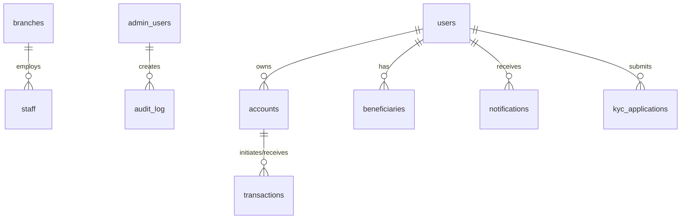

# Database Architecture

## Metadata
- **Version:** 1.0.0
- **Status:** Approved
- **Owner:** Finzo Architecture Team
- **Last Updated:** July 2026

## Purpose
To define the complete database architecture and schemas for the Finzo System.

---

### ER Diagram

### Table Definitions

#### `users`
Core customer table. 
- **PK:** `id` (INT)
- **Columns:** `customer_id`, `full_name`, `email`, `phone`, `password_hash`, `status`, `kyc` fields.
- **Indexes:** `idx_status`, `idx_email`.

#### `admin_users`
System administrators and moderators.
- **PK:** `id` (INT)
- **Columns:** `admin_id`, `admin_role`, `access_level`.
- **Security:** `two_fa_enabled`, `account_locked`.

#### `staff`
Branch staff.
- **FK:** `branch_id` -> `branches(id)`
- **Columns:** `designation` (Teller/Supervisor).

#### `transactions`
Immutable financial ledger.
- **FK:** `from_account_id` -> `accounts`, `to_account_id` -> `accounts`.
- **Status:** `pending`, `completed`, `failed`, `reversed`.
- **Indexes:** `idx_txn_id`, `idx_type`, `idx_created_at`.

---

## Revision History
| Version | Date | Author | Summary |
|---------|------|--------|---------|
| 1.0.0 | July 2026 | Architect | Initial creation based on schema. |
