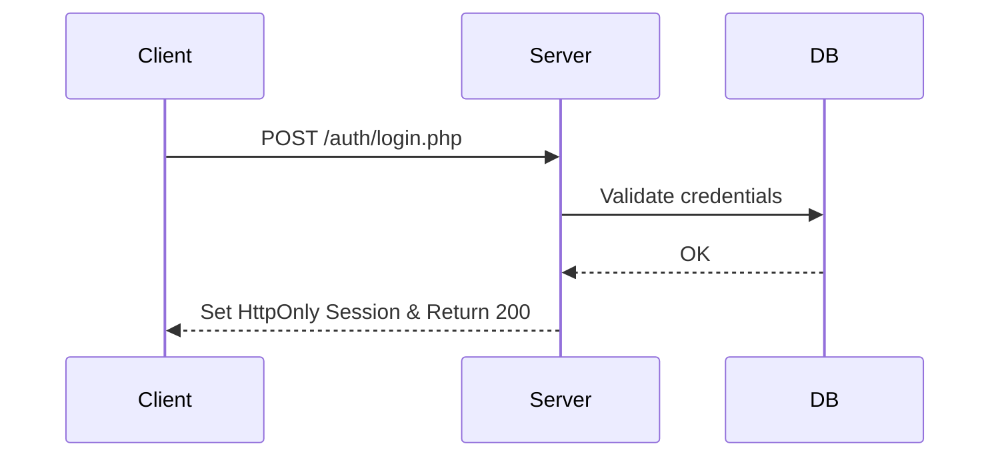

# API Architecture & Endpoints

## Metadata
- **Version:** 1.0.0
- **Status:** Approved
- **Owner:** Finzo Engineering
- **Last Updated:** July 2026

## Purpose
Document the RESTful API architecture and primary endpoints.

---

### Authentication Flow
Authentication is managed via HttpOnly session cookies. CSRF tokens are required for all POST mutations.

### Primary Endpoints (Extracted from \`api.php\`)

#### **Auth Controller**
- \`POST /auth/login.php\` - Customer Login
- \`POST /auth/admin-login.php\` - Admin Login
- \`POST /auth/staff-login.php\` - Staff Login
- \`POST /auth/register.php\` - Customer Registration

#### **Admin Management Controller**
- \`POST /Admin/add-admin.php\`
- \`GET /Admin/get-admins.php\`
- \`POST /Admin/update-admin-profile.php\`

#### **Admin Operations Controller**
- \`GET /Admin/audit-log.php\`
- \`GET /Admin/transactions.php\`
- \`GET /Admin/pending-approvals.php\`
- \`POST /Admin/review-application.php\`
- \`POST /Admin/unlock-account.php\`

#### **Admin Staff Controller**
- \`POST /Admin/add-staff.php\`
- \`GET /Admin/get-staff.php\`
- \`POST /Admin/generate-staff-password.php\`
- \`POST /Admin/reset-staff-password.php\`

---

## Revision History
| Version | Date | Author | Summary |
|---------|------|--------|---------|
| 1.0.0 | July 2026 | Architect | Extracted directly from routes. |
