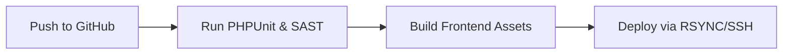

# Deployment & CI/CD Strategy

## Metadata
- **Version:** 1.0.0
- **Status:** Approved
- **Owner:** Finzo DevOps Team
- **Last Updated:** July 2026

## Purpose
Document the deployment pipelines and environment configurations.

---

### Environments
1. **Local (Development):** XAMPP / Docker containers running PHP 8.x and MySQL 8.x.
2. **Staging:** Replica of production environment used for QA and UAT. Connects to a sanitized staging database.
3. **Production:** Live clustered environment with isolated DB and read-replicas.

### CI/CD Flow

### Rollback Procedure
Blue/Green deployment model is utilized. If a failure is detected in production post-deployment, traffic is routed back to the previous stable release folder via symlink switch within 15 seconds.

---

## Revision History
| Version | Date | Author | Summary |
|---------|------|--------|---------|
| 1.0.0 | July 2026 | DevOps | Initial CI/CD docs. |
