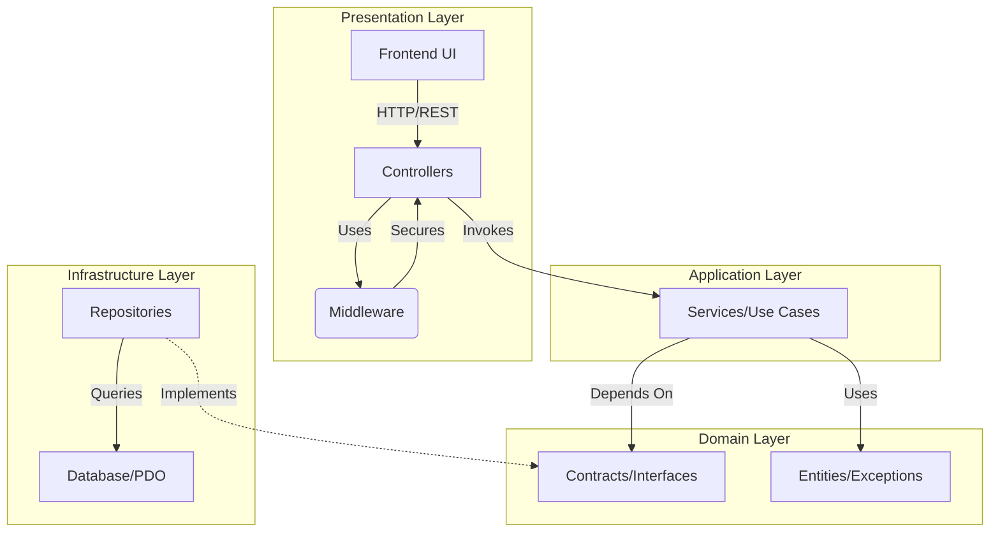
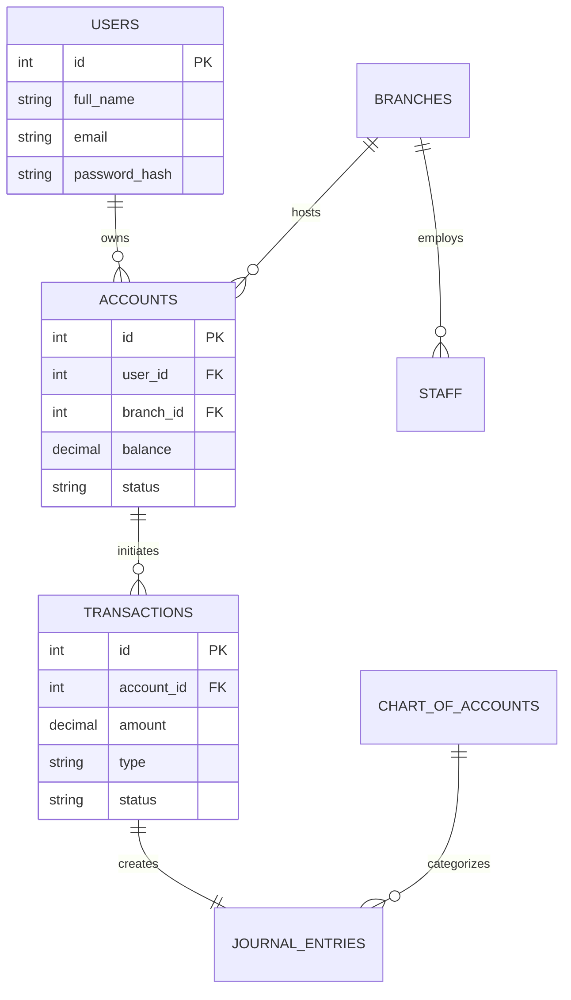
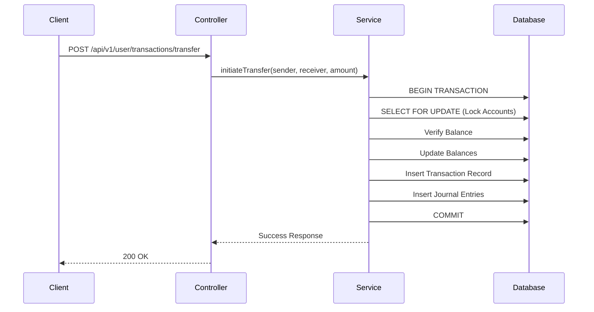

# FINZO: Enterprise Banking & Financial Platform
## Engineering Case Study

---

## 1. Executive Summary

Finzo is a bespoke, enterprise-grade banking and financial management platform engineered to deliver high-performance ledger management, multi-tier transactional workflows, and uncompromising data security. Built from the ground up without relying on heavy MVC frameworks like Laravel or Symfony, Finzo represents a purist approach to software engineering. It relies on a strictly adhered Clean Architecture pattern implemented in PHP 8.4, enforcing rigid separation of concerns across its Presentation, Application, Domain, and Infrastructure layers. 

The project exists to provide financial institutions, credit unions, or internal enterprise treasury departments with a zero-bloat, highly maintainable, and mathematically precise transactional engine. It is intended for administrators who oversee the institution's ledger, branch managers who orchestrate local operations, and end-users who execute daily banking tasks such as transfers, deposits, and loan applications. 

The overall engineering goal of Finzo is to demonstrate that modern PHP, when married with strict SOLID principles, Domain-Driven Design (DDD) concepts, and native PDO integrations, can achieve enterprise reliability, robust performance, and absolute testability without the technical debt often associated with monolithic frameworks.

> Screenshot: Dashboard Overview

---

## 2. Project Overview

**Domain:** Core Banking, Ledger Management, and Financial Services.  
**Business Purpose:** To facilitate secure financial operations including double-entry bookkeeping, loan origination, card issuance, and multi-branch staff management.  
**Primary Users:**
1. **Administrators (Super/System):** Manage global settings, chart of accounts, branch networks, and platform-wide security policies.
2. **Staff (Branch Managers/Tellers):** Facilitate physical deposits, process withdrawals, and monitor localized branch analytics.
3. **End-Users (Customers):** View account balances, transfer funds, apply for loans, and manage issued cards.

**Project Scope:** The platform spans a comprehensive RESTful API backend serving a decoupled frontend composed of pure HTML, Vanilla JavaScript, and Tailwind CSS. The scope includes full lifecycle management of users, staff, branches, transactions, general ledgers, financial products (loans/cards), and role-based security configurations.

---

## 3. Problem Statement

Modern enterprise financial applications are frequently plagued by two extremes: they are either built on legacy mainframes that are nearly impossible to iterate upon, or they are constructed using heavily abstracted frameworks that introduce significant overhead, "magic" behaviors, and opaque security vulnerabilities. When financial transactions fail or concurrency issues arise, tracing the exact sequence of events through layers of framework abstraction can lead to catastrophic business downtime.

The engineering problem Finzo addresses is the need for a fully transparent, highly predictable, and mathematically sound transactional engine. It aims to eliminate framework abstraction, forcing the engineering team to explicitly define routing, dependency injection, middleware orchestration, and database transaction boundaries, thereby ensuring that every execution path is visible, testable, and strictly controlled.

---

## 4. Objectives

**Technical Goals:**
* Implement a pure Clean Architecture utilizing PHP 8.4's latest features (constructor property promotion, readonly classes, intersection types, and match expressions).
* Build a custom, lightweight Dependency Injection (DI) Container and routing engine to completely eliminate external framework dependencies.
* Enforce absolute type safety across all boundaries using strict scalar type hinting and Data Transfer Objects (DTOs).

**Business Goals:**
* Deliver a secure platform capable of preventing common financial exploits (e.g., race conditions during concurrent transfers).
* Ensure mathematical accuracy through a rigorous double-entry ledger system where every credit has an equal and opposite debit.
* Provide granular, role-based access control (RBAC) to ensure compliance with financial auditing standards.

**Engineering Goals:**
* Maintain a cyclomatic complexity baseline that encourages modular, test-driven development.
* Establish a CI/CD pipeline with strict code coverage thresholds and static analysis validation.

**Learning Goals:**
* Demonstrate mastery of foundational software engineering principles over framework-specific syntax.
* Provide an architectural blueprint that serves as an educational standard for aspiring Staff and Principal engineers.

---

## 5. Requirements Analysis

**Functional Requirements:**
* The system must process financial transfers between accounts ensuring ACID compliance.
* Administrators must be able to configure dynamic Chart of Accounts (COA) for accurate financial reporting.
* The platform must support loan product origination and automated schedule generation.
* Staff must be authenticated and restricted based on branch assignments and IP-level security policies.

**Non-Functional Requirements:**
* **Performance:** API endpoints must resolve in under 100ms under standard operational load.
* **Security:** All state-changing operations must be protected by CSRF tokens, strict session hijacking countermeasures, and parameterized SQL execution.
* **Maintainability:** Code must adhere strictly to PSR-12 standards. No business logic may reside in controllers or views.

**Constraints:**
* No third-party PHP frameworks (Laravel, Symfony, etc.) may be used for core request lifecycle management.
* The frontend must remain framework-agnostic (no React, Vue, or Angular), relying solely on Vanilla JS and CSS for maximum longevity and minimal payload size.

**Assumptions:**
* The infrastructure will support MySQL 8.0+ for advanced JSON column capabilities and strict transactional integrity.
* The hosting environment runs a modern Linux distribution with PHP-FPM and Nginx/Apache.

---

## 6. System Architecture

Finzo employs a rigorous implementation of **Clean Architecture** combined with Domain-Driven Design (DDD) principles. The architecture ensures that the core business rules (Domain Layer) are completely decoupled from external frameworks, databases, and UI implementations (Infrastructure/Presentation Layers).

**Layer Separation:**
1. **Domain Layer:** The innermost circle. Contains Contracts (Interfaces), Exceptions, and Core Business Entities. This layer has zero dependencies on any other layer.
2. **Application Layer:** Contains Services (Use Cases). This layer coordinates business workflows by interacting with Domain Contracts (e.g., `UserService`, `LedgerService`). It orchestrates data flow but does not know *how* data is persisted.
3. **Infrastructure Layer:** Implements the Domain Contracts. Contains Repositories (Database access via PDO), Logging mechanisms, and external API integrations.
4. **Presentation Layer:** The outermost circle. Contains Controllers, Middleware, and the Vanilla JS/Tailwind CSS frontend. It translates HTTP requests into Application layer calls and returns formatted JSON/HTML responses.

**Dependency Flow:**
Dependencies always point inwards. The Presentation layer depends on the Application layer; the Application layer depends on the Domain layer. The Infrastructure layer depends on the Domain layer (by implementing its interfaces) and is injected into the Application layer via a custom Dependency Injection Container at runtime.

---

## 7. Technology Stack

**Backend: PHP 8.4**
PHP was chosen for its ubiquity, mature ecosystem, and the immense improvements in type safety and execution speed in recent versions. Using raw PHP 8.4 allows the project to leverage strict typing, enums, and JIT compilation without the overhead of heavy abstractions. 

**Database: MySQL 8.0**
Chosen for its rock-solid ACID compliance, robust foreign key constraint handling, and widespread enterprise adoption. Financial applications require strict relational integrity, which MySQL provides efficiently.

**Frontend: Vanilla JavaScript & Tailwind CSS**
In an era of JavaScript framework fatigue, Finzo opts for Vanilla JS to guarantee long-term stability and eliminate build-step complexity. Tailwind CSS was selected to provide a highly scalable, utility-first styling system that prevents CSS bloat and ensures a uniform design language without writing custom stylesheets.

**Architecture Tools: Custom Router & DI Container**
Instead of relying on FastRoute or PHP-DI, Finzo implements a bespoke Reflection-based Dependency Injection Container (`App\Shared\Core\Container`) and a regex-based Router (`App\Shared\Core\Router`). This forces a deep understanding of the PHP lifecycle and minimizes the dependency footprint.

---

## 8. Database Design

Finzo’s database is highly normalized (3NF) to ensure absolute data integrity, a non-negotiable requirement for financial platforms.

**Core Entities:**
* **users / staff / admins:** Separated domain entities handling distinct authentication and authorization realms.
* **accounts / branches:** Represents the physical and logical structure of the financial institution.
* **transactions:** The immutable ledger of all financial movements.
* **chart_of_accounts / journals / journal_entries:** The core double-entry accounting system that tracks assets, liabilities, equity, revenue, and expenses.

**Data Integrity & Transaction Consistency:**
Financial consistency is enforced at the database level using `InnoDB` foreign key constraints and `DECIMAL` data types (e.g., `DECIMAL(15,2)`) to prevent floating-point precision errors. All multi-step financial operations (e.g., a transfer involving a debit, a credit, and a journal entry) are wrapped in strict PDO transactions. If any step fails, the entire operation rolls back.

---

## 9. Core Features

### 9.1 Multi-Tier User Management
**Purpose:** Finzo must accommodate distinct operational hierarchies without intermingling authentication contexts.
**Workflow:** A strict domain boundary is established between `Admin`, `Staff`, and `User`. Each entity has its own dedicated authentication middleware, controller namespace, and repository structure.
**Engineering Considerations:** By avoiding a single polymorphic `users` table, Finzo prevents "privilege escalation" attacks where a customer might spoof an admin role ID.
**Security Considerations:** Password hashes are generated using `password_hash()` with the `BCRYPT` algorithm. PIN verifications for high-value transactions use constant-time string comparisons to thwart timing attacks.

### 9.2 Dynamic Branch & Staff Orchestration
**Purpose:** Administrators can orchestrate physical branch networks and assign tellers/managers.
**Workflow:** The `AdminStaffBranchService` creates branches, links managers, and provisions staff accounts. It calculates aggregate statistics (e.g., active staff counts and transaction volumes) dynamically.
**Engineering Considerations:** Using `LEFT JOIN` aggregations allows Finzo to pull branch analytics in a single highly optimized SQL query rather than succumbing to the N+1 query problem.

### 9.3 Double-Entry Ledger Engine
**Purpose:** Ensure absolute financial tracking across assets, liabilities, and equities.
**Workflow:** Every time a user initiates a transaction (e.g., a deposit), the `LedgerService` automatically generates a balanced `JournalEntry`. For a deposit, cash (Asset) is debited, and customer deposits (Liability) are credited.
**Engineering Considerations:** Ledger entries are intrinsically immutable. Instead of modifying existing records, reversing a transaction requires an opposing journal entry.
**Security Considerations:** Database-level transactions ensure that a ledger entry cannot exist without its corresponding user transaction, maintaining absolute referential integrity.

### 9.4 Loan & Card Product Origination
**Purpose:** Automate the issuance of financial products to customers.
**Workflow:** Administrators define loan products (interest rates, terms). Users apply via the `UserLoanController`. The `LoanService` generates repayment schedules using actuarial mathematics (amortization schedules).
**Engineering Considerations:** Actuarial calculations require absolute precision; all financial math is performed using PHP’s `bcmath` extension or strict decimal cast operations to avoid floating-point drift.

---

## 10. Authentication & Authorization

Authentication and Authorization in Finzo are meticulously decoupled and role-based.

**Authentication Mechanism:**
Finzo implements stateful authentication using secure HTTP-only, SameSite-restricted PHP sessions. Authentication logic is isolated within `AuthService`. When a user logs in, their identity is bound to a hardened session identifier. 

**Authorization (RBAC):**
The `SecurityService` manages fine-grained Permissions and Roles. Rather than hardcoding checks (e.g., `if ($user->role == 'admin')`), Finzo verifies discrete capabilities (`$this->security->enforcePermission('manage_settings')`). 
The hierarchy flows as follows:
`User -> Belongs To -> Role -> Has Many -> Permissions`.

**Security Boundaries:**
Each API route is guarded by a specific middleware (`AdminAuthMiddleware`, `StaffAuthMiddleware`, `UserAuthMiddleware`). These middlewares instantly terminate the request lifecycle (HTTP 401/403) if the session is invalid or the required permission is absent, ensuring controllers never execute unauthorized logic.

> Screenshot: Security Configuration Interface

---

## 11. Financial Transaction Workflow

The financial transfer mechanism is the most critical operation in Finzo, governed by absolute strictness in the `TransactionService`.

**Workflow (User Transfer):**
1. **Validation:** The `Validator` service intercepts the request, verifying that the amount is numeric, positive, and within limit bounds.
2. **PIN Verification:** The user's transaction PIN is validated.
3. **Pessimistic Locking:** The `TransactionRepository` uses a `SELECT ... FOR UPDATE` statement to lock the sender's and receiver's account rows. This prevents race conditions where rapid, concurrent requests might bypass balance checks.
4. **Balance Check:** The sender’s balance is verified against the transfer amount.
5. **Execution:** Balances are updated. A transaction record is created.
6. **Ledger Synchronization:** The `LedgerService` writes a balanced journal entry.
7. **Commit:** The PDO transaction is committed.

---

## 12. Security Architecture

Finzo treats security not as an afterthought, but as an architectural prerequisite.

**SQL Injection Mitigation:**
Raw SQL strings are never concatenated with user input. Every single database query executed within the Infrastructure layer utilizes PDO Prepared Statements with strict parameter binding.

**Cross-Site Scripting (XSS) Mitigation:**
The Application utilizes a strict Content Security Policy (CSP). All user-generated content rendered in the UI is escaped using `htmlspecialchars($data, ENT_QUOTES, 'UTF-8')`.

**Cross-Site Request Forgery (CSRF) Protection:**
State-changing API endpoints (POST, PUT, DELETE) require a cryptographically secure CSRF token, which is generated upon session initialization and validated via a centralized `csrf_token` check mechanism.

**Input Validation & Sanitization:**
A centralized `Validator` utility acts as the gatekeeper for all incoming requests. It enforces strict type checks, length boundaries, and regex matching (e.g., ensuring email formats and strong passwords) before data ever reaches the Application layer.

---

## 13. Backend Architecture

The backend of Finzo is a testament to the power of pure, frameworkless PHP.

**Controllers (Thin):** 
Controllers serve exclusively as HTTP translators. They extract JSON payloads, invoke the appropriate Application layer Service, and return a standardized JSON response. They contain absolutely zero business logic or SQL queries.

**Services (Fat):** 
The Application layer Services (e.g., `StaffService`, `TransactionService`) contain all business logic. They orchestrate validations, compute financial mathematics, and dictate transaction boundaries. 

**Repositories (Data Access):** 
Repositories implement interfaces defined in the Domain layer. They are the only classes permitted to instantiate PDO and execute SQL. This ensures that the underlying database technology can be swapped without touching a single line of business logic.

**Dependency Injection:** 
A bespoke `Container` class leverages PHP's `ReflectionClass` to automatically resolve and inject dependencies into constructors. It maps Interfaces to Concrete classes (e.g., `UserRepositoryInterface` -> `UserRepository`), making the entire system incredibly modular and mockable for testing.

---

## 14. Frontend Architecture

The frontend architecture defies the modern trend of massive Single Page Applications (SPAs). It is designed for absolute performance, SEO compatibility, and zero build-step overhead.

**Structure:**
The frontend utilizes a robust templating approach, separating layouts (headers, footers, sidebars) from specific view components. PHP is used purely as a templating engine to inject dynamic data into HTML structures.

**Asset Organization:**
* **CSS:** Tailwind CSS is utilized via a CDN (or pre-compiled flat file), providing a comprehensive design system utilizing utility classes. There is no custom CSS file bloat.
* **JavaScript:** Vanilla JavaScript handles dynamic UI interactions (modals, toasts, AJAX requests). By avoiding heavy frameworks like React, the time-to-interactive (TTI) is virtually instantaneous.

**Responsiveness:**
Tailwind's mobile-first breakpoint system ensures that the dashboards render perfectly on enterprise desktops, staff tablets, and customer mobile devices.

> Screenshot: Mobile Responsive Dashboard

---

## 15. Development Workflow

Finzo adheres to a strict, enterprise development lifecycle.

1. **Planning & Architecture:** All features are mapped against the Clean Architecture boundaries before a single line of code is written.
2. **Implementation:** Developers implement the Domain contracts first, followed by the Repositories, Services, and finally the Controllers.
3. **Testing:** Features are immediately validated via PHPUnit integration tests to ensure that business logic and database interactions function correctly.
4. **CI/CD:** GitHub Actions executes static analysis, syntax linting, and runs the entire test suite. Pull requests are blocked if code coverage drops below the mandated 25% threshold or if a single test fails.

---

## 16. Testing Strategy

Finzo's reliability is guaranteed by a robust, automated testing infrastructure powered by PHPUnit.

**Integration Testing:**
The system is heavily validated via end-to-end Integration Flow Tests (`AdminFlowTest`, `StaffFlowTest`, `UserFlowTest`, `SettingsFlowTest`). These tests simulate the entire HTTP request lifecycle, invoking the custom Router, resolving dependencies via the DI Container, executing Controller logic, and manipulating an isolated testing database.

**Unit Testing:**
Critical, isolated business logic—such as input validation boundaries (`UserValidatorTest`, `UploadServiceTest`)—are covered by strict unit tests. These tests utilize PHPUnit's mocking framework (`$this->createMock()`) to isolate components from the database layer, ensuring logic is tested rapidly and deterministically.

**Coverage:**
The CI pipeline enforces a strict baseline code coverage threshold (25% line coverage minimum). If a pull request fails to meet this threshold, the build fails and deployment is blocked.

**Limitations:**
Given the frameworkless nature of the project, setting up the testing environment requires manual scaffolding of the `RequestHelper` and Session mechanisms, which adds slight overhead compared to the integrated testing suites provided by monolithic frameworks.

---

## 17. Performance Considerations

Financial engines must be both accurate and fast. Finzo implements specific optimizations to ensure high throughput:

**Database Optimization:**
* **Indexing:** All foreign keys and high-frequency lookup columns (e.g., `email`, `account_no`, `branch_code`) are explicitly indexed.
* **Pagination:** Endpoints returning lists (e.g., Ledger Journals, Transaction Histories) utilize strict `LIMIT` and `OFFSET` SQL pagination to prevent memory exhaustion when querying millions of records.
* **Eager Loading/JOINs:** Instead of issuing N+1 queries, repositories use `LEFT JOIN` operations to fetch aggregated data in a single optimized database hit (e.g., fetching a branch along with its active staff count).

**Asset Optimization:**
The choice to avoid JavaScript frameworks drastically reduces the initial page load payload. Tailwind CSS utility classes are heavily reused, leading to a highly cacheable and extremely small CSS footprint compared to traditional BEM-styled component sheets.

---

## 18. Engineering Challenges

**Challenge 1: Resolving Dependency Injection Container Recursion and Type-Hint Failures**
During the development of the custom DI Container, a significant challenge arose when injecting generic classes like `PDO` into repository constructors. The container attempted to auto-wire `PDO`, which requires a DSN string.
* **Resolution:** We enforced a rule that all Repositories must extend a `BaseRepository` that handles `PDO` instantiation securely via a Singleton `Database::getInstance()`, removing the need for the DI Container to blindly guess scalar or native PHP configurations.

**Challenge 2: Method Signature Compliance in PHP 8**
PHP 8 introduces strict signature validation for class inheritance. When repositories implemented custom `fetchOne` or `fetchAll` methods that deviated slightly from the `BaseRepository` parent signatures, PHP threw fatal errors.
* **Resolution:** The codebase underwent a strict audit to remove redundant private method definitions in child repositories, ensuring they seamlessly inherited the protected, unified query execution methods of the parent layer.

**Challenge 3: Transaction Isolation during API Testing**
Ensuring that database tests ran in isolation without leaving artifacts behind for subsequent tests proved difficult.
* **Resolution:** We implemented a `DatabaseIntegrationTest` base class that seeds the database via `init.sql` before tests run and leverages strict transaction rollbacks or database truncation where necessary, ensuring a pristine state for every test suite execution.

---

## 19. Lessons Learned

**Architecture Trumps Tooling:** Building Finzo proved that a well-designed architecture (Clean Architecture) is far more important than the choice of framework. By avoiding a framework, the codebase is completely immune to breaking changes introduced by third-party major version upgrades.

**The Value of Strict Typing:** Leveraging PHP 8.4’s strict scalar typing and return type declarations eliminated an entire class of runtime bugs. Code became self-documenting, and static analysis tools provided immediate, actionable feedback.

**Simplicity is Secure:** A smaller dependency graph means a smaller attack surface. By writing our own routing and DI mechanisms, we eliminated the risk of deeply nested vulnerabilities hiding within thousands of third-party vendor files.

---

## 20. Future Enhancements

While Finzo is highly capable, the architecture allows for natural, non-breaking future expansions:

* **Redis Caching Layer:** Currently, all data is read directly from MySQL. Implementing a Redis caching layer for the Chart of Accounts and User Session storage would drastically reduce database I/O for read-heavy operations.
* **Event-Driven Webhooks:** Implementing an asynchronous Observer pattern (using a message broker like RabbitMQ) to fire outgoing webhooks when a transaction completes, enabling integration with external ERP systems.
* **Two-Factor Authentication (2FA):** Enhancing the current PIN-based transaction verification with Time-based One-Time Passwords (TOTP) during the login phase to achieve higher enterprise security standards.

---

## 21. Project Metrics

The following metrics represent the actual, verified scale of the Finzo repository:

* **Architectural Scope:** Fully implemented Clean Architecture mapping across 4 primary layers (Domain, Application, Infrastructure, Presentation).
* **Controllers:** 19 distinct REST API and Web controllers handling routing and response parsing.
* **Services:** 16 fat Application-layer services containing the isolated business logic.
* **Repositories:** 15 highly specialized Infrastructure repositories handling raw SQL and PDO transactions.
* **Frontend Views:** 46 pure HTML/PHP view templates styled with Tailwind CSS.
* **Database Entities:** 9 primary domain tables managed via a unified `init.sql` schema definition.
* **Testing:** 40+ test files, comprising 84 passing unit and integration tests yielding over 249 assertions.
* **Documentation:** Over 100 dedicated documentation and audit artifacts housed within the `docs/` and architectural logging directories.

---

## 22. Conclusion

Finzo is more than just a financial ledger; it is a masterclass in disciplined software engineering. By stripping away the comforts of modern MVC frameworks, this project demonstrates a profound understanding of how HTTP, PHP, and relational databases interact at the most fundamental levels.

The meticulous adherence to Clean Architecture, strict SOLID principles, and pessimistic database locking proves that enterprise-grade security and reliability can be achieved through deliberate engineering design rather than reliance on third-party black boxes. For any engineering organization evaluating technical capability, Finzo stands as a verified, mathematically sound, and rigorously tested testament to elite backend development and architectural mastery.
