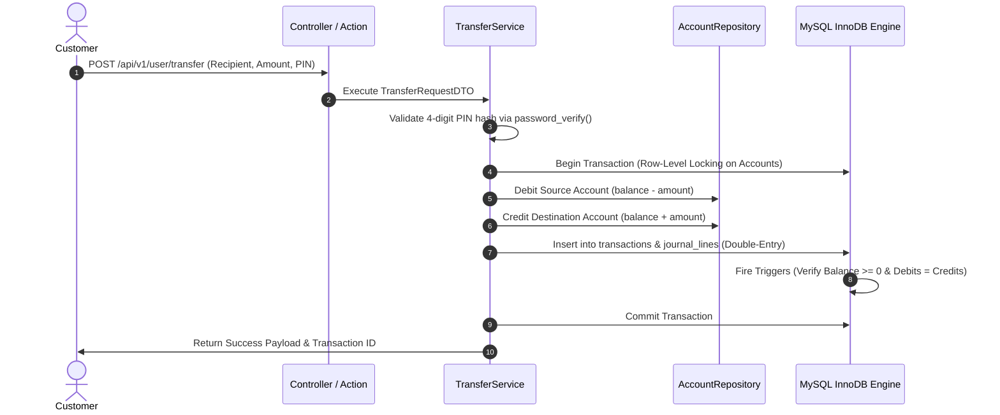

# Database Architecture Guide

The Finzo Banking Management System database is engineered with strict adherence to **Enterprise 3rd Normal Form (3NF)**, ensuring absolute data consistency and enforcing core financial business rules directly at the database engine level (MySQL 8.0 InnoDB).

---

## 1. Core Design Philosophy

1. **Engine-Level Integrity:** No invalid financial state can persist, regardless of application-layer bugs. Strict `CHECK` constraints, foreign keys, and triggers guarantee data quality.
2. **Double-Entry Ledger as Absolute Truth:** All financial mutations (deposits, withdrawals, transfers) are backed by an immutable double-entry ledger. Account balance columns act as high-speed cached representations of the underlying ledger entries.
3. **Forensic Immutability:** Audit records and finalized ledger lines cannot be altered or deleted, even by administrators. Modification attempts trigger immediate database exceptions.
4. **Read Isolation via Views:** Complex analytical queries and reporting aggregations are encapsulated in optimized SQL Views to minimize application-layer query overhead.

---

## 2. Architectural Domains

### 2.1 Identity Domain
- **`users`**: Customer profiles containing identity, contact details, authentication hashes, and KYC verification status.
- **`staff`**: Bank employees and branch personnel with associated branch affiliations and role designations.
- **`admin_users`**: System administrators and compliance officers, isolated in a dedicated table to prevent privilege escalation.
- **`branches`**: Physical and operational branch entities with unique routing codes, servicing regions, and manager assignments.

### 2.2 Operational Banking Domain
- **`accounts`**: Customer deposit holdings (Savings, Current). Enforces `balance >= 0` (zero unauthorized overdrafts) and status states (`active`, `pending`, `dormant`, `frozen`, `closed`).
- **`beneficiaries`**: Pre-approved internal and external transfer recipients linked to customer accounts.
- **`kyc_applications`**: Customer onboarding submissions, encrypted document references, review histories, and admin adjudication notes.
- **`user_security_settings`**: Two-factor authentication configuration, security notification preferences, and bcrypt-hashed 4-digit transaction PINs.

### 2.3 Financial & Ledger Domain
- **`transactions`**: High-level transaction history representing business-level money movements (transfers, deposits, withdrawals).
- **`chart_of_accounts`**: Enterprise COA definitions classifying accounts into standard accounting categories: Assets, Liabilities, Equity, Revenue, and Expenses.
- **`journal_entries`**: Header records for double-entry ledger batches, maintaining balancing metadata and timestamp verification.
- **`journal_lines`**: Individual debit and credit rows. Strictly requires `SUM(debits) = SUM(credits)` for every posted entry.
- **`accounting_periods`**: Financial reporting windows and closure cycles.

### 2.4 Governance & Audit Domain
- **`audit_log`**: Comprehensive forensic log tracking user, staff, and admin actions with event types, client IP addresses, actor roles, and structured JSON payloads.
- **`roles` & `permissions`**: Granular Role-Based Access Control matrix linking roles to operational capabilities.
- **`staff_shifts`**: Staff teller shift tracking, clock-in/out timestamps, shift cash balances, and turnover remarks.

---

## 3. Database Triggers & Engine Constraints

| Trigger / Constraint | Target Table | Enforcement Function |
|---|---|---|
| `trg_validate_transaction` | `transactions` | Enforces account active status, daily velocity limits, and positive transfer amounts (`amount > 0`). |
| `trg_validate_journal_balancing` | `journal_entries` | Mathematically verifies that `SUM(debits) = SUM(credits)` before any journal entry can be marked `posted`. |
| `prevent_audit_update` | `audit_log` | Intercepts `UPDATE` statements and throws `SQLSTATE 45000` to prevent tampering with forensic logs. |
| `prevent_audit_delete` | `audit_log` | Intercepts `DELETE` statements and throws `SQLSTATE 45000` to guarantee audit trail permanence. |

---

## 4. End-to-End Data Flow

### Example: Domestic Fund Transfer

---

## 5. Automated Engine Events

MySQL's built-in Event Scheduler manages background maintenance tasks:
- **`evt_cleanup_expired_tokens`**: Runs every 24 hours to purge expired password reset tokens from `password_resets`.
- **`evt_cleanup_expired_sessions`**: Runs hourly to remove inactive web sessions exceeding configured timeout windows.
