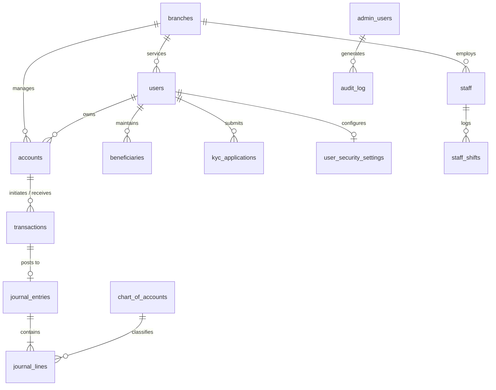

# Database Schema Reference

This reference documents the relational structure, constraints, and relationships across the Finzo core database schema.

---

## 1. Entity Relationship Overview

---

## 2. Core Tables & Column Specifications

### 2.1 `users`
Represents customer identity and primary account ownership.

| Column | Type | Constraints | Description |
|---|---|---|---|
| `id` | `INT UNSIGNED` | `AUTO_INCREMENT, PRIMARY KEY` | Internal surrogate primary key |
| `customer_id` | `VARCHAR(32)` | `UNIQUE, NOT NULL` | Public customer identifier (e.g., `CUST001248`) |
| `full_name` | `VARCHAR(128)` | `NOT NULL` | Full legal name matching identity documents |
| `email` | `VARCHAR(191)` | `UNIQUE, NOT NULL` | Primary email address for notifications and login |
| `phone` | `VARCHAR(32)` | `UNIQUE, NOT NULL` | Verified mobile phone number |
| `password_hash` | `VARCHAR(255)` | `NOT NULL` | Bcrypt password hash |
| `status` | `ENUM` | `'pending', 'under_review', 'active', 'suspended', 'rejected'` | Account onboarding lifecycle state |
| `profile_picture` | `VARCHAR(255)` | `NULL` | Relative storage path to uploaded portrait photo |
| `id_front_path` | `VARCHAR(255)` | `NULL` | Relative storage path to encrypted front ID document |
| `id_back_path` | `VARCHAR(255)` | `NULL` | Relative storage path to encrypted back ID document |
| `branch_id` | `INT UNSIGNED` | `NULL, FOREIGN KEY (branches.id)` | Servicing branch association |
| `created_at` | `DATETIME` | `DEFAULT CURRENT_TIMESTAMP` | Account creation timestamp |
| `updated_at` | `DATETIME` | `ON UPDATE CURRENT_TIMESTAMP` | Last profile update timestamp |

---

### 2.2 `accounts`
Holds banking deposits and balances for savings and business current accounts.

| Column | Type | Constraints | Description |
|---|---|---|---|
| `id` | `INT UNSIGNED` | `AUTO_INCREMENT, PRIMARY KEY` | Account internal identifier |
| `user_id` | `VARCHAR(32)` | `NOT NULL, INDEX` | Customer ID (`users.customer_id`) |
| `account_no` | `VARCHAR(32)` | `UNIQUE, NOT NULL` | Bank account number (e.g., `FNZ2026001248`) |
| `account_type` | `ENUM` | `'savings', 'current'` | Banking account classification tier |
| `balance` | `DECIMAL(15,2)` | `NOT NULL, DEFAULT 0.00, CHECK (balance >= 0)` | Cleared available balance |
| `txn_pin_hash` | `VARCHAR(255)` | `NULL` | Bcrypt hash of the customer's 4-digit transaction PIN |
| `status` | `ENUM` | `'pending', 'active', 'dormant', 'frozen', 'closed'` | Account operating status |
| `daily_limit` | `DECIMAL(15,2)` | `DEFAULT 50000.00` | Maximum 24-hour transfer limit |
| `opened_date` | `DATE` | `NULL` | Date account was approved and opened |
| `created_at` | `DATETIME` | `DEFAULT CURRENT_TIMESTAMP` | Record creation timestamp |

---

### 2.3 `transactions`
Immutable business ledger of all monetary movements.

| Column | Type | Constraints | Description |
|---|---|---|---|
| `id` | `INT UNSIGNED` | `AUTO_INCREMENT, PRIMARY KEY` | Transaction internal identifier |
| `transaction_id` | `VARCHAR(64)` | `UNIQUE, NOT NULL` | Public reference ID (e.g., `TXN8A4B2C19...`) |
| `from_account_id` | `INT UNSIGNED` | `NULL, FOREIGN KEY (accounts.id)` | Source account (`NULL` for external cash deposit) |
| `to_account_id` | `INT UNSIGNED` | `NULL, FOREIGN KEY (accounts.id)` | Destination account (`NULL` for cash withdrawal) |
| `transaction_type` | `ENUM` | `'deposit', 'withdrawal', 'transfer'` | Transaction category |
| `amount` | `DECIMAL(15,2)` | `NOT NULL, CHECK (amount > 0)` | Transaction monetary amount |
| `balance_after` | `DECIMAL(15,2)` | `NOT NULL` | Balance of the transacting account after operation |
| `description` | `VARCHAR(255)` | `NULL` | User or teller reference narrative |
| `status` | `ENUM` | `'pending', 'completed', 'failed', 'reversed'` | Lifecycle status |
| `created_at` | `DATETIME` | `DEFAULT CURRENT_TIMESTAMP` | Transaction execution timestamp |

---

### 2.4 `staff` & `staff_shifts`
Internal personnel and teller shift tracking.

- **`staff`**: Stores staff members, their branch assignment, designation, status, and authentication credentials.
- **`staff_shifts`**: Tracks daily teller shifts (`shift_date`, `clock_in`, `clock_out`, `opening_balance`, `closing_balance`, `status`, `handover_notes`).

---

### 2.5 `audit_log`
Forensic immutability trail capturing all administrative, staff, and system security actions.

| Column | Type | Constraints | Description |
|---|---|---|---|
| `id` | `BIGINT UNSIGNED` | `AUTO_INCREMENT, PRIMARY KEY` | Audit sequence identifier |
| `event_id` | `VARCHAR(64)` | `INDEX` | Unique correlation ID for the event |
| `action_type` | `VARCHAR(64)` | `NOT NULL, INDEX` | Action identifier (e.g., `kyc_approved`, `staff_clock_in`) |
| `actor_id` | `VARCHAR(64)` | `NOT NULL` | Identifying ID of the actor executing the change |
| `actor_role` | `VARCHAR(32)` | `NOT NULL` | Role tier: `admin`, `staff`, `user`, `system` |
| `ip_address` | `VARCHAR(45)` | `NOT NULL` | Client IPv4 or IPv6 address |
| `details` | `TEXT` | `NULL` | Narrative or JSON snapshot of the state mutation |
| `status` | `VARCHAR(20)` | `DEFAULT 'success'` | Result status (`success`, `failure`, `warning`) |
| `created_at` | `DATETIME` | `DEFAULT CURRENT_TIMESTAMP` | Log record timestamp |
