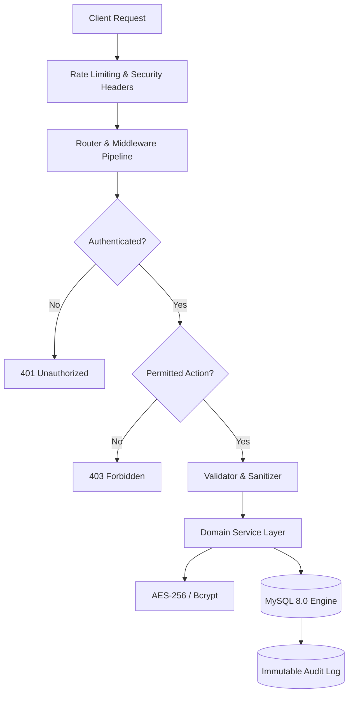

# Enterprise Security Architecture

Finzo is engineered around a **Zero-Trust** security model designed to safeguard sensitive banking transactions, customer personally identifiable information (PII), and forensic audit integrity.

---

## 1. Security Architecture Principles

1. **Deny-by-Default:** Access to any resource or API route is forbidden unless explicitly permitted by an authentication gate or role check.
2. **Decoupled Security Boundaries:** Domain logic is strictly separated from HTTP presentation. Authentication services validate credentials without touching session superglobals directly.
3. **Defense in Depth:** Security controls exist at the perimeter (firewalls/rate limiters), web server (headers), application layer (middleware/validators), and database engine (triggers/row-level locks).
4. **Forensic Immutability:** Audit trails and transactional records are append-only. Modification and deletion are blocked at the engine layer.

---

## 2. Core Security Subsystems

### 2.1 Authentication & Session Management
- **Decoupled Architecture:** `AuthService` handles identity verification, while `SessionManager` handles cookie lifecycle, session ID regeneration on privilege changes, and activity timeouts.
- **Session Protection:**
  - `HttpOnly`: Flags prevent client-side JavaScript from accessing session tokens.
  - `SameSite=Strict`: Shields against Cross-Site Request Forgery (CSRF).
  - `Secure`: Ensures session cookies are transmitted exclusively over encrypted HTTPS/TLS connections.
  - **Inactivity Timeout:** Sessions automatically invalidate after 30 minutes of inactivity.

### 2.2 Password & Transaction PIN Security
- **Login Passwords:** Bcrypt algorithm (`PASSWORD_BCRYPT`) with a standard cost factor, enforcing complexity: minimum 8 characters, containing uppercase, lowercase, numbers, and symbols.
- **Transaction PINs (TPIN):** 4-digit numeric PINs required for money transfers and withdrawals. Bcrypt-hashed upon KYC onboarding and stored in `accounts.txn_pin_hash` and `user_security_settings.transaction_pin_hash`.

### 2.3 PII Encryption at Rest
National identity document numbers (Aadhaar, PAN, Passport, Driving License) are classified as sensitive PII:
- Encrypted using **AES-256-GCM** via `EncryptionService`.
- Deterministic hashing is used where exact-match document indexing is required without exposing plaintext values.

### 2.4 SQL Injection & XSS Defenses
- **100% Parameterized Queries:** Database interactions strictly use PDO prepared statements. Dynamic string concatenation in SQL queries is prohibited.
- **Output Escaping:** View templates sanitize rendered content using `html_encode()` / `htmlspecialchars()` with `ENT_QUOTES | ENT_HTML5`.
- **Central Validator:** The centralized `Validator` utility validates types, formats, lengths, and regex patterns before requests reach domain services.

### 2.5 HTTP Security Headers
The `SecurityHeadersMiddleware` injects modern browser defense directives on all responses:
- `Content-Security-Policy`: Restricts authorized sources for scripts, styles, and fonts.
- `Strict-Transport-Security`: Enforces TLS across all subsequent connections (`max-age=31536000; includeSubDomains`).
- `X-Frame-Options: DENY`: Blocks clickjacking attacks.
- `X-Content-Type-Options: nosniff`: Prevents MIME-type sniffing.
- `Referrer-Policy: strict-origin-when-cross-origin`: Restricts sensitive URI leakage.

---

## 3. Rate Limiting & Brute-Force Defense

The atomic cache rate limiter tracks incoming requests per client IP:
- **Global API Endpoints:** 120 requests per 60 seconds.
- **Authentication Endpoints (`/api/v1/auth/*`):** 5 failed attempts per 5-minute window before triggering a temporary cooldown lock.
- Breached thresholds return HTTP `429 Too Many Requests` with standard retry headers (`X-RateLimit-Limit`, `X-RateLimit-Remaining`, `X-RateLimit-Reset`).
